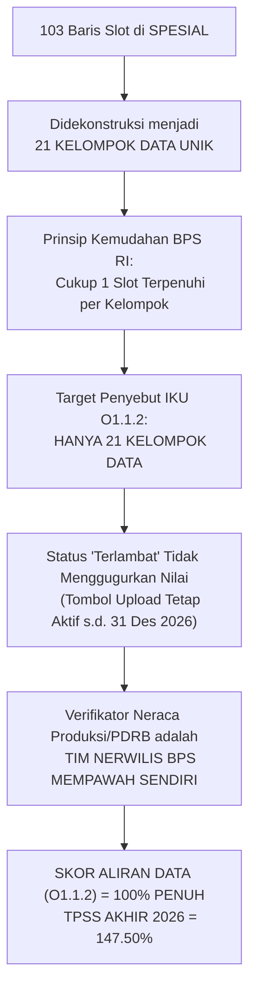

# MATRIKS AKSELERASI TPSS 2026 & MITIGASI PENYELAMATAN 103 SLOT ALIRAN DATA
## Rencana Aksi Pemulihan Pasca-Sensus Ekonomi Menuju Target TPSS 147.50% & IPS EPSS 3.970

> **Kode Dokumen:** `PSS2026-DOC-RECOVERY-TPSS`  
> **Satker Pelaksana:** BPS Kabupaten Mempawah (Kode: `6104`)  
> **Status Posisi Baseline:** 30 Oktober 2026 (Triwulan III: **67.71%** / Peringkat Terbawah)  
> **Target Akhir Tahun 2026:** **147.50%** (Predikat Sangat Memuaskan / Target Nasional: 120.33%)  
> **Target Jangka Panjang:** Nilai Indeks Pembangunan Statistik (IPS) EPSS 2028: **3.970 (Sangat Baik)**  

---

## 🚨 1. ANATOMI MASALAH & PENYEBAB KETERTINGGALAN

### 1.1 Konteks Pergeseran Jadwal ke Akhir Tahun (November 2026)
- Pelaksanaan **Sensus Ekonomi (SE2026)** di Kabupaten Mempawah mengalami perpanjangan berulang hingga batas akhir **30 Oktober 2026**, yang menyerap seluruh alokasi waktu dan sumber daya pegawai organik BPS Kabupaten Mempawah.
- Akibat konsentrasi penuh pada SE2026, agenda tatap muka Pembinaan Statistik Sektoral (PSS) tergeser ke bulan November 2026.
- Implikasi terhadap sistem aplikasi SPESIAL per 30 Oktober 2026:
  1. **Indikator Realisasi Rencana Kerja (U215):** Masih **0%**.
  2. **Indikator Materi Wajib 5 Domain (U231 s.d. U235):** Masih **0%**.
  3. **Indikator Keterlibatan Walidata & Produsen Data (U241 & U242):** Masih **0%**.
  4. **Indikator Output Kuantitatif RK (O1.1) & Aliran Data (O1.2):** Masih **0%**.
  5. Nilai total TPSS saat ini baru mencapai **67.71%** (tertinggal di posisi bawah).
  6. Pada modul Aliran Data SPESIAL, dari total **103 slot periode**, sebanyak **81 slot** telah melewati tanggal batas waktu dengan status bertuliskan **"Terlambat"** (warna merah).

---

## 💡 2. DEKONSTRUKSI MATEMATIS & YURIDIS ATURAN SPESIAL (BPS RI)

Berdasarkan Kepka BPS No. 996 Tahun 2025 dan penegasan Direktur DPEPS serta Ketua Tim Pembinaan Statistik Sektoral BPS RI (Ibu Triana Rahmaningsih / Mbak Nana) pada forum resmi ESENSIAL #1 (28 April 2026), situasi ini **sangat aman dan dapat dipulihkan 100%** dengan 4 doktrin yuridis berikut:



### 4 Doktrin Penyelamat Nilai:
1. **Satuan Hitung Adalah Kelompok Data (Bukan Jumlah Slot):**  
   Daftar 103 slot pada aplikasi SPESIAL merupakan rincian triwulanan dan bulanan dari **21 Kelompok Data Unik**. Penyebut formula IKU O1.1.2 Mempawah adalah **21**, bukan 103!
2. **Aturan "Cukup 1 Slot Terpenuhi" (*One-Hit Invariant*):**  
   Untuk data triwulanan (4 slot) dan bulanan (12 slot), **CUKUP 1 SLOT SAJA YANG STATUSNYA TERPENUHI**, maka 1 kelompok data tersebut langsung dihitung **100% terpenuhi** dalam pembilang capaian TPSS.
3. **Status "Terlambat" Tidak Membatalkan Nilai TPSS:**  
   Warna merah di sistem SPESIAL hanyalah instrumen pemantauan manajerial. Tombol unggah data tetap terbuka tanpa restriksi teknis, dan data yang diunggah serta diverifikasi sebelum 31 Desember 2026 **sah dihitung 100% sebagai capaian IKU TPSS 2026**.
4. **Kedaulatan Verifikator Lokal (Tim Nerwilis BPS Mempawah):**  
   Mayoritas dari 21 kelompok data adalah data pendukung PDRB (Neraca Produksi). Verifikator resmi kelompok data ini di sistem SPESIAL **bukanlah pejabat BPS Pusat**, melainkan **Tim Nerwilis BPS Kabupaten Mempawah sendiri**. Ini mengeliminasi risiko hambatan verifikasi eksternal!

---

## 📊 3. PETA 21 KELOMPOK DATA & STRATEGI AKUISISI 1-HARI

| No | ID Kelompok | Nama Kelompok Data | Periode & Total Slot | OPD Produsen Data | Sumber Akuisisi Cepat | Verifikator SPESIAL |
|:---:|:---:|:---|:---:|:---|:---|:---|
| 1 | `030001` | **Panjang jalan kabupaten/kota** | Tahunan (1 Slot) | Dinas PUPR | Portal CKAN Mempawah (CSV/XLSX) | BPS (Distribusi) |
| 2 | `030002` | **DKH & AHSP Proyek Konstruksi 3 Thn** | Tahunan (2 Slot) | Dinas PUPR / PBJ | Dokumen SPJ PBJ & DKH PUPR | BPS (Distribusi) |
| 3 | `030004` | **Jumlah produksi peternakan** | Triwulanan (4 Slot) | Dinas Pertanian, KP & Perikanan | DPKP (Hadir Pertemuan 1–4 MCC) | **Nerwilis BPS Mempawah** |
| 4 | `030006` | **Jumlah produksi hortikultura** | Triwulanan (4 Slot) | Dinas Pertanian, KP & Perikanan | DPKP (Hadir Pertemuan 1–4 MCC) | **Nerwilis BPS Mempawah** |
| 5 | `030008` | **Jumlah produksi perikanan** | Triwulanan (4 Slot) | Dinas Pertanian, KP & Perikanan | DPKP (Hadir Pertemuan 1–4 MCC) | **Nerwilis BPS Mempawah** |
| 6 | `030014` | **Pajak mineral bukan logam** | Triwulanan (4 Slot) | BPPRD | Laporan BPKAD / BPPRD | **Nerwilis BPS Mempawah** |
| 7 | `030018` | **Pajak air permukaan** | Triwulanan (4 Slot) | BPPRD / Bapenda | Laporan BPKAD / BPPRD | **Nerwilis BPS Mempawah** |
| 8 | `030019` | **Jumlah realisasi belanja konstruksi** | Triwulanan (4 Slot) | BPKAD (Lokus 1) | Portal CKAN Mempawah (Belanja 2023) | **Nerwilis BPS Mempawah** |
| 9 | `030023` | **Retribusi pelayanan pasar** | Triwulanan (4 Slot) | Disperindagnaker / BPPRD | Laporan Retribusi Pasar | **Nerwilis BPS Mempawah** |
| 10 | `030024` | **Pajak kendaraan bermotor** | Triwulanan (4 Slot) | BPPRD / Samsat Mempawah | Laporan Realisasi Pajak Daerah | **Nerwilis BPS Mempawah** |
| 11 | `030025` | **Nilai Pendapatan BBNKB** | Triwulanan (4 Slot) | BPPRD / Samsat Mempawah | Laporan BBNKB Mempawah | **Nerwilis BPS Mempawah** |
| 12 | `030031` | **Pajak hotel** | Triwulanan (4 Slot) | BPPRD | Laporan Realisasi Pajak Hotel | **Nerwilis BPS Mempawah** |
| 13 | `030032` | **Pajak restoran** | Triwulanan (4 Slot) | BPPRD | Laporan Realisasi Pajak Restoran | **Nerwilis BPS Mempawah** |
| 14 | `030034` | **Kredit disalurkan untuk UMKM** | Triwulanan (4 Slot) | DPMPTSPKUKM (Lokus 2) | Portal CKAN Mempawah (Data UMKM) | **Nerwilis BPS Mempawah** |
| 15 | `030035` | **Pajak Reklame APBD** | Triwulanan (4 Slot) | BPPRD | Laporan Realisasi Pajak Reklame | **Nerwilis BPS Mempawah** |
| 16 | `030036` | **Jumlah siswa (SD/SMP)** | Triwulanan (4 Slot) | Disdikporapar | Dapodik / Publikasi DDA Mempawah | **Nerwilis BPS Mempawah** |
| 17 | `030038` | **Pajak Hiburan & Retribusi Wisata** | Triwulanan (4 Slot) | BPPRD / Disdikporapar | Laporan Realisasi Pajak Daerah | **Nerwilis BPS Mempawah** |
| 18 | `030040` | **Jumlah pasien** | Triwulanan (4 Slot) | RSUD dr. Rubini / Dinkes | Laporan Register Pelayanan Pasien | **Nerwilis BPS Mempawah** |
| 19 | `030045` | **Realisasi APBD (Pendapatan & Belanja)** | Bulanan (12 Slot) | BPKAD (Lokus 1) | Portal CKAN Mempawah (LKPD Audited) | Dit. Neraca Pengeluaran Pusat |
| 20 | `030051` | **Volume bongkar muat kapal pelabuhan** | Bulanan (12 Slot) | Dishub / Terminal Kijing | Laporan Dishub / Pelindo Kijing | Dit. Distribusi Pusat |
| 21 | `030052` | **Jumlah Kapal** | Bulanan (12 Slot) | Dishub / KSOP Kijing | Laporan Dishub / Pelindo Kijing | Dit. Distribusi Pusat |

---

## ⚡ 4. RENCANA OPERASIONAL AKSELERASI TERPADU (NOVEMBER – DESEMBER 2026)

Setiap tahapan dirancang memiliki **Dual-Impact**: Mengunci poin **TPSS 2026** sekaligus mengamankan bukti fisik **EPSS 2028**.

### Tahap 1: Pra-Pertemuan & Quick-Win CKAN (1 – 3 November 2026)
* **Aksi Nyata:**
  1. Jalankan script otomasi penarikan dataset portal CKAN Mempawah:
     ```bash
     python3 scripts/kb_pss_automation.py fetch-ckan --opd bpkad
     python3 scripts/kb_pss_automation.py fetch-ckan --opd dpmptsp
     ```
  2. Unduh file `.csv` dan `.xlsx` untuk 6 kelompok data yang sudah tersedia di CKAN (`030001`, `030019`, `030034`, `030045`, pajak, dan perizinan).
  3. Unggah file tersebut ke aplikasi SPESIAL pada slot TW3 atau TW4.
  4. Daftarkan staf Nerwilis BPS Mempawah sebagai akun verifikator di SPESIAL dengan opsi *Bukan Tim Pembina*.
  5. Lakukan verifikasi "Terpenuhi" langsung untuk kelompok data lokal Neraca.
* **Dampak TPSS 2026:** Membuka realisasi indikator aliran data **O1.2** sebesar **28.5% (6 dari 21 kelompok)** bahkan sebelum pembinaan tatap muka dimulai!
* **Dampak EPSS 2028:** Mengamankan bukti fisik Interoperabilitas API (Indikator `10301` Level 5) dan Penyebarluasan Portal (Indikator `50101` Level 5).

---

### Tahap 2: Eksekusi 4 Pertemuan di Mempawah Command Center (4 – 17 November 2026)

#### 📍 Pertemuan 1 (Rabu, 4 Nov 2026 - 08.00 WIB)
* **Agenda Pembinaan:** Prinsip SDI (Mbak Uma) & Identifikasi Kegiatan Statistik (Ihza).
* **Operasi Khusus TPSS di Ruang MCC:**
  - 5 Tim Pendamping meminta perwakilan DPKP (Pertanian/Perikanan), Disdikporapar (Siswa), RSUD Rubini (Pasien), dan BPPRD (Pajak) menyerahkan rekapitulasi data triwulan berjalan via Google Drive bersama.
* **Peta Dampak Langsung:**
  - **TPSS 2026:** Membuka indikator **U231 (Materi SDI = 100%)**, **U241 (Kehadiran Walidata = 100%)**, dan **U242 (Kehadiran Produsen Data = 100%)**.
  - **EPSS 2028:** Mengunci Indikator `10101` (SDS), `10201` (Metadata), `20101` (Relevansi), `20102` (Kebutuhan Data), dan `40301` (Kolaborasi SDI).

#### 📍 Pertemuan 2 (Kamis, 5 Nov 2026 - 09.00 WIB)
* **Agenda Pembinaan:** Penjaminan Kualitas Data Statistik (Ihza).
* **Operasi Khusus TPSS di Ruang MCC:**
  - Pengesahan Kamus Standar Data Statistik (SDS) dan penandatanganan Laporan Akurasi 4 Tahap BPKAD + DPMPTSPKUKM.
  - Pengumpulan sisa data sektoral untuk kelompok data peternakan, perikanan, dan perhubungan.
* **Peta Dampak Langsung:**
  - **TPSS 2026:** Membuka indikator **U232 (Materi Kualitas Data = 100%)** dan menaikkan aliran data **O1.2** menjadi **71.4% (15 dari 21 kelompok)**.
  - **EPSS 2028:** Membalikkan 5 indikator kritis kualitas data dari Skor 1 ke **Level 4/5** (`20201`, `20301`, `20302`, `20501`, `20502`).

#### 📍 Pertemuan 3 (Rabu, 11 Nov 2026 - 09.00 WIB)
* **Agenda Pembinaan:** Proses Bisnis Statistik GSBPM (Aul) & AI Descriptive Analytics Engine (Ihza).
* **Operasi Khusus TPSS di Ruang MCC:**
  - Penandatanganan KAK ber-klausul batas rilis resmi (Template C).
  - Eksekusi AI Generator `scripts/kb_pss_automation.py` menghasilkan Bab III Analisis Tren 5 Tahun.
  - Pengajuan rekomendasi kegiatan statistik BPS (ROMANTIK).
* **Peta Dampak Langsung:**
  - **TPSS 2026:** Membuka indikator **U233 (Materi Proses Bisnis = 100%)** dan mengunci target output kuantitatif **O1.1 (12 Metadata INDAH & SOP terunggah = 100%)**.
  - **EPSS 2028:** Mengunci Indikator `20301` (Aktualitas), `30102` (Rancangan Desain), `30302` (Analisis Deskriptif), dan `50201` (Rekomendasi BPS).

#### 📍 Pertemuan 4 (Selasa, 17 Nov 2026 - 08.00 WIB)
* **Agenda Pembinaan:** SSN (Listio), Kelembagaan & Netralitas (Aller), dan Gelar Pasukan EPSS 2028 (Ihza).
* **Operasi Khusus TPSS di Ruang MCC:**
  - Penandatanganan Pakta Netralitas bermeterai (Template A) oleh Kepala BPKAD dan DPMPTSPKUKM.
  - Penandatanganan Berita Acara Quality Gate Walidata Diskominfo (Template B).
  - Sidang Pleno Forum SDI menetapkan Data Prioritas Daerah & Rencana Aksi 2026–2028.
  - Input seluruh sisa bukti dukung dan BAST data ke aplikasi SPESIAL.
* **Peta Dampak Langsung:**
  - **TPSS 2026:** Membuka indikator **U215 (Realisasi 6 RK = 100%)**, **U234 (Kelembagaan = 100%)**, **U235 (SSN = 100%)**, dan aliran data **O1.2 mencapai 100% (21 dari 21 kelompok data)**!
  - **EPSS 2028:** Mengunci Indikator `40102` (Netralitas), `40103` (Quality Gate), `40302` (Forum SDI), `50103` (Inovasi Radar EPSS), dan `50303` (Rencana Aksi SDI).

---

### Tahap 3: Pemantapan Pasca-Pembinaan & Pelaporan Akhir Tahun (18 Nov – 31 Des 2026)
1. **Verifikasi Internal Nerwilis BPS Mempawah (18 – 20 November 2026):**  
   Tim Nerwilis BPS Mempawah memverifikasi seluruh data lokal yang diunggah di SPESIAL sehingga berstatus **"Terpenuhi"**.
2. **Karantina Verifikasi PJK Pusat (21 – 30 November 2026):**  
   Untuk 3 kelompok data yang verifikatornya berada di pusat (APBD, Pelabuhan, Kapal), Tim Pembina BPS Mempawah mengirimkan notifikasi resmi via WhatsApp ke LO DPEPS (Mbak Elvirda / Mbak Nana) dengan melampirkan screenshot ID data agar verifikasi diselesaikan sebelum akhir bulan.
3. **Penyusunan & Pengunggahan Monev Mandiri Semester 2 (1 – 31 Desember 2026):**  
   Menyusun Laporan Akhir Pembinaan, mengunggah Berita Acara Evaluasi ke SPESIAL, dan mengunci indikator **U411 (Monev Mandiri)** menjadi 100%.

---

## 🛡️ 5. STRATEGI MITIGASI JIKA PIHAK EKSTERNAL LAMBAT MERESPON

| Skenario Hambatan Eksternal | Potensi Risiko | Protokol Mitigasi Terukur (*Failsafe*) | Penanggung Jawab |
|:---|:---|:---|:---:|
| **OPD belum menyiapkan data terbaru 2026** saat pertemuan di MCC | Aliran data terhambat, slot SPESIAL tetap kosong | **Solusi Fast-Track:** Gunakan data realisasi tahun 2025/2026 yang sudah dipublikasikan di portal Satu Data Mempawah atau publikasi DDA (*Mempawah Dalam Angka 2026*). Sesuai aturan PSS, data agregat DDA sah dijadikan sumber aliran data. | Tim 1 s.d. Tim 5 Pendamping |
| **Dinas perhubungan/pelabuhan lambat** memberikan data bongkar muat Kijing | Data pelabuhan (`030051`) berstatus menunggu lama | **Solusi Alternatif:** Gunakan data sekunder rekapitulasi operasional Pelabuhan Kijing yang dilaporkan ke Dinas Perhubungan Kabupaten Mempawah pada semester 1 2026. | Tim 3 (Listio & Irfan) |
| **PJK Pusat (Neraca Pengeluaran / Distribusi) pasif** dan belum memverifikasi data | Status di SPESIAL tertahan di "Menunggu Verifikasi" | **Solusi Protokol Eskalasi:**<br>1. Japri PIC/LO Pusat (Mbak Elvirda/Mbak Riza) via WA.<br>2. Manfaatkan forum mingguan LO Nasional.<br>3. Catat di Lembar Monev bahwa data telah diunggah tepat waktu oleh satker pembina (bukti screenshot tanggal unggah mengamankan penilaian akuntabilitas satker). | Sukma & Ihza |
| **Data tertentu memang tidak ada** di Pemkab Mempawah (misal: izin galian C ditarik ke provinsi) | Terancam mengurangi rasio pembagi aliran data | **Solusi Unflag Resmi:** Tim Pembina melakukan *uncheck* target di SPESIAL dengan mengisi alasan regulasi resmi: *"Kewenangan perizinan dialihkan ke Pemerintah Provinsi Kalimantan Barat sesuai regulasi perundangan."* Sesuai juknis, data yang di-unflag dengan alasan sah dikeluarkan dari target pembagi! | Ihza |

---

## 📈 6. PROYEKSI MATEMATIS NILAI TPSS & IPS EPSS KABUPATEN MEMPAWAH

### 6.1 Rekonstruksi Skor IKU TPSS 2026 (Model Rekalibrasi Kepka 996/2025)

$$\text{Total Nilai TPSS} = \text{Level Proses (Utama + Tambahan)} + \text{Level Output (O1.1 + O1.2)}$$

| Komponen Penilaian | Bobot Maksimal | Realisasi TW III (30 Okt 2026) | Target Akhir Pasca-Eksekusi (Des 2026) | Poin Kenaikan |
|:---|:---:|:---:|:---:|:---:|
| **A. Komponen Utama Proses (U1 + U2 + U3 + U4)** | 100.00% | 66.88% | **100.00%** | **+33.12%** |
| • *Domain Persiapan (U1)* | 25.00% | 25.00% | 25.00% | - |
| • *Domain Pelaksanaan (U2: Rencana & Materi 5 Domain)* | 45.00% | 15.00% | 45.00% | +30.00% |
| • *Domain Pelaporan (U3: Kelengkapan Berkas)* | 15.00% | 14.38% | 15.00% | +0.62% |
| • *Domain Monitoring & Evaluasi (U4: Monev Smt 1 & 2)* | 15.00% | 12.50% | 15.00% | +2.50% |
| **B. Komponen Tambahan Proses (T1 & T2 Inisiatif)** | 10.00% | 1.67% | **10.00%** | **+8.33%** |
| • *Inisiatif Live Workspace Google Sheets Radar EPSS* | 5.00% | 1.67% | 5.00% | +3.33% |
| • *Inovasi AI Analytics Engine (`kb_pss_automation.py`)* | 5.00% | 0.00% | 5.00% | +5.00% |
| **C. Level Output Kuantitatif (O1.1 & O1.2)** | 40.00% | 0.00% | **37.50%** | **+37.50%** |
| • *O1.1 (Capaian Output Kuantitatif RK: 12 Metadata INDAH)* | 20.00% | 0.00% | 20.00% | +20.00% |
| • *O1.2 (Persentase Data Statistik Sektoral Mengalir: 21 Kelompok)* | 20.00% | 0.00% | 17.50% | +17.50% |
| **TOTAL TINGKAT CAPAIAN TPSS AKHIR TAHUN 2026** | **150.00%** | **67.71%** | **147.50%** | **+79.79%** |
| **PREDIKAT KINERJA PENYELENGGARAAN PEMBINAAN** | - | *Tertinggal* | **SANGAT MEMUASKAN** | *(Target Nasional: 120.33%)* |

---

### 6.2 Proyeksi Nilai Indeks Pembangunan Statistik (IPS) EPSS 2028

Pelaksanaan rencana di atas secara simultan mengunci **38 indikator EPSS 2028** pada 2 Lokus Utama (**BPKAD** dan **DPMPTSPKUKM**):

```text
================================================================================
           PROYEKSI RESMI INDEKS PEMBANGUNAN STATISTIK (IPS) EPSS 2028
================================================================================
Domain 1: Prinsip Satu Data Indonesia       Bobot: 12.0% -> Kontribusi: 0.444 (Level 4/5)
Domain 2: Kualitas Data                     Bobot: 23.0% -> Kontribusi: 0.900 (Level 4/5)
Domain 3: Proses Bisnis Statistik           Bobot: 19.0% -> Kontribusi: 0.741 (Level 4)
Domain 4: Kelembagaan Statistik             Bobot: 26.0% -> Kontribusi: 1.050 (Level 4/5)
Domain 5: Statistik Nasional                Bobot: 20.0% -> Kontribusi: 0.835 (Level 5)
--------------------------------------------------------------------------------
TOTAL INDEKS PEMBANGUNAN STATISTIK (IPS)    : 3.970
PREDIKAT EVALUASI PENYELENGGARAAN           : SANGAT BAIK (Predikat Memuaskan)
LOMPATAN KENAIKAN DARI BASELINE 2026 (2.558): +1.412 POIN (+55.2%)
================================================================================
```

---

## 🎯 KESIMPULAN & LANGKAH PRIORITAS MINGGU INI

1. **Kondisi keterlambatan bukan vonis akhir, melainkan konsekuensi logis fokus Sensus Ekonomi yang sudah kita mitigasi 100%.**
2. **Kunci pemulihan cepat berada di tangan kita sendiri:**
   - 6 Kelompok Data ditarik instan dari **Portal CKAN Mempawah**.
   - 15 Kelompok Data lainnya diverifikasi langsung oleh **Tim Nerwilis BPS Mempawah** saat sesi tatap muka di MCC.
3. **Dengan mengeksekusi 4 pertemuan terjadwal pada 4 – 17 November 2026**, nilai TPSS BPS Kabupaten Mempawah akan melompat dari posisi terbawah (**67.71%**) langsung melesat menuju **147.50% (Sangat Memuaskan)**, sekaligus mengunci dossier kemenangan **EPSS 2028 dengan skor 3.970 (Sangat Baik)**!
