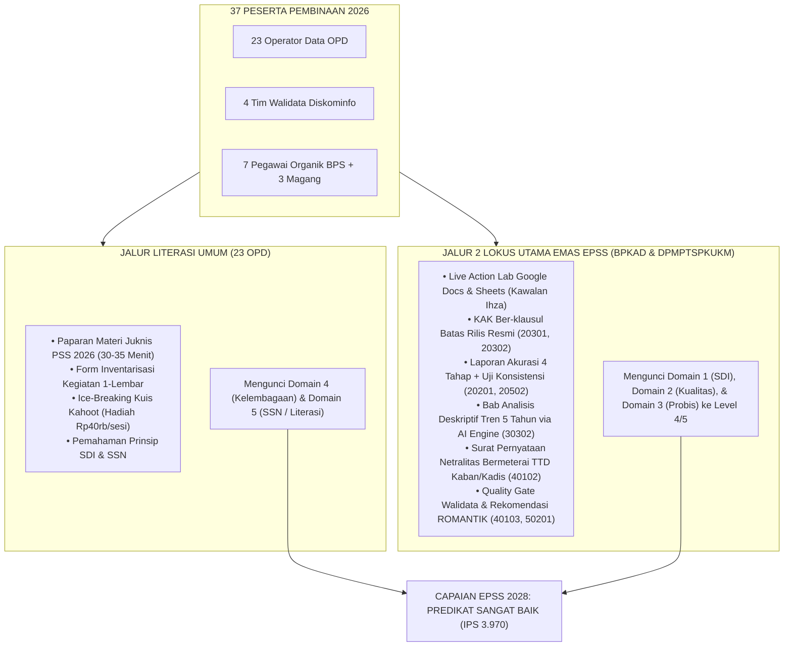

# PETA JALAN & MASTER BLUEPRINT PEMBINAAN STATISTIK SEKTORAL (PSS) 2026
## Arsitektur 4 Pertemuan x 3 Jam: Strategi 2 Lokus Utama dari 23 OPD, 5 Tim Pendamping, & Kolaborasi Live Workspace Kawalan Ihza Menuju Nilai Maksimal EPSS 2028

**Penyelenggara:** Tim Pembina Statistik Sektoral BPS Kabupaten Mempawah bersama Dinas Kominfo (Walidata)  
**Sasaran Peserta (Total 37 Orang):**
- 23 Operator Data Organisasi Perangkat Daerah (OPD) se-Kabupaten Mempawah
- 4 Tim Walidata Dinas Komunikasi dan Informatika (Diskominfo)
- 7 Pegawai Organik Tim Pembina BPS Kabupaten Mempawah
- 3 Mahasiswa Magang BPS Kabupaten Mempawah

**Format Penyelenggaraan:** 4 Sesi Pertemuan Tatap Muka (Masing-masing 3 Jam / Total 12 Jam Efektif)  
**Anggaran Operasional:**
- Konsumsi Snack: Rp2.720.000 (17.000 × 40 porsi × 4 pertemuan)
- Hadiah Kuis Kahoot Interaktif: Rp160.000 (Maksimal Rp40.000 per pertemuan / 1 pemenang per sesi)

**Target Evaluasi:** Evaluasi Penyelenggaraan Statistik Sektoral (EPSS) Tahun 2028 (Predikat **SANGAT BAIK**, Proyeksi IPS $\ge \mathbf{3.970}$)

---

## 📌 1. Urgensi & Filosofi Strategi: "2 Lokus Utama dari 23 OPD"

### 1.1 Realita Penilaian EPSS & Aturan Rotasi Lokus Sektoral
Berdasarkan Peraturan BPS No. 3 Tahun 2022 tentang Tata Kelola Evaluasi Penyelenggaraan Statistik Sektoral (EPSS), Tim Penilai Badan (TPB) BPS RI dan BPS Provinsi **hanya menilai 2 (dua) Kegiatan Statistik Sektoral** yang diselenggarakan oleh Pemerintah Daerah sebagai sampel lokus evaluasi domain hulu-ke-hilir (Domain 1 Prinsip SDI, Domain 2 Kualitas Data, dan Domain 3 Proses Bisnis Statistik).

> [!IMPORTANT]
> **ATURAN WAJIB ROTASI LOKUS EPSS (2024 -> 2026):**
> Pada siklus evaluasi EPSS sebelumnya (data 2024 yang dievaluasi di 2024/2026), Pemkab Mempawah telah mengajukan **Dinas Kesehatan (Profil Kesehatan)** dan **Disperindagnaker (Ketenagakerjaan)**. Sesuai regulasi dan petunjuk teknis EPSS, kegiatan yang telah dinilai pada siklus sebelumnya **tidak boleh dipilih kembali secara berturut-turut** guna memastikan pemerataan kematangan statistik di dinas-dinas lain.
> 
> Oleh karena itu, pada Pembinaan 2026 (objek penilaian **EPSS 2028**), BPS Kabupaten Mempawah secara resmi menetapkan dan mendaftarkan **2 Lokus Emas Baru** (telah terdaftar di sistem BPS wilayah 6104 dengan PIC `ihzakarunia`):
> 1. **Badan Pengelola Keuangan dan Aset Daerah (BPKAD):**  
>    *Kegiatan:* **Kompilasi Data Laporan Keuangan Pemerintah Daerah Yang Di Audit Tahun 2026** (Kompromin).
> 2. **Dinas Penanaman Modal, Koperasi UKM dan PTSP (DPMPTSPKUKM):**  
>    *Kegiatan:* **Kompilasi Data Realisasi Pelayanan Perizinan Kabupaten Mempawah Tahun 2026** (Kompromin).

Jika kita memaksakan ke-23 OPD semua membuat berkas tebal, energi tim pembina dan OPD akan terpecah (*burnout*), berkas tidak tuntas, dan risiko ketimpangan berkas terulang seperti EPSS 2026.

Oleh karena itu, strategi kita adalah **"Satu Komando, Dua Jalur Fokus"**:
1. **Jalur 23 OPD (Literasi & Fondasi SDI Daerah):**
   - Mengikuti paparan materi wajib statistik sektoral, mengisi formulir inventarisasi 1-lembar, mengikuti kuis interaktif Kahoot, dan memahami prinsip Satu Data.
   - Ini secara otomatis mengamankan **Domain 5 (Sistem Statistik Nasional - Bobot 12%)** dan **Domain 4 (Kelembagaan - Bobot 17%)**.
2. **Jalur 2 Lokus Emas Utama (*Golden Lokus EPSS 2028: BPKAD & DPMPTSPKUKM*):**
   - Dipilih **BPKAD** (Akuntabilitas Keuangan & Aset Daerah) dan **DPMPTSPKUKM** (Iklim Investasi, Perizinan Berusaha OSS-RBA, & Koperasi UKM).
   - Diberikan pendampingan intensif VIP (*Red Carpet Treatment*) menggunakan **Live Collaborative Workspace (Google Sheets & Google Docs)** kawalan langsung Bg Ihza dan tim pembina BPS.
   - Seluruh 38 indikator bukti dukung fisik/digital kedua OPD ini diproduksi, diuji akurasi & konsistensinya, ditandatangani kepala dinas/badan, dan diamankan di brankas digital Google Drive 2 tahun sebelum penilaian 2028 dimulai!



---

## 👥 2. Struktur Tim Pelaksana & Pembagian 5 Tim Pendamping 23 OPD

Berdasarkan Notula Rapat Tim Statistik Sektoral BPS Mempawah, peran kepanitiaan dan pembagian 5 tim pendamping teknis ditetapkan sebagai berikut:

### 2.1 Pembagian Peran Panitia Acara
- **Pra Acara:**
  - Pengadaan snack (40 porsi × 4 sesi) & Hadiah Kahoot: **Vaniya**
  - Administrasi, pendaftaran peserta, & daftar hadir fisik/digital: **Mahasiswa Magang, Nadya, dan Rara** (dibimbing **Mbak Uma**)
- **Hari H (Pelaksanaan Sesi):**
  - Doa pembuka pertemuan pertama: **Bg Tio**
  - MC & pemandu doa mandiri pertemuan 2 s.d. 4: **Vaniya**
  - Operator laptop penayang slide materi & kuis Kahoot: **Akma**
  - Dokumentasi foto/video kegiatan (bukti fisik portal SPESIAL): **Irfan**
- **Pasca Acara:**
  - Rekapitulasi berkas, pengesahan presensi, dan penyusunan SPJ administrasi: **Sukma**

### 2.2 Alokasi 23 OPD ke 5 Tim Pendamping BPS (1 Tim = 4–5 OPD)
Setiap tim bertugas mendampingi perwakilan OPD dalam membuka form, menginput data, dan mengecek kelengkapan instrumen via Google Sheets & Docs bersama:

| Tim | Ketua Pendamping | Anggota Pendamping | Daftar OPD Dampingan (4–5 OPD) | Fokus Khusus |
|:---:|:---|:---|:---|:---|
| **Tim 1** | **Sukma** | Nadya | 1. **BPKAD (LOKUS UTAMA 1)** ⭐ *(Supervisi: Ihza)*<br>2. BKPSDM<br>3. Bakesbangpol<br>4. BPPRD<br>5. Inspektorat Daerah | **Pusat Pengawalan Lokus Emas 1 (LKPD Audited 2026 - PIC: ihzakarunia)** & data keuangan/aset |
| **Tim 2** | **Ihza** | Mahasiswa Magang 1 | 1. **DPMPTSPKUKM (LOKUS UTAMA 2)** ⭐<br>2. Dinas Kesehatan, PPKB (Eks-Lokus 2024)<br>3. RSUD dr. Rubini<br>4. Dinas Sosial, P3APMPD<br>5. Disdukcapil | **Pusat Pengawalan Lokus Emas 2 (Pelayanan Perizinan 2026 - PIC: ihzakarunia)** & perizinan/sosial |
| **Tim 3** | **Listio** | Irfan | 1. Disperindagnaker (Eks-Lokus 2024)<br>2. Dinas Pertanian, KP & Perikanan (DPKP)<br>3. Dinas Perhubungan & LH (Dishub-LH) | Pengawalan data ketenagakerjaan, pertanian/pangan, dan lingkungan hidup |
| **Tim 4** | **Aller** | Rara | 1. Dinas Pekerjaan Umum dan PR (DPUPR)<br>2. BPBD (Penanggulangan Bencana)<br>3. Satpol PP<br>4. Dinas Perpustakaan & Kearsipan (Dispersip)<br>5. Sekretariat DPRD | Standar data infrastruktur, mitigasi bencana, perda, dan kearsipan |
| **Tim 5** | **Aul** | Mbak Uma | 1. Bapperida (Perencana & Koordinator SDI)<br>2. Diskominfo (Walidata Daerah)<br>3. Disdikporapar (Pendidikan, Olahraga, Pariwisata)<br>4. Sekretariat Daerah (Setda) | Sinkronisasi Perencanaan Daerah, Quality Gate Walidata, & Portal Satu Data |

---

## 📅 3. Jadwal Definitif 4 Sesi Pertemuan & Distribusi Materi

Setiap pertemuan berlangsung selama **180 Menit (3 Jam)** dengan pembagian waktu yang proporsional:
- **00 – 35 Menit:** Paparan Materi Teknis Wajib (Slide ringkas, visual, to-the-point) diakhiri Kuis Kahoot (5 Menit) berhadiah Rp40.000.
- **35 – 170 Menit:** **Sesi Spesial Kawalan Ihza & 5 Tim Pendamping** (Workshop Kolaboratif Live Google Docs/Sheets & Otomasi AI Generator).
- **170 – 180 Menit:** Review keluaran bukti fisik, penandatanganan pengesahan, dan penutupan.

| Pertemuan & Tanggal | Pemateri Resmi | Materi Paparan Wajib (35 Mnt) | Sesi Praktek / Workshop Kawalan Ihza & 5 Tim (135 Mnt) | Target Output Bukti Fisik EPSS Terkunci |
|:---|:---|:---|:---|:---|
| **Sesi 1**<br>Rabu, 28 Okt 2026 | **Ihza** | **Identifikasi Kegiatan Statistik:**<br>• Definisi Statistik Sektoral (Sensus, Survei, Kompromin)<br>• Kaidah penulisan judul standar BPS<br>• Rotasi Lokus & Doktrin 2 Lokus Baru EPSS 2028 | **Kickoff Live Workspace Kolaboratif:**<br>• Pembagian tautan Google Sheets & Google Docs bersama<br>• Input serentak Form Inventarisasi 1-Lembar 23 OPD<br>• Pleno Pengesahan BA Penetapan 2 Lokus Baru (BPKAD & DPMPTSPKUKM) | • Rekap Inventarisasi Kegiatan 23 OPD (Indikator 20102, 30101)<br>• BA Penetapan 2 Lokus Baru Terdaftar BPS (Indikator 20101, 40301)<br>• Kuis Kahoot Sesi 1 (Akma & Vaniya) |
| **Sesi 2**<br>Rabu, 4 Nov 2026 | **Materi 1: Uma**<br>**Materi 2: Ihza** | **Prinsip SDI & Kualitas Data:**<br>• 4 Prinsip SDI (SDS, Metadata, Interoperabilitas, Kode Referensi)<br>• Evaluasi 10 Indikator Pleno 2026 yang jatuh ke Skor 1 (Akurasi, Aktualitas, Konsistensi) | **Bedah Kualitas Data Live Google Docs:**<br>• Praktik live menyusun Kamus Standar Data & Metadata INDAH<br>• Simulasi 4 Tahap Pemeriksaan Akurasi Data + BA Ground Check BPKAD & DPMPTSPKUKM<br>• Bedah Uji Konsistensi Logis Searah 2 Variabel Terkait | • Kamus Standar Data Statistik (SDS) TTD BPS (Indikator 10101)<br>• Bukti Registrasi Metadata INDAH (Indikator 10201)<br>• Laporan Uji Akurasi & Konsistensi (Indikator 20201, 20502)<br>• Kuis Kahoot Sesi 2 |
| **Sesi 3**<br>Rabu, 11 Nov 2026 | **Aul** | **Proses Bisnis Statistik (GSBPM):**<br>• Tahapan GSBPM (Perencanaan s.d. Evaluasi)<br>• Alur Pengajuan ROMANTIK BPS (UU 16/1997)<br>• Klausul batas waktu rilis diseminasi (ARC) | **Penyusunan KAK & Analisis AI Generator:**<br>• Pengisian KAK Ber-klausul Batas Rilis Resmi (Template Plug-and-Play)<br>• **Eksekusi AI Engine (`kb_pss_automation.py`)**: Generate Bab Analisis Deskriptif Tren 5 Tahun dari data mentah lokus<br>• Format Surat Rekomendasi Statistik Layak BPS | • KAK Final TTD Kaban/Kadis ber-klausul rilis (Indikator 20301, 20302, 50301)<br>• Surat Rekomendasi Statistik Layak BPS (Indikator 50201)<br>• Naskah Bab III Analisis Deskriptif Tren 5 Tahun (Indikator 30302)<br>• Kuis Kahoot Sesi 3 |
| **Sesi 4**<br>Selasa, 17 Nov 2026 | **Materi 1: Listio**<br>**Materi 2: Aller** | **SSN & Kelembagaan Sektoral:**<br>• Peran BPS (Pembina), Diskominfo (Walidata), & OPD (Produsen)<br>• Tata Kelola Forum SDI & Rencana Aksi Daerah<br>• Penjaminan Netralitas & Mutu Data Walidata | **Quality Gate Walidata, Netralitas, & Final Audit:**<br>• Pengisian Lembar Checklist Mutu Walidata Diskominfo (Template B)<br>• Penandatanganan Surat Pernyataan Netralitas bermeterai (Template A)<br>• Simulasi Pleno Forum SDI & BA Kesepakatan Data Prioritas<br>• Gelar Pasukan EPSS 2028: Audit Kesiapan Skor IPS 3.970 | • Pakta Komitmen Netralitas TTD Kaban/Kadis bermeterai (Indikator 40102)<br>• Berita Acara Quality Gate Mutu Walidata (Indikator 40103)<br>• Notula & BA Sidang Pleno Forum SDI (Indikator 40302)<br>• Dossier Final EPSS 2028 Siap Panen (Proyeksi Sangat Baik)<br>• Kuis Kahoot Sesi 4 |

---

## 💻 4. Sesi Spesial Pimpinan Ihza: "EPSS Live Collaborative Workspace Engine"

Inovasi utama pembinaan tahun 2026 ini dipimpin langsung oleh **Ihza Fikri Zaki Karunia**, yaitu menghadirkan ruang kerja kolaboratif digital (*Live Collaborative Workspace*) yang menghubungkan seluruh laptop operator OPD, tim Walidata Diskominfo, dan tim pendamping BPS secara *real-time*.

### 4.1 Komponen 1: Google Sheets "Radar EPSS Mempawah 2026–2028"
File Google Sheets bersama yang diproyeksikan ke layar proyektor aula:
1. **Tab 1: Leaderboard & Radar 23 OPD**
   - Menampilkan status lampu indikator (*Traffic Light System*): Merah (Belum Isi), Kuning (Draf Diisi), Hijau (Berkas Lengkap & TTD).
   - Menjadi pemicu motivasi positif antar-OPD.
2. **Tab 2: Lokus Emas 1 (BPKAD - Kompilasi Data Laporan Keuangan Pemda Yang Di Audit 2026)**
   - Matriks 38 Indikator EPSS dengan kolom: Nomor Indikator, Nama Bukti Dukung, Tautan Folder Google Drive, PIC BPKAD, PIC Pendamping BPS (Sukma & Ihza), dan Status Validasi TPB.
3. **Tab 3: Lokus Emas 2 (DPMPTSPKUKM - Kompilasi Data Realisasi Pelayanan Perizinan 2026)**
   - Matriks 38 Indikator identik yang dipantau langsung oleh Ihza bersama tim DPMPTSPKUKM.
4. **Tab 4 s.d. 8: Meja Kerja Tim 1 s.d. Tim 5**
   - Ruang interaksi teknis masing-masing tim pendamping bersama 4–5 OPD dampingannya.

### 4.2 Komponen 2: Google Docs "Master Dossier Bukti Dukung Plug-and-Play"
Operator OPD tidak menulis dari nol. Ihza membuka dokumen master di layar proyektor dan mendemonstrasikan pengisian secara langsung:
- Mengambil **1 contoh nyata** (misal: Kompilasi Realisasi Pelayanan Perizinan DPMPTSPKUKM atau LKPD Audited BPKAD).
- Operator OPD cukup mengganti teks berwarna biru (nama dinas, nama pejabat, NIP, nama kegiatan).
- Seluruh klausul metodologi hukum, klausul batas rilis diseminasi, dan formula akurasi sudah terstandarisasi sesuai pedoman EPSS BPS RI.

### 4.3 Komponen 3: Mesin Otomasi AI Generator (`scripts/kb_pss_automation.py`)
Untuk kebutuhan analisis data statistik (Indikator 30302 yang jatuh ke Skor 1 di 2026 karena publikasi dinas hanya berisi tabel tanpa ulasan narasi tren), tim pembina memanfaatkan script Python otomasi AI:
```bash
# Operator OPD cukup menyerahkan CSV angka mentah 5 tahun, sistem menghasilkan Bab Analisis Deskriptif lengkap 4 subbab:
python3 scripts/kb_pss_automation.py generate-analysis \
  --opd "DPMPTSPKUKM" \
  --kegiatan "Kompilasi Data Realisasi Pelayanan Perizinan Kabupaten Mempawah Tahun 2026" \
  --data-file /path/to/data_perizinan_5th.json \
  --output Bab3_Analisis_Perizinan_DPMPTSP.md
```

### 4.4 Nilai Inovasi Jangka Panjang (*Sustainable Long-Term System*)
Sistem ini tidak bubar saat pembinaan 4 hari selesai, melainkan terus hidup sebagai **Pusat Pemantauan Penyelenggaraan Statistik Sektoral Kabupaten Mempawah**:
1. Menjadi arsip terpusat bukti dukung (*Evidence Vault*) di Google Drive bersama antara BPS dan Diskominfo.
2. Saat penilaian mandiri dan interview EPSS 2028 dibuka, Diskominfo dan BPS tinggal menyalin tautan berkas yang sudah rapi tanpa perlu pontang-panting mencari arsip lama.
3. Inovasi ini secara mandiri menjadi bukti fisik otentik Level 5 untuk **Indikator 50103 (Literasi Statistik & Inovasi Pembinaan)** dan **Indikator 40103 (Penjaminan Kualitas Data oleh Walidata)**.

---

## 🧮 5. Proyeksi Matematis Nilai EPSS Mempawah 2028

Berdasarkan formula pembobotan resmi EPSS BPS RI (`epss_calc.py`), strategi pengawalan 2 Lokus Utama dan 23 OPD ini menghasilkan lompatan nilai yang terukur:

```text
================================================================================
                    SIMULASI CAPAIAN EPSS MEMPAWAH (TARGET 2028)
================================================================================
Domain 1: Prinsip Satu Data Indonesia       Bobot: 12.0% -> Kontribusi: 0.444
Domain 2: Kualitas Data                     Bobot: 23.0% -> Kontribusi: 0.900
Domain 3: Proses Bisnis Statistik           Bobot: 19.0% -> Kontribusi: 0.741
Domain 4: Kelembagaan                       Bobot: 26.0% -> Kontribusi: 1.050
Domain 5: Statistik Nasional                Bobot: 20.0% -> Kontribusi: 0.835
--------------------------------------------------------------------------------
TOTAL INDEKS PEMBANGUNAN STATISTIK (IPS)     : 3.970
KATEGORI / PREDIKAT                          : SANGAT BAIK (Predikat Memuaskan)
PROYEKSI KENAIKAN DARI BASELINE 2026 (2.558) : +1.412 Poin (+55.2%)
================================================================================
```

Dengan peta jalan ini, seluruh panitia dan pemateri BPS memiliki panduan kerja yang padu, terukur, dan fokus mengamankan bukti fisik kemenangan EPSS Mempawah 2028!