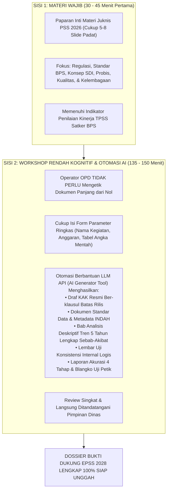

# PETA JALAN & MASTER BLUEPRINT PEMBINAAN STATISTIK SEKTORAL (PSS) 2026
## Arsitektur 4 Pertemuan x 3 Jam: Padat Materi Wajib, Rendah Beban Kognitif OPD, & Berbantuan Otomasi AI Menuju Nilai Maksimal EPSS 2028
**Penyelenggara:** Tim Pembina Statistik Sektoral BPS Kabupaten Mempawah  
**Target Lokus & Peserta:** Operator Data Organisasi Perangkat Daerah (OPD), Tim Walidata Diskominfo, dan Bapperida Kabupaten Mempawah  
**Format Penyelenggaraan:** 4 Sesi Pertemuan Tatap Muka (Masing-masing 3 Jam / Total 12 Jam Efektif)  
**Target Evaluasi:** Evaluasi Penyelenggaraan Statistik Sektoral (EPSS) Tahun 2028 (Predikat SANGAT BAIK, IPS $\ge 3.65$)  

---

## 📌 1. Urgensi & Transformasi Paradigma 4 Pertemuan

### 1.1 Kendala Nyata Operator OPD & Evaluasi EPSS 2026
Pada EPSS 2026 (yang mengevaluasi data 2024), Kabupaten Mempawah sempat anjlok pada **10 Indikator bernilai 1** karena:
1. Operator OPD memiliki beban kerja rutin tinggi di dinasnya, bukan berlatar belakang statistik, dan mengalami kebingungan teknis (*cognitive overload*) jika diminta menyusun dokumen metodologi yang rumit dari kertas kosong (*blank-page paralysis*).
2. Pembinaan sebelumnya menghabiskan waktu pada ceramah panjang tanpa menghasilkan draf dokumen bukti dukung riil yang siap ditandatangani pimpinan.
3. Waktu tatap muka sangat terbatas, yaitu **hanya 4 kali pertemuan dengan durasi masing-masing 3 jam**.

### 1.2 Doktrin Baru: "Smart, Fast, & Low Cognitive Load"
Untuk menjawab batasan tersebut, Pembinaan Statistik Sektoral 2026 direstrukturisasi dengan formula keseimbangan dua sisi (*Dual-Sided Balanced Architecture*):



---

## 🗺️ 2. Matriks Integrasi 4 Pertemuan vs EPSS vs Juknis PSS 2026

Seluruh 38 Indikator EPSS dan 6 Rencana Kerja Wajib Juknis PSS 2026 dipadatkan secara presisi ke dalam 4 pertemuan:

| Sesi | Modul Pertemuan (3 Jam) | Porsi Teori Wajib (Slide Juknis 2026) | Porsi Workshop & Otomasi AI (Rendah Kognitif OPD) | Indikator EPSS yang Terkunci | Target Level | Artefak Bukti Fisik yang Dihasilkan |
|:---:|:---|:---|:---|:---:|:---:|:---|
| **01** | **Pertemuan 1:** Kick-Off, Prinsip SDI, Inventarisasi Cepat, & Penetapan 2 Lokus EPSS | **Materi Wajib SDI & Identifikasi Kegiatan (35 mnt):**<br>• Definisi SSN, Sensus/Survei/Kompromin<br>• 4 Prinsip SDI (SDS, Metadata, Interoperabilitas, Kode Referensi) | **Otomasi & Form 1-Lembar (145 mnt):**<br>• Form Wizard Inventarisasi Cepat OPD<br>• Seleksi Otomatis 2 Lokus Prioritas Calon EPSS (Dinkes & Disperindag)<br>• AI Generator: Kamus Standar Data & Metadata MS-Var | `10101`, `10201`, `10301`, `10401`, `20101`, `20102`, `30101`, `40301` | **L4** | 1. Dokumen Inventarisasi Kegiatan Statistik OPD (Living Doc)<br>2. Berita Acara Penetapan 2 Kegiatan Prioritas Calon EPSS 2028<br>3. Kamus Standar Data Statistik (SDS) Disahkan BPS<br>4. Form Metadata MS-Var terdaftar di INDAH BPS |
| **02** | **Pertemuan 2:** Perencanaan Terstandar, Rekomendasi ROMANTIK BPS, & Penjaminan Netralitas | **Materi Wajib Probis GSBPM & SSN (35 mnt):**<br>• Fase Perencanaan & Desain Statistik<br>• Alur Pengajuan ROMANTIK (UU 16/1997)<br>• Kelembagaan: Netralitas & Konfidensialitas | **Otomasi & Template Siap Cetak (145 mnt):**<br>• Template KAK Plug-and-Play ber-klausul batas rilis<br>• Auto-generate Form FS3 ROMANTIK BPS<br>• Generator Template A: Surat Pernyataan Netralitas bermeterai TTD Kadis | `30101`-`30103`, `30201`, `40101`, **`40102` (Skor 1)**, `40104`, `50201`, fondasi `20301` | **L4** | 1. KAK Final bertandatangan Kadis ber-klausul batas rilis<br>2. Surat Rekomendasi Statistik Layak Resmi BPS No. Reg<br>3. Surat Pernyataan Netralitas & Objektivitas TTD Kadis (Template A)<br>4. Surat Edaran Permintaan Data Resmi ke faskes/unit |
| **03** | **Pertemuan 3:** Pengolahan Data, 4 Tahap Akurasi, & Analisis Tren AI Engine | **Materi Wajib Kualitas Data (35 mnt):**<br>• Mengapa Akurasi, Keterbandingan, & Konsistensi jatuh ke Skor 1 di 2026<br>• 4 Tahap Baku Pemeriksaan Akurasi | **Otomasi AI & Spreadsheet Validasi (145 mnt):**<br>• Spreadsheet otomatis: validasi rumus & deteksi ganda<br>• **LLM AI Engine**: Mengubah tabel angka mentah 5 tahun menjadi Bab Analisis Tren Deskriptif lengkap ulasan sebab-akibat & rekomendasi kebijakan<br>• AI Generator: Lembar Uji Konsistensi logis searah | **`20201` (Skor 1)**, **`20501` (Skor 1)**, **`20502` (Skor 1)**, `30301`, **`30302` (Skor 1)** | **L4** | 1. Laporan 4 Tahap Akurasi Data + BA Ground Check<br>2. Bab Analisis Deskriptif Publikasi (Template D) hasil generate AI<br>3. Laporan Keterbandingan 5 Tahun & Wilayah berkonsep baku<br>4. Lembar Hasil Uji Konsistensi Internal Logis (Template C2) |
| **04** | **Pertemuan 4:** Diseminasi Multi-Kanal (ARC), Mutu Walidata, Forum SDI, & Gelar Pasukan EPSS | **Materi Wajib Kelembagaan & Diseminasi (35 mnt):**<br>• Kalender Rilis Resmi (ARC), Diseminasi Terbuka, & Literasi (Domain 5)<br>• Quality Gate Walidata & Forum SDI | **Otomasi Toolkit & Simulasi SIMBATIK (145 mnt):**<br>• Rilis Kalender ARC Publik di Portal SDI<br>• Lembar Checklist Mutu Walidata 5 Kriteria (Template B)<br>• Sidang Pleno Forum SDI: BA Data Prioritas & Rencana Aksi SDI 2026-2028 (Template J & K)<br>• Zero-Gap Audit & Simulasi Skor IPS EPSS | **`20301` (Skor 1)**, **`20302` (Skor 1)**, `20401`-`20403`, `30401`, **`40103` (Skor 1)**, **`40302` (Skor 2)**, **`50103` (Skor 1)**, **`50301` (Skor 1)**, `50303` | **L4** | 1. Dokumen Kalender Rilis Resmi (ARC) & Laporan Waktu Romantik<br>2. Lembar Checklist Mutu Walidata TTD Kadiskominfo (Template B)<br>3. Berita Acara Forum SDI & Dokumen Rencana Aksi SDI 2026–2028<br>4. Paket 5 Bukti Literasi Statistik Publik<br>5. Berita Acara Kesiapan EPSS 2028 (Proyeksi IPS 3.970 / Sangat Baik) |

---

## 🤖 3. Mesin Otomasi Berbantuan AI (`scripts/kb_pss_automation.py`)

Untuk memangkas habis beban kognitif operator OPD, telah disediakan alat bantu CLI otomasi cerdas di repositori:

```bash
# 1. Menghasilkan draf KAK lengkap ber-klausul batas waktu rilis yang mengikat:
python3 scripts/kb_pss_automation.py generate-kak --opd "Dinas Kesehatan" --kegiatan "Profil Kesehatan 2026" --deadline "2026-10-31"

# 2. Mengubah tabel angka mentah 5 tahun OPD menjadi Bab Analisis Deskriptif Lengkap via LLM API:
python3 scripts/kb_pss_automation.py generate-analysis --opd "Disperindagnaker" --kegiatan "Penempatan Tenaga Kerja" --data-file data_naker.json

# 3. Menghasilkan Lembar Verifikasi Uji Konsistensi Internal Logis:
python3 scripts/kb_pss_automation.py generate-consistency --opd "Dinas Kesehatan" --var1 "Cakupan K4" --var2 "Kematian Ibu" --data-file data_kia.json

# 4. Menghasilkan Bundel Surat Pernyataan Netralitas (Template A) siap cetak dan bermeterai:
python3 scripts/kb_pss_automation.py generate-netralitas --opd "Disperindagnaker" --kadis "Johana Saragih, S.H."

# 5. Menjalankan Zero-Gap Audit 38 Indikator dan Kalkulasi Proyeksi Skor IPS EPSS:
python3 scripts/kb_pss_automation.py audit-epss --drive-folder "/path/to/epss-drive"
```

---

## 🧮 4. Target Kinerja Kematangan EPSS 2028

- **Baseline Hasil Pleno EPSS 2026:** $\mathbf{2.558}$ (Predikat: **CUKUP**)
- **Target Tercapai 4 Pertemuan Terpadu 2026:**
  - Domain 1 Prinsip SDI (Bobot 28%): Rata-rata Skor $4.000 \rightarrow$ Kontribusi **1.120**
  - Domain 2 Kualitas Data (Bobot 24%): Rata-rata Skor $4.000 \rightarrow$ Kontribusi **0.960**
  - Domain 3 Proses Bisnis (Bobot 19%): Rata-rata Skor $4.000 \rightarrow$ Kontribusi **0.760**
  - Domain 4 Kelembagaan (Bobot 17%): Rata-rata Skor $3.820 \rightarrow$ Kontribusi **0.650**
  - Domain 5 Statistik Nasional (Bobot 12%): Rata-rata Skor $4.000 \rightarrow$ Kontribusi **0.480**
- **Total Proyeksi Indeks Pembangunan Statistik (IPS) 2028:** $\mathbf{3.970}$ (Predikat: **SANGAT BAIK**)  
  *(Lompatan peningkatan sebesar **+1.412 poin / +55.2%** secara absolut).*

---

## 📁 5. Arsitektur Penyimpanan Berkas & Dossier Bukti Fisik

Setiap OPD produsen data difasilitasi folder terstandar di Google Drive bersama:
```text
DRIVE_EPSS_2028_MEMPAWAH/
├── 01_DOMAIN_1_PRINSIP_SDI/          --> Dihasilkan pada Pertemuan 1
├── 02_DOMAIN_2_KUALITAS_DATA/        --> Dihasilkan pada Pertemuan 3 & 4
├── 03_DOMAIN_3_PROSES_BISNIS/        --> Dihasilkan pada Pertemuan 2 & 3
├── 04_DOMAIN_4_KELEMBAGAAN/          --> Dihasilkan pada Pertemuan 2 & 4
└── 05_DOMAIN_5_STATISTIK_NASIONAL/   --> Dihasilkan pada Pertemuan 4
```

Dengan sistem 4 pertemuan ini, BPS Kabupaten Mempawah memastikan **seluruh kewajiban juknis pembinaan BPS terpenuhi**, **beban operator OPD sangat ringan (tinggal isi parameter)**, dan **100% bukti dukung EPSS 2028 telah siap dan terkunci 2 tahun lebih awal!**
