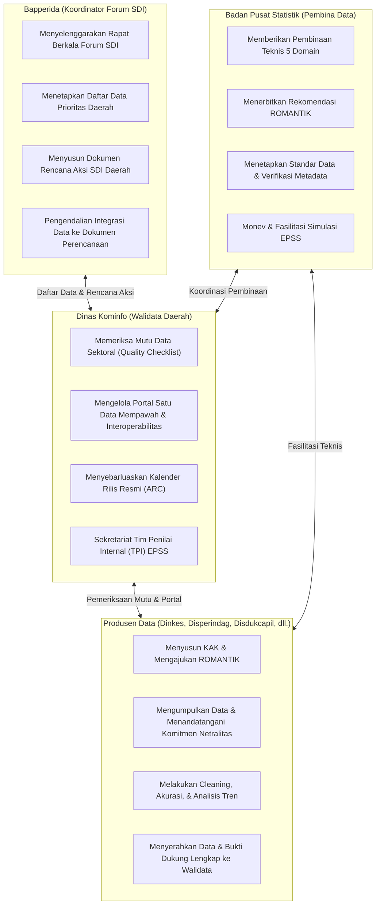

# PETA JALAN DAN MATRIKS INTEGRASI PEMBINAAN STATISTIK SEKTORAL (PSS) 2026
## Strategi Pengawalan Bukti Dukung Komprehensif Menuju Nilai Maksimal EPSS 2028 (Predikat Sangat Baik / Memuaskan)
**Penyelenggara:** Tim Pembina Statistik Sektoral BPS Kabupaten Mempawah  
**Target Pengguna / Peserta:** Operator Data Organisasi Perangkat Daerah (OPD), Tim Walidata Daerah (Dinas Kominfo), dan Koordinator Forum Satu Data Indonesia (Bapperida) Kabupaten Mempawah  
**Periode Pelaksanaan Pembinaan:** Tahun Anggaran 2026  
**Objek Evaluasi:** Evaluasi Penyelenggaraan Statistik Sektoral (EPSS) Tahun 2028  

---

## 📌 1. Latar Belakang & Urgensi Transformasi Paradigma

### 1.1 Evaluasi Kritis EPSS 2026 (Refleksi Pembinaan 2024)
Pada pelaksanaan Rapat Pleno Provinsi Kalimantan Barat tanggal 3–4 September 2026, hasil penilaian EPSS 2026 Pemerintah Kabupaten Mempawah (yang mengevaluasi kegiatan statistik tahun 2024 pada Dinas Kesehatan dan Disperindagnaker) sempat mengalami penurunan drastis pada **10 Indikator yang diberi Nilai 1 (dari skala 5)** oleh Tim Penilai Badan (TPB BPS Ketapang):
1. **Domain 2 (Kualitas Data):** 
   - `20201` (Akurasi Data): Nilai 1 — Tidak ada bukti tertulis alur verifikasi data, de-duplikasi, dan validasi rumus.
   - `20301` (Aktualitas Data): Nilai 1 — Tidak ada kesepakatan tertulis batas waktu rilis data dalam KAK.
   - `20302` (Ketepatan Waktu Diseminasi): Nilai 1 — Tidak ada Kalender Rilis (ARC) dan pemantauan realisasi jadwal Romantik vs rilis faktual.
   - `20501` (Keterbandingan Data): Nilai 1 — Tidak ada runtun waktu (time series 3–5 tahun) dan perbandingan wilayah berkonsep baku.
   - `20502` (Konsistensi Statistik): Nilai 1 — Tidak ada dokumen uji konsistensi korelasi searah logis antar-variabel.
2. **Domain 3 (Proses Bisnis Statistik):**
   - `30302` (Analisis Data): Nilai 1 — Publikasi hanya berupa kompilasi tabel angka mentah tanpa ulasan narasi tren deskriptif.
3. **Domain 4 (Kelembagaan):**
   - `40102` (Netralitas & Objektifitas): Nilai 1 — Tidak ada Surat Pernyataan Komitmen Netralitas bertandatangan Kepala Dinas.
   - `40103` (Penjaminan Kualitas Walidata): Nilai 1 — Walidata tidak menerbitkan Lembar Checklist Pemeriksaan Mutu formal.
   - `40302` (Penyelenggaraan Forum SDI): Nilai 2 — Berkas dokumen berkala tidak terhimpun dan sempat terhambat surat alasan efisiensi anggaran.
4. **Domain 5 (Statistik Nasional):**
   - `50103` (Sosialisasi & Literasi Statistik): Nilai 1 — Dokumentasi edukasi/bimtek statistik ke pengguna sangat minim.
   - `50301` (Perencanaan Pembangunan Statistik): Nilai 1 — Belum memiliki Dokumen Rencana Aksi Satu Data Indonesia (SDI) Daerah yang sah.

### 1.2 Akar Masalah Fundamental
Mengapa hal di atas terjadi?
> **"Selama ini pembinaan statistik sektoral berjalan terpisah dari kebutuhan bukti dukung EPSS. Materi pembinaan hanya bersifat ceramah normatif/teoretis di ruangan, tanpa mewajibkan OPD menghasilkan dokumen bukti fisik saat proses kegiatan berlangsung. Akibatnya, saat EPSS tiba, OPD dan Walidata kelabakan mencari berkas yang tidak pernah dibuat atau tidak terarsip rapi."**

### 1.3 Doktrin Baru: Evidence-Driven PSS 2026
Siklus penilaian EPSS adalah siklus 2 tahunan. Kegiatan statistik sektoral yang diselenggarakan oleh perangkat daerah di Pemkab Mempawah pada **Tahun Anggaran 2026** akan menjadi **objek penilaian fisik pada EPSS Tahun 2028**!

Oleh karena itu, Pembinaan Statistik Sektoral Tahun 2026 menganut doktrin:
> **"NO MEETING WITHOUT EVIDENCE (Tidak Ada Pertemuan Tanpa Bukti Dukung Riil)"**
> 
> Setiap pertemuan pembinaan dirancang bukan sekadar transfer materi, melainkan workshop terpandu (*hands-on coaching*) yang secara langsung menghasilkan **artefak bukti dukung (deliverables) bertandatangan sah** yang langsung dimasukkan ke dalam **Dossier Portofolio Statistik Sektoral OPD**.

---

## 🎯 2. Target Kinerja Kematangan EPSS 2028

### 2.1 Formula Indeks Pembangunan Statistik (IPS)
Sesuai Peraturan BPS, IPS dihitung berdasarkan 5 Domain pembobotan:
$$\text{IPS} = 0.28 \times D_1 + 0.24 \times D_2 + 0.19 \times D_3 + 0.17 \times D_4 + 0.12 \times D_5$$

### 2.2 Skala Predikat IPS
- **$\text{IPS} < 1.80$**: Predikat Kurang
- **$1.80 \le \text{IPS} < 2.60$**: Predikat Cukup
- **$2.60 \le \text{IPS} < 3.50$**: Predikat Baik
- **$3.50 \le \text{IPS} < 4.20$**: Predikat Sangat Baik
- **$\text{IPS} \ge 4.20$**: Predikat Memuaskan

### 2.3 Simulasi Lompatan Kinerja Pemkab Mempawah
- **Baseline EPSS 2026 (Pleno):** $\text{IPS} = 2.558$ (Predikat: Cukup)
- **Target Realistis EPSS 2028 (Seluruh Indikator Minimal Level 3):** $\text{IPS} = 3.000$ (Predikat: Baik)
- **Target Strategis & Maksimal EPSS 2028 (Kombinasi Level 3, 4, dan 5):**
  - Domain 1 (SDI): 100% Level 4 (Terpadu dan Terukur)
  - Domain 2 (Kualitas Data): Level 3 s.d. Level 4
  - Domain 3 (Proses Bisnis): Level 3 s.d. Level 4
  - Domain 4 (Kelembagaan): Level 3 s.d. Level 4
  - Domain 5 (Statistik Nasional): Level 3 s.d. Level 4 (Big Data Level 4)
  - **Proyeksi Skor Akhir: $\text{IPS} \ge 3.650$ (Predikat: SANGAT BAIK)**

---

## 🗺️ 3. Arsitektur Matriks Integrasi: 10 Pertemuan Pembinaan vs EPSS vs GSBPM

Tabel berikut menunjukkan keselarasan mutlak antara setiap sesi pertemuan pembinaan 2026 dengan fase GSBPM, 6 Rencana Kerja (RK) Wajib Juknis PSS 2026, indikator EPSS, dan target artefak bukti dukungnya:

| No | Modul Pertemuan | Fase GSBPM | RK Juknis PSS 2026 | Indikator EPSS Terkait | Target Level | Artefak Bukti Dukung Wajib (Deliverables) |
|:--:|:---|:---|:---|:---|:---:|:---|
| **01** | **Pertemuan 1:** Kick-Off, Inventarisasi Kegiatan Statistik OPD, & Seleksi 2 Lokus Prioritas EPSS | Fase 1 (*Specify Needs*) | RK 1 (Identifikasi & Prioritas) | `20101`, `20102`, `30101`, `40301`, `40303` | L3 / L4 | 1. Dokumen Rekapitulasi Inventarisasi Kegiatan Statistik Sektoral Daerah (Living Document)<br>2. Berita Acara Penetapan 2 Kegiatan Prioritas Calon Lokus EPSS 2028 (BPS-Diskominfo-OPD) |
| **02** | **Pertemuan 2:** Prinsip Satu Data Indonesia, Arsitektur Data, SDS, & Metadata | Overarching (*Data & Metadata*) | RK 2 (Satu Data Indonesia) | `10101`, `10201`, `10301`, `10401` *(Domain 1 Bobot 28%)* | **L4** | 1. Kamus Standar Data Statistik (SDS) Kegiatan Prioritas (Konsep, Definisi, Klasifikasi, Satuan)<br>2. Form Metadata Statistik (MS-Keg, MS-Var, MS-Ind) Approved BPS di INDAH<br>3. Bukti Interoperabilitas API Portal SDI Mempawah |
| **03** | **Pertemuan 3:** Desain Statistik, Standarisasi KAK, & Rekomendasi Statistik (ROMANTIK) | Fase 2 (*Design*) | RK 6 (SSN) & RK 4 (Probis) | `30101`, `30102`, `30103`, `50201` | **L4** | 1. Dokumen KAK Final bertandatangan Kepala Dinas memuat klausul batas waktu rilis<br>2. Form FS3 Pengajuan Rekomendasi di ROMANTIK BPS<br>3. Surat Rekomendasi Statistik Resmi Diterbitkan BPS (Status Layak) |
| **04** | **Pertemuan 4:** Instrumen Pengumpulan Data, Akuisisi Kompromin, & Penjaminan Netralitas Metodologi | Fase 3 (*Build*) & Fase 4 (*Collect*) | RK 4 (Probis) & RK 5 (Kelembagaan) | `30201`, `40101`, `40102` *(Kritis Skor 1)*, `40104` | L3 / L4 | 1. Kuesioner / Formulir Isian Kompromin Terstandar<br>2. Surat Permintaan Data Resmi ke Unit Sumber Data<br>3. Surat Pernyataan Komitmen Netralitas Metodologi bertandatangan Kepala Dinas & Bermaterai (Template A)<br>4. Dokumen SOP Pengamanan Kerahasiaan Data (Non-PII) |
| **05** | **Pertemuan 5:** Pengolahan Data, Aturan Validasi Rumus, & Penilaian Akurasi Data | Fase 5 (*Process*) | RK 3 (Kualitas Data) & RK 4 (Probis) | `20201` *(Kritis Skor 1)*, `30301` | L3 / L4 | 1. SOP Pemeriksaan & Pembersihan Data Sektoral OPD<br>2. Laporan Tahapan Pemeriksaan Akurasi Data (Completeness, Ground Check, De-duplication, Formula Validation)<br>3. Berita Acara Uji Petik (*Ground Check*) Lapangan<br>4. Screenshot Aturan Validasi Rumus Excel / Sistem |
| **06** | **Pertemuan 6:** Analisis Data Statistik, Keterbandingan Antarwaktu/Wilayah, & Uji Konsistensi Logis | Fase 6 (*Analyze*) | RK 3 (Kualitas Data) & RK 4 (Probis) | `20501` *(Kritis Skor 1)*, `20502` *(Kritis Skor 1)*, `30302` *(Kritis Skor 1)* | L3 / L4 | 1. Draf Bab Ulasan & Analisis Naratif Tren Deskriptif Publikasi (Template D)<br>2. Laporan Penjaminan Keterbandingan Runtun Waktu (3-5 Tahun) & Wilayah Berkonsep Baku (KBLI/Permenkes)<br>3. Lembar Hasil Uji Konsistensi Internal Data (Korelasi Searah Logis Bebas Anomali) |
| **07** | **Pertemuan 7:** Diseminasi Data, Kalender Rilis Resmi (ARC), Format Terbuka, & Literasi Statistik | Fase 7 (*Disseminate*) | RK 3 (Kualitas Data), RK 4, & RK 6 (SSN) | `20301` *(Kritis Skor 1)*, `20302` *(Kritis Skor 1)*, `20401`-`20403`, `30401`, `50103` *(Kritis Skor 1)*, `50302` | L3 / L4 | 1. Dokumen Kalender Rilis Resmi (*Advance Release Calendar* / ARC) Pemkab Mempawah 2026 di Portal SDI<br>2. Laporan Pemantauan Ketepatan Waktu Diseminasi (Penyandingan Jadwal Romantik vs Rilis Faktual)<br>3. Bukti Unggah Data Format Terbuka (.csv / .xlsx) di Portal SDI<br>4. Bukti Dukung Kegiatan Literasi / Sosialisasi Data ke Publik |
| **08** | **Pertemuan 8:** Quality Gates, Penjaminan Kualitas oleh Walidata Daerah, & Evaluasi GSBPM | Fase 8 (*Evaluate*) & Overarching | RK 3 (Kualitas Data) & RK 5 (Kelembagaan) | `40103` *(Kritis Skor 1)*, `40304` | L3 / L4 | 1. SOP Pengendalian Mutu Statistik oleh Walidata Diskominfo<br>2. Lembar Hasil Pemeriksaan Kualitas Data Statistik Sektoral (Checklist Mutu 5 Kriteria Baku) bertandatangan Statistisi Walidata & Kadiskominfo (Template B)<br>3. Berita Acara Serah Terima Data Produsen ke Walidata<br>4. Laporan Evaluasi Penyelenggaraan Kegiatan Statistik |
| **09** | **Pertemuan 9:** Penguatan Kelembagaan, Sidang Pleno Forum SDI, & Rencana Aksi SDI Daerah | Kelembagaan & Tata Kelola | RK 5 (Kelembagaan) & RK 6 (SSN) | `40201`, `40202`, `40301`, `40302` *(Kritis Skor 2)*, `40303`, `50101`, `50102`, `50301` *(Kritis Skor 1)*, `50303` | L3 / L4 | 1. Paket Penyelenggaraan Forum SDI Berkala (Undangan, Notula, Daftar Hadir Seluruh Kepala OPD, Foto)<br>2. Berita Acara Kesepakatan Daftar Data Prioritas Daerah Tahun Berjalan<br>3. Dokumen Draf Rencana Aksi SDI Kabupaten Mempawah 2026-2028 (Matriks 6 Program Kerja)<br>4. Laporan Rekapitulasi Sertifikat Pelatihan SDM Statistik OPD |
| **10** | **Pertemuan 10:** Simulasi Penilaian Mandiri TPI, Audit Kesiapan Dossier 38 Indikator, & Gelar Pasukan EPSS | Persiapan Evaluasi Mandiri | Finalisasi TPSS & Pra-EPSS | Seluruh 38 Indikator EPSS | **L3-L4 (Predikat Sangat Baik)** | 1. Lembar Kerja Penilaian Mandiri TPI Kabupaten Mempawah di SIMBATIK<br>2. Matriks Audit Kesiapan Dossier Bukti Dukung (Status 100% Lengkap & Sah)<br>3. Struktur Cloud Drive Bersama Siap Unggah<br>4. Berita Acara Kesiapan Menghadapi EPSS 2028 |

---

## 🏛️ 4. Pembagian Peran dan Tanggung Jawab Ekosistem



---

## 📁 5. Arsitektur Tata Kelola Pengarsipan Dossier Bukti Dukung (Dual Storage)

Setiap OPD produsen data dan Tim Walidata wajib menerapkan sistem penyimpanan terstandar **Dual Storage (Cloud Google Drive & Binder Fisik Dinas)**:

### 5.1 Struktur Direktori Cloud (Google Drive Master EPSS 2028)
```text
[DRIVE_EPSS_2028_PEMKAB_MEMPAWAH]/
├── 01_DOMAIN_1_PRINSIP_SATU_DATA_INDONESIA/
│   ├── 10101_Standar_Data_Statistik/
│   ├── 10201_Metadata_Statistik/
│   ├── 10301_Interoperabilitas_Data/
│   └── 10401_Kode_Referensi_dan_Data_Induk/
├── 02_DOMAIN_2_KUALITAS_DATA/
│   ├── 20101_Relevansi_Data/
│   ├── 20102_Identifikasi_Kebutuhan_Data/
│   ├── 20201_Penilaian_Akurasi_Data/               <-- [KRITIS SKOR 1]
│   ├── 20301_Penjaminan_Aktualitas_Data/          <-- [KRITIS SKOR 1]
│   ├── 20302_Ketepatan_Waktu_Diseminasi/          <-- [KRITIS SKOR 1]
│   ├── 20401_Ketersediaan_Data/
│   ├── 20402_Akses_Media_Penyebarluasan/
│   ├── 20403_Penyediaan_Format_Data/
│   ├── 20501_Keterbandingan_Data/                 <-- [KRITIS SKOR 1]
│   └── 20502_Konsistensi_Statistik/               <-- [KRITIS SKOR 1]
├── 03_DOMAIN_3_PROSES_BISNIS_STATISTIK/
│   ├── 30101_Pendefinisian_Kebutuhan/
│   ├── 30102_Desain_Statistik/
│   ├── 30103_Penyiapan_Instrumen/
│   ├── 30201_Pengumpulan_Data/
│   ├── 30301_Pengolahan_Data/
│   ├── 30302_Analisis_Data/                       <-- [KRITIS SKOR 1]
│   └── 30401_Diseminasi_Data/
├── 04_DOMAIN_4_KELEMBAGAAN/
│   ├── 40101_Transparansi_Informasi/
│   ├── 40102_Netralitas_dan_Objektivitas/         <-- [KRITIS SKOR 1]
│   ├── 40103_Penjaminan_Kualitas_Walidata/        <-- [KRITIS SKOR 1]
│   ├── 40104_Konfidensialitas_Data/
│   ├── 40201_Kompetensi_SDM_Statistik/
│   ├── 40202_Kompetensi_SDM_Manajemen_Data/
│   ├── 40301_Kolaborasi_Penyelenggara/
│   ├── 40302_Penyelenggaraan_Forum_SDI/           <-- [KRITIS SKOR 2]
│   ├── 40303_Kolaborasi_Pembina_Data/
│   └── 40304_Tugas_Sebagai_Walidata/
└── 05_DOMAIN_5_STATISTIK_NASIONAL/
    ├── 50101_Pemanfaatan_Data_Statistik_Dasar/
    ├── 50102_Pemanfaatan_Data_Statistik_Sektoral/
    ├── 50103_Sosialisasi_dan_Literasi_Statistik/  <-- [KRITIS SKOR 1]
    ├── 50201_Pelaksanaan_Rekomendasi_ROMANTIK/
    ├── 50301_Perencanaan_Pembangunan_Statistik/   <-- [KRITIS SKOR 1]
    ├── 50302_Penyebarluasan_Data/
    └── 50303_Pemanfaatan_Big_Data/
```

### 5.2 Standar Penamaan File Berkas Digital
Setiap file bukti dukung yang disimpan wajib mengikuti format penamaan baku:
`[KODE_INDIKATOR]_[NAMA_OPD]_[NAMA_DOKUMEN]_[TAHUN].pdf`
- Contoh: `20201_Dinkes_Laporan_Tahapan_Pemeriksaan_Akurasi_2026.pdf`
- Contoh: `40102_Disperindag_Surat_Pernyataan_Netralitas_2026.pdf`
- Contoh: `40103_Diskominfo_Lembar_Hasil_Pemeriksaan_Mutu_Data_2026.pdf`

---

## 🚀 6. Panduan Pembina BPS dalam Memimpin Sesi Pembinaan

1. **Persiapan H-3 Sesi:**
   - Kirimkan surat undangan resmi dari Kepala BPS ke Diskominfo dan seluruh OPD peserta.
   - Siapkan Lembar Kerja Praktik (Worksheet) cetak dan file digital.
   - Konfirmasi kehadiran Pejabat Eselon/Ketua Tim dan Operator Data OPD.
2. **Pelaksanaan Sesi (Durasi 2–3 Jam Efektif):**
   - **45 Menit Pertama:** Pemaparan konsep inti, regulasi, dan kesalahan fatal masa lalu pada indikator terkait.
   - **60 Menit Kedua:** Praktik langsung (*hands-on workshop*) pengisian formulir, pengetikan draf dokumen, atau simulasi teknis pada laptop masing-masing operator.
   - **30 Menit Ketiga:** Reviu bersama dan *quality check* atas hasil draf dokumen yang disusun operator.
   - **15 Menit Terakhir:** Penandatanganan berkas bukti fisik, pengambilan dokumentasi foto, dan penyerahan tugas tindak lanjut.
3. **Pasca-Sesi (H+1 Sesi):**
   - Tim Pembina BPS mengunggah 5 dokumen kelengkapan sesi ke portal **SPESIAL (`https://spesial.web.bps.go.id/`)**:
     1. Surat Undangan
     2. Daftar Hadir
     3. Notula Pertemuan
     4. Materi Paparan (PPT/PDF)
     5. Foto / Video Dokumentasi
   - Memastikan berkas bukti dukung yang dihasilkan operator telah diunggah ke Google Drive Master EPSS.

---
*Pedoman ini menjadi payung induk bagi seluruh rencana pelaksanaan pertemuan pembinaan (Pertemuan 1 s.d. Pertemuan 10) yang diuraikan secara rinci pada berkas dokumen berikutnya.*
