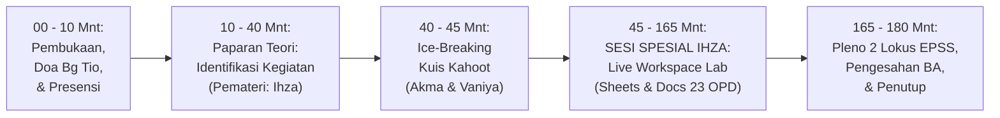

# MODUL PERTEMUAN 01: IDENTIFIKASI KEGIATAN STATISTIK & KICKOFF LIVE WORKSPACE
## Sesi 1 dari 4: Identifikasi Sektoral, Seleksi 2 Lokus Utama EPSS 2028, & Kolaborasi Digital

**Kode Dokumen:** `PSS2026-PLAN-S1`  
**Waktu Pelaksanaan:** Rabu, 28 Oktober 2026 (08.30 – 11.30 WIB / 180 Menit)  
**Tempat:** Ruang Rapat BPS / Mempawah Command Centre (MCC) Diskominfo  
**Pemateri Utama:** **Ihza Fikri Zaki Karunia, S.Tr.Stat.**  
**Panitia Bertugas:**
- **MC & Pemandu:** Vaniya
- **Doa Pembuka Hari Pertama:** Bg Tio
- **Operator Slide & Kuis Kahoot:** Akma
- **Registrasi & Presensi:** Mahasiswa Magang, Nadya, dan Rara (dibimbing Mbak Uma)
- **Dokumentasi Foto/Video:** Irfan
- **Pengadaan Snack & Hadiah Kahoot:** Vaniya
- **Rekapitulasi Berkas & SPJ:** Sukma
- **Tim Pendamping Teknis:** Tim 1 (Sukma), Tim 2 (Ihza), Tim 3 (Listio), Tim 4 (Aller), Tim 5 (Aul & Uma)

---

## 🎯 1. Target Kinerja Sesi 1 & Bukti Dukung EPSS Terkunci

Pertemuan 1 meletakkan pondasi seluruh kegiatan statistik daerah dan mengunci indikator kunci EPSS:
- **Indikator 20101 (Relevansi Data - Target Level 4):** Berita Acara Penetapan Kegiatan Prioritas yang selaras dengan IKU Kepala Daerah.
- **Indikator 20102 (Identifikasi Kebutuhan Data - Target Level 4):** Dokumen inventarisasi kebutuhan data rutin dari 23 OPD.
- **Indikator 30101 (Pendefinisian Kebutuhan Statistik - Target Level 4):** Standardisasi judul kegiatan, variabel, dan cara pengumpulan data.
- **Indikator 40301 (Kolaborasi Penyelenggaraan Statistik - Target Level 4):** Kolaborasi aktif antara Pembina (BPS), Walidata (Diskominfo), dan 23 OPD Produsen Data.

---

## ⏱️ 2. Susunan Acara & Alokasi Waktu (180 Menit / 3 Jam)

| Rentang Waktu | Durasi | Agenda Kegiatan | Penanggung Jawab / Fasilitator |
|:---:|:---:|:---|:---|
| 08.30 – 08.40 | 10 Mnt | Registrasi peserta, pembukaan oleh MC (Vaniya), dan Doa Pembuka resmi | Vaniya & Bg Tio |
| 08.40 – 09.10 | 30 Mnt | **Paparan Materi: Identifikasi Kegiatan Statistik Sektoral** (Slide Ringkas & Lugas) | **Ihza** (Operator: Akma) |
| 09.10 – 09.15 | 5 Mnt | **Ice-Breaking: Kuis Kahoot Interaktif Sesi 1** (Hadiah Rp40.000 untuk 1 Pemenang) | Akma & Vaniya |
| 09.15 – 10.35 | 80 Mnt | **SESI SPESIAL KAWALAN IHZA: Live Action Lab Google Sheets & Docs** • Pembagian tautan QR Code Google Sheets "Radar EPSS Mempawah" • Pendampingan serentak 23 OPD oleh 5 Tim BPS • Pengisian Form 1-Lembar Inventarisasi Kegiatan Statistik | **Ihza** & 5 Tim Pendamping (Sukma, Ihza, Listio, Aller, Aul) |
| 10.35 – 11.15 | 40 Mnt | **Bedah 1 Contoh Nyata & Pleno Penetapan 2 Lokus Emas EPSS 2028:** • Live demo pengisian dossier Profil Kesehatan Dinkes di Google Docs • Pleno penetapan Dinkes-PPKB & Disperindagnaker sebagai Lokus Emas | Ihza, Walidata Diskominfo, & Bapperida |
| 11.15 – 11.30 | 15 Mnt | Penandatanganan Berita Acara Penetapan Lokus, foto bersama, & arahan Sesi 2 | Vaniya, Irfan (Foto), & Sukma |

---

## 📚 3. Paparan Materi: Identifikasi Kegiatan Statistik (Pemateri: Ihza - 30 Menit)

Ihza memaparkan materi inti menggunakan slide padat (maksimal 6 slide), bahasa membumi, dan contoh konkret:

### Slide 1: Mengapa Kita Harus Bersiap Sekarang? (EPSS 2028 Dimulai Hari Ini!)
- Evaluasi Penyelenggaraan Statistik Sektoral (EPSS) mengevaluasi bukti dukung 2 tahun ke belakang.
- **Kegiatan statistik yang bapak/ibu jalankan di tahun 2026 adalah objek yang dinilai pada EPSS 2028.**
- Di masa lalu (EPSS 2026), Mempawah sempat anjlok ke Skor 1 di 10 indikator karena bukti dukung baru dicari saat penilaian tiba. Hari ini kita balik: **Bukti dukung kita amankan bersamaan dengan berjalannya kegiatan!**

### Slide 2: Mengenal 3 Cara Pengumpulan Statistik Sektoral
- **Survei:** Mengambil sebagian sampel responden (misal: Survei Kepuasan Pasien di RSUD dr. Rubini).
- **Sensus:** Mencacah seluruh populasi target tanpa kecuali (misal: Pendataan seluruh pabrik industri di Mempawah).
- **Kompilasi Produk Administrasi (KOMPROMIN):** Mengolah dan merekapitulasi buku register pelayanan harian dinas menjadi data agregat tahunan (misal: Kompilasi Profil Kesehatan dari puskesmas, Kompilasi Data AK-1 Pencari Kerja).  
  > *Catatan Emas:* **90% kegiatan statistik di OPD Pemkab Mempawah adalah Kompromin!**

### Slide 3: Formula Baku Penulisan Judul Kegiatan Statistik (Standar BPS)
Banyak judul kegiatan OPD ditolak BPS karena rancu dengan nomenklatur kegiatan anggaran. Gunakan rumus baku 4 elemen:
$$\mathbf{[Cara\ Pengumpulan]} + \mathbf{[Objek\ Data]} + \mathbf{[Cakupan\ Wilayah]} + \mathbf{[Tahun]}$$
- *Contoh Salah:* Kegiatan Pelayanan Kesehatan Masyarakat (Ini nama program APBD, bukan nama data!).
- *Contoh Benar 1:* **Kompilasi Data Profil Kesehatan Kabupaten Mempawah Tahun 2026** (Dinkes).
- *Contoh Benar 2:* **Kompilasi Data Pencari Kerja Terdaftar dan Penempatan Tenaga Kerja Kabupaten Mempawah Tahun 2026** (Disperindagnaker).

### Slide 4: Doktrin "2 Lokus Utama dari 23 OPD" Menuju Nilai Maksimal
- BPS RI dalam penilaian EPSS hanya mengambil sampel **2 Kegiatan Statistik Sektoral** dari Pemerintah Daerah.
- Seluruh 23 OPD hari ini kita bina agar tertib administrasi dan paham Satu Data Indonesia.
- Namun, energi pengawalan berkas tebal akan kita fokuskan pada **2 OPD Lokus Utama (Golden Lokus)** agar nilai bukti dukungnya tembus Skor 4 dan 5 sempurna!

### Slide 5: Kriteria Pemilihan 2 Lokus Utama
1. **Dukungan Prioritas Daerah:** Mendukung Indikator Kinerja Utama (IKU) Bupati atau target RPJMD (misal: Penurunan Stunting, Penyerapan Tenaga Kerja, Pengendalian Inflasi).
2. **Keteraturan & Rutinitas:** Diterbitkan secara berkala setiap tahun dan memiliki rekapitulasi data historis minimal 3–5 tahun terakhir.
3. **Cakupan Wilayah:** Mencakup seluruh 9 kecamatan di Kabupaten Mempawah.
4. **Komitmen Pimpinan & Operator:** Siap menandatangani KAK, SOP, dan Surat Pernyataan Netralitas bersama BPS.

### Slide 6: Bantuan Otomasi Digital & Kolaborasi Live
BPS Mempawah tidak membiarkan operator mengetik sendirian di rumah. Hari ini kita bekerja bersama di satu layar Google Sheets dan Google Docs bersama!

---

## 🏆 4. Ice-Breaking: Kuis Kahoot Sesi 1 (Operator: Akma & MC: Vaniya - 5 Menit)

Untuk menyegarkan suasana dan menguji pemahaman peserta sebelum masuk ke sesi teknis:
- **Platform:** Kahoot.it (PIN ditampilkan oleh Akma di layar proyektor).
- **Hadiah:** Uang pembinaan / saldo digital Rp40.000 langsung diserahkan oleh Vaniya kepada 1 pemenang skor tertinggi.
- **Materi Soal (5 Soal Cepat):**
  1. *Apa singkatan dari KOMPROMIN?* (Jawaban: Kompilasi Produk Administrasi).
  2. *Data register pelayanan posyandu dan puskesmas yang direkap tiap bulan termasuk jenis apa?* (Jawaban: Kompromin).
  3. *Berapa jumlah kegiatan statistik yang dinilai oleh Tim Penilai Badan pada EPSS?* (Jawaban: 2 Kegiatan).
  4. *Manakah judul kegiatan statistik yang memenuhi kaidah standar BPS?* (Jawaban: Kompilasi Data Profil Kesehatan Kab. Mempawah 2026).
  5. *Tahun berapakah hasil pembinaan statistik kita hari ini akan dinilai pada EPSS?* (Jawaban: EPSS 2028).

---

## 💻 5. SESI SPESIAL KAWALAN IHZA: Live Action Lab Google Sheets & Docs (120 Menit)

Inilah sesi inti di mana Ihza mengambil alih panggung dan menggerakkan seluruh 23 OPD ke dalam satu ekosistem kerja digital:

### 5.1 Peluncuran Google Sheets Bersama: "Radar EPSS Mempawah 2026–2028"
- Ihza menampilkan QR Code dan tautan pendek (`bit.ly/sandi-epss-mempawah`) di layar proyektor.
- Seluruh operator membuka laptop masing-masing dan masuk ke lembar kerja bersama.
- **Struktur Sheet Kolaboratif:**
  - **Tab 'LEADERBOARD 23 OPD':** Berisi daftar 23 OPD, nama operator, nomor WhatsApp, nama kegiatan statistik yang diajukan, dan status lampu indikator (*Merah = Belum Isi, Kuning = Draf Masuk, Hijau = Terverifikasi BPS*).
  - **Tab 'TIM 1 s.d. TIM 5':** Meja kerja pendampingan teknis di mana operator berinteraksi langsung dengan ketua tim pendampingnya.

### 5.2 Pendampingan Serentak oleh 5 Tim BPS (40 Menit)
Setiap tim mendampingi 4–5 OPD dampingannya untuk mengisi Form 1-Lembar LK-01 langsung di Google Sheets:
- **Tim 1 (Sukma & Nadya):** Mendampingi BKPSDM, Bakesbangpol, BPKAD, BPPRD, dan Inspektorat.
- **Tim 2 (Ihza & Magang 1):** Mendampingi **Dinkes-PPKB (Lokus 1)**, RSUD dr. Rubini, Dinsos-P3APMPD, dan Disdukcapil.
- **Tim 3 (Listio & Irfan):** Mendampingi **Disperindagnaker (Lokus 2)**, DPMPTSP-KUKM, DPKP (Pertanian), dan Dishub-LH.
- **Tim 4 (Aller & Rara):** Mendampingi DPUPR, BPBD, Satpol PP, Dispersip, dan Setwan.
- **Tim 5 (Aul & Uma):** Mendampingi Bapperida, Diskominfo, Disdikporapar, dan Setda.

### 5.3 Live Typed Demonstration: Bedah 1 Contoh Nyata di Google Docs (40 Menit)
- Ihza membuka file Google Docs Master di proyektor: **"Dossier Bukti Dukung: Kompilasi Data Profil Kesehatan Kabupaten Mempawah 2026"**.
- Ihza memandu operator Dinkes (dan disaksikan seluruh 22 OPD lainnya) cara mengisi komponen penting:
  1. *Menulis Identitas Variabel Utama:* Jumlah Balita Stunting, Angka Kematian Ibu, Cakupan Imunisasi Dasar Lengkap.
  2. *Menyusun Alur Pengumpulan Data Rutin dari Puskesmas.*
  3. *Menetapkan Jadwal Rilis Diseminasi Resmi (ARC):* Dikunci pada 31 Oktober 2026.
- Menunjukkan bahwa proses ini **tidak rumit dan tidak memakan waktu lama** jika menggunakan template standar BPS.

### 5.4 Pleno Kilat Pengesahan 2 Lokus Utama Calon EPSS 2028 (20 Menit)
BPS Mempawah bersama Dinas Kominfo (Walidata) dan Bapperida menetapkan secara resmi 2 Lokus Utama:
1. **Lokus Utama 1:** **Dinas Kesehatan, Pengendalian Penduduk dan KB (Dinkes-PPKB)**  
   *Nama Kegiatan:* **Kompilasi Data Profil Kesehatan Kabupaten Mempawah Tahun 2026**
2. **Lokus Utama 2:** **Dinas Perindustrian, Perdagangan, dan Tenaga Kerja (Disperindagnaker)**  
   *Nama Kegiatan:* **Kompilasi Data Pencari Kerja Terdaftar (AK-1) dan Penempatan Tenaga Kerja Kabupaten Mempawah Tahun 2026**

---

## 📦 6. Deliverables Bukti Fisik yang Dihasilkan pada Sesi 1

1. **Rekapitulasi Inventarisasi Kegiatan Statistik Sektoral 23 OPD di Google Sheets:**  
   Menjadi bukti fisik mutlak untuk **Indikator 20102** (Identifikasi Kebutuhan Data) dan **30101** (Pendefinisian Kebutuhan Statistik).
2. **Berita Acara Penetapan 2 Kegiatan Prioritas Calon Lokus EPSS 2028:**  
   Ditandatangani oleh Kepala BPS, Kadiskominfo, Kepala Bapperida, Kadinkes, dan Kadisperindag. Mengunci **Indikator 20101** (Relevansi Data) dan **40301** (Kerja Sama Sektoral).
3. **Dokumentasi Lengkap Sesi 1 untuk Portal SPESIAL:**  
   Undangan, Daftar Hadir (37 peserta fisik), Notula Rapat resmi, Slide Materi Ihza, Hasil Tangkapan Layar Kuis Kahoot (Juara 1), dan Foto Dokumentasi oleh Irfan.

---

## 📌 7. Arahan Menuju Pertemuan 2 (Rabu, 4 November 2026)
Operator 23 OPD **TIDAK DIBERI PR MENGETIK DI RUMAH**. Cukup:
1. Operator Dinkes dan Disperindag membawa tabel angka data tahunan (format Excel biasa).
2. Membawa draf blangko pengumpulan data rutin puskesmas / pendaftaran pencari kerja.
3. Menyiapkan laptop dan charger untuk sesi praktek Kualitas Data dan Standar Data Statistik bersama Mbak Uma dan Ihza di Pertemuan 2.