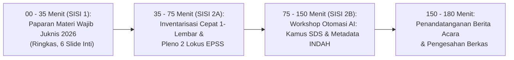

# MODUL PERTEMUAN 01: KICK-OFF PEMBINAAN, PRINSIP SDI, & PENETAPAN LOKUS EPSS 2028
## Sesi 1 dari 4: Sinergi Satu Data Indonesia & Identifikasi Cepat Rendah Beban Kognitif
**Kode Dokumen:** `PSS2026-PLAN-S1`  
**Alokasi Waktu:** 180 Menit (3 Jam Penuh)  
**Tempat:** Mempawah Command Centre (MCC) / Aula Bapperida  
**Penyelenggara:** Tim Pembina Statistik Sektoral BPS Kabupaten Mempawah bersama Dinas Kominfo (Walidata)  
**Sasaran Peserta:** Operator Data Seluruh OPD Pemkab Mempawah, Tim Walidata Diskominfo, dan Fungsional Perencana Bapperida  

---

## 🎯 1. Target Kinerja Sesi 1 & Keterkaitan Indikator EPSS 2028

Pertemuan 1 memadatkan materi pembinaan hulu dan mengunci **Domain 1 EPSS (Bobot 28%!)** serta persiapan kegiatan prioritas:
- **Indikator 10101 (Standar Data Statistik - Target Level 4):** Kamus SDS baku disahkan BPS.
- **Indikator 10201 (Metadata Statistik - Target Level 4):** Registrasi MS-Keg dan MS-Var di Portal INDAH BPS.
- **Indikator 10301 (Interoperabilitas Data - Target Level 4):** Format data terbuka .csv dan keterhubungan API Portal SDI Mempawah.
- **Indikator 10401 (Kode Referensi & Data Induk - Target Level 4):** Standardisasi kode wilayah Kemendagri & KBLI/KBJI.
- **Indikator 20101, 20102, 30101, 40301 (Identifikasi & Seleksi Lokus):** Berita Acara Penetapan 2 Kegiatan Prioritas.

---

## ⏱️ 2. Pembagian Waktu Sesi (Total 180 Menit)



---

## 📚 3. SISI 1: Paparan Materi Wajib Statistik Sektoral (35 Menit / 6 Slide Inti)

Fasilitator BPS menyampaikan paparan esensial dengan ringkas, lugas, dan bebas jargon membingungkan:

### Slide 1: Mengapa Kita Berkumpul Hari Ini? (EPSS 2028 Dimulai Sekarang!)
- Evaluasi Penyelenggaraan Statistik Sektoral (EPSS) adalah evaluasi kinerja 2 tahunan.
- **Kegiatan statistik yang bapak/ibu laksanakan di dinas pada tahun 2026 adalah data yang dinilai pada EPSS 2028.**
- Di masa lalu (EPSS 2026), Mempawah sempat anjlok ke Skor 1 di 10 indikator karena bukti dukung tidak disiapkan saat kegiatan berlangsung.
- Hari ini kita ubah: BPS mendampingi operator dinas agar **seluruh bukti fisik selesai bersamaan dengan selesainya kegiatan**.

### Slide 2: Jenis Kegiatan Statistik Sektoral (Sensus, Survei, Kompromin)
- **Bukan Semua Data itu Kegiatan Statistik:** Surat masuk, absen dinas, dan kuitansi SPJ adalah data administrasi kantor.
- **3 Cara Pengumpulan Statistik Sektoral:**
  1. *Survei:* Mengambil sampel (misal: Survei Kepuasan Pasien RSUD).
  2. *Sensus:* Mencacah seluruh unit (misal: Pendataan Seluruh Industri Pabrik Sawit).
  3. *Kompilasi Produk Administrasi (KOMPROMIN):* Mengolah dan merekapitulasi catatan harian pelayanan dinas menjadi data agregat (misal: Kompilasi Profil Kesehatan dari puskesmas, Kompilasi Data Pencari Kerja AK-1 dari register dinas). *Mayoritas kegiatan OPD Mempawah adalah Kompromin!*

### Slide 3: Empat Prinsip Satu Data Indonesia (Perpres 39/2019 - Bobot EPSS 28%)
1. **Standar Data Statistik (SDS):** Konsep jelas, definisi terukur, satuan baku, dan klasifikasi standar (KBLI, ICD-10).
2. **Metadata Statistik:** Informasi terstruktur pelabel data (MS-Kegiatan & MS-Variabel) via portal INDAH BPS.
3. **Interoperabilitas Data:** Data mudah dibagipakaikan dalam format terbuka (.csv, .xlsx, REST-API).
4. **Kode Referensi & Data Induk:** Menggunakan kode wilayah Kemendagri (bukan nama desa manual yang rentan salah ketik).

### Slide 4: Kaidah Baku Penulisan Judul Kegiatan
Formula judul standar BPS:
$$\textbf{[Cara Pengumpulan]} + \textbf{[Objek Data]} + \textbf{[Cakupan Wilayah]} + \textbf{[Tahun]}$$
- *Contoh Benar 1:* **Kompilasi Data Profil Kesehatan Kabupaten Mempawah Tahun 2026** (Dinkes).
- *Contoh Benar 2:* **Kompilasi Data Pencari Kerja Terdaftar dan Penempatan Tenaga Kerja Kabupaten Mempawah Tahun 2026** (Disperindagnaker).

### Slide 5: Kriteria Penetapan 2 Kegiatan Prioritas Calon Lokus EPSS 2028
1. Mendukung Indikator Kinerja Utama (IKU) Kepala Daerah / RPJMD Mempawah.
2. Rutin dilaksanakan dan diterbitkan setiap tahun (*sustainable*).
3. Memiliki cakupan seluruh 9 kecamatan di Kabupaten Mempawah.
4. Pimpinan OPD dan operator berkomitmen melengkapi bukti dukung bersama BPS.

### Slide 6: Skema Bantuan Otomasi BPS untuk Operator OPD
- Operator dinas tidak dibebani mengetik dokumen metodologi berpuluh-puluh halaman.
- BPS menyediakan **Template Siap Pakai** dan **Mesin Otomasi AI Generator**: cukup setorkan tabel angka mentah, naskah standar akan ter-generate otomatis!

---

## 🛠️ 4. SISI 2: Workshop Rendah Beban Kognitif & Otomasi AI (145 Menit)

### 4.1 Tahap A: Pengisian Cepat Form Inventarisasi 1-Lembar (20 Menit)
Operator OPD cukup mengisi formulir ringkas tanpa perlu berpikir rumit:

```markdown
FORM INVENTARISASI CEPAT KEGIATAN STATISTIK OPD (LK-01)
Nama OPD      : ................................................................
Nama Operator : ................................. (WhatsApp: ....................)

Tuliskan maksimal 3 kegiatan pendataan/rekapitulasi rutin yang ada di dinas bapak/ibu:
1. Nama Pendataan  : ...........................................................
   Cara Pengumpulan: [ ] Kompromin / [ ] Survei / [ ] Sensus
   Unit Sumber Data: [ ] Puskesmas / [ ] Sekolah / [ ] Perusahaan / [ ] Desa
   Periode Rilis   : [ ] Bulanan / [ ] Triwulanan / [ ] Tahunan
   Keluaran Utama  : ...........................................................

2. Nama Pendataan  : ...........................................................
   Cara Pengumpulan: [ ] Kompromin / [ ] Survei / [ ] Sensus
   Unit Sumber Data: ...........................................................
   Periode Rilis   : [ ] Bulanan / [ ] Triwulanan / [ ] Tahunan
   Keluaran Utama  : ...........................................................
```

### 4.2 Tahap B: Pleno Kilat Penetapan 2 Kegiatan Prioritas Calon EPSS 2028 (20 Menit)
- BPS, Diskominfo, dan Bapperida mereviu cepat form LK-01 yang terkumpul.
- Menetapkan secara resmi 2 kegiatan prioritas yang akan dikawal dari hulu ke hilir:
  1. **Dinas Kesehatan (Dinkes-PPKB):** *Kompilasi Data Profil Kesehatan Kabupaten Mempawah Tahun 2026*.
  2. **Dinas Perindustrian, Perdagangan, dan Tenaga Kerja (Disperindagnaker):** *Kompilasi Data Pencari Kerja Terdaftar (AK-1) dan Penempatan Tenaga Kerja Kabupaten Mempawah Tahun 2026*.

### 4.3 Tahap C: Otomasi AI Penyusunan Kamus Standar Data & Metadata INDAH (75 Menit)
- Operator menyerahkan daftar kolom/tabel yang biasa dikumpulkan di dinasnya.
- **Pemanfaatan Tool Otomasi AI (`scripts/kb_pss_automation.py`)**:
  - Script membaca struktur kolom data Excel dinas.
  - LLM API secara otomatis memetakan variabel ke **Kamus Standar Data Statistik (SDS)** dan menghasilkan draft **Metadata Variabel (MS-Var)** berformat INDAH BPS!
- Operator dan mentor BPS tinggal memverifikasi kesesuaian satuan dan definisi.
- Mengunggah metadata ke portal INDAH BPS (`https://indah.bps.go.id/`).

### 4.4 Tahap D: Penandatanganan Berita Acara & Pengesahan (30 Menit)
- Penandatanganan Berita Acara Penetapan Kegiatan Prioritas oleh Kepala BPS, Kepala Diskominfo, Kepala Bapperida, dan Kepala OPD terpilih.
- Penandatanganan Lembar Pengesahan Standar Data Statistik oleh Pembina Data BPS.

---

## 📦 5. Deliverables Bukti Fisik yang Dihasilkan pada Sesi 1

1. **Dokumen Rekapitulasi Inventarisasi Kegiatan Statistik Sektoral Pemkab Mempawah 2026:**
   - Menjadi bukti fisik mutlak untuk **Indikator 20102** (Proses Identifikasi Kebutuhan Data) dan **30101** (Pendefinisian Kebutuhan Statistik).
2. **Berita Acara Penetapan 2 Kegiatan Statistik Prioritas Calon Lokus EPSS 2028:**
   - Menjadi bukti fisik mutlak untuk **Indikator 20101** (Relevansi Data) dan **40301** (Kolaborasi Penyelenggaraan Statistik).
3. **Dokumen Kamus Standar Data Statistik (SDS) yang Disahkan Pembina Data BPS:**
   - Mengunci **Indikator 10101 pada Level 4/5**.
4. **Form Metadata Statistik Variabel (MS-Var) Berstatus Terdaftar di Portal INDAH BPS:**
   - Mengunci **Indikator 10201 pada Level 4**.
5. **Paket Dokumentasi Sesi 1 untuk Portal SPESIAL:**
   - Undangan, Daftar Hadir, Notula Rapat, Materi Paparan 6 Slide, dan Foto Dokumentasi.

---

## 📌 6. Arahan Menuju Pertemuan 2 (Beban Operator Sangat Ringan)
Operator OPD **TIDAK PERLU mengetik apapun di rumah**. Cukup:
1. Membawa DPA dinas tahun 2026 yang memuat nama anggaran kegiatan prioritas.
2. Membawa draf kuesioner / blangko Excel yang dikirimkan ke unit pelapor (puskesmas/perusahaan).
3. Mengetahui nama lengkap dan NIP Kepala Dinas untuk penyiapan naskah Surat Pernyataan Netralitas (Template A) pada Pertemuan 2.
