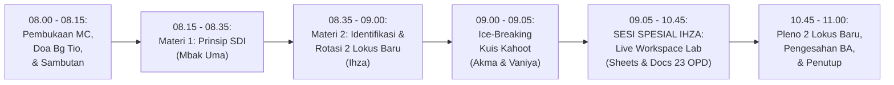

# MODUL PERTEMUAN 01: PRINSIP SATU DATA INDONESIA, IDENTIFIKASI KEGIATAN STATISTIK, & KICKOFF LOKUS
## Sesi 1 dari 4: Sinergi SDI Daerah, Seleksi 2 Lokus Baru EPSS 2028 (BPKAD & DPMPTSPKUKM), & Peluncuran Live Workspace

**Kode Dokumen:** `PSS2026-PLAN-S1`  
**Dasar Surat Resmi:** Surat Sekretaris Daerah Kabupaten Mempawah Nomor `500.14.1/7358/DISKOMINFO-C` hal *Pelaksanaan Pembinaan Statistik Sektoral Kabupaten Mempawah Tahun 2026*  
**Waktu Pelaksanaan:** **Rabu, 4 November 2026 (08.00 – 11.00 WIB / 180 Menit)**  
**Tempat Penyelenggaraan:** **Mempawah Command Center (MCC)**, Dinas Komunikasi dan Informatika Kabupaten Mempawah  
**Sasaran Peserta (37 Orang):** 23 Tenaga Entri Data OPD (sesuai lampiran surat Sekda), 4 Tim Walidata Diskominfo, 7 Pegawai Organik BPS, dan 3 Mahasiswa Magang BPS.  
**Pemateri Resmi:**
- **Materi 1 (Prinsip Satu Data Indonesia / SDI):** **Mbak Uma (Sukmawati, S.E.)**
- **Materi 2 (Identifikasi Kegiatan Statistik & Rotasi 2 Lokus Baru):** **Ihza Fikri Zaki Karunia, S.Tr.Stat.**

**Panitia Bertugas:**
- **MC & Pemandu:** Vaniya
- **Doa Pembuka Hari Pertama:** Bg Tio (Listio, S.Tr.Stat.)
- **Operator Slide & Kuis Kahoot:** Akma
- **Registrasi & Presensi Peserta:** Mahasiswa Magang, Nadya, dan Rara (dibimbing Mbak Uma)
- **Dokumentasi Foto/Video Kegiatan:** Irfan
- **Pengadaan Snack (40 Porsi) & Hadiah Kahoot:** Vaniya
- **Rekapitulasi Berkas & SPJ Administrasi:** Sukma
- **Tim Pendamping Teknis (5 Tim):** Tim 1 (Sukma & Nadya), Tim 2 (Ihza & Magang 1), Tim 3 (Listio & Irfan), Tim 4 (Aller & Rara), Tim 5 (Aul & Uma)

---

## 🎯 1. Target Kinerja Sesi 1: Dual Impact (TPSS 2026 x EPSS 2028)

Pertemuan 1 meletakkan fondasi kegiatan statistik daerah dan mengunci indikator kunci secara simultan:

### A. Penguncian Indikator IKU TPSS BPS Mempawah (Menuju Target Satker 99.09)
- **Indikator U231 (Materi Wajib SDI):** Langsung bernilai **100% (Membuka Poin Penuh)** begitu paparan Mbak Uma disajikan.
- **Indikator U241 & U242 (Keterlibatan Walidata & Produsen Data):** Langsung bernilai **100%** dengan hadirnya 4 tim Diskominfo dan 23 operator OPD di MCC.
- **Poin Kenaikan TPSS:** Bertambah **+6.00%**, mengerek posisi TPSS dari **67.71% menjadi 73.71%** (memangkas defisit menuju target **99.09**).

### B. Penguncian Bukti Dukung EPSS Pemkab Mempawah 2028
- **Indikator 10101 & 10201 (SDI & Metadata - Target Level 4):** Pemahaman 4 Prinsip SDI dan inisiasi Standar Data & Metadata INDAH BPS.
- **Indikator 20101 (Relevansi Data - Target Level 4):** Berita Acara Penetapan 2 Kegiatan Prioritas Baru (BPKAD & DPMPTSPKUKM) yang selaras dengan IKU Kepala Daerah.
- **Indikator 20102 (Identifikasi Kebutuhan Data - Target Level 4):** Dokumen inventarisasi kebutuhan data rutin dari 23 tenaga entri data OPD.
- **Indikator 30101 (Pendefinisian Kebutuhan Statistik - Target Level 4):** Standardisasi judul kegiatan, variabel, dan cara pengumpulan data (Kompromin).
- **Indikator 40301 (Kolaborasi Penyelenggaraan Statistik - Target Level 4):** Kolaborasi aktif antara Pembina (BPS), Walidata (Diskominfo), dan 23 OPD Produsen Data.

---

## ⏱️ 2. Susunan Acara & Alokasi Waktu (180 Menit / 3 Jam)

| Rentang Waktu | Durasi | Agenda Kegiatan di Mempawah Command Center (MCC) | Penanggung Jawab / Fasilitator |
|:---:|:---:|:---|:---|
| 08.00 – 08.15 | 15 Mnt | Registrasi peserta, pembagian snack (Vaniya), pembukaan oleh MC (Vaniya), Doa Pembuka oleh Bg Tio, dan Sambutan | Vaniya & Bg Tio |
| 08.15 – 08.35 | 20 Mnt | **Materi 1: Empat Prinsip Satu Data Indonesia (Perpres No. 39/2019)** (Slide Ringkas & Visual) | **Mbak Uma** (Operator: Akma) |
| 08.35 – 09.00 | 25 Mnt | **Materi 2: Identifikasi Kegiatan Statistik, Mengenal Kompromin, & Rotasi 2 Lokus Baru EPSS 2028** | **Ihza** (Operator: Akma) |
| 09.00 – 09.05 | 5 Mnt | **Ice-Breaking: Kuis Kahoot Interaktif Sesi 1** (Hadiah Rp40.000 untuk 1 Pemenang Skor Tertinggi) | Akma & Vaniya |
| 09.05 – 10.15 | 70 Mnt | **SESI SPESIAL KAWALAN IHZA: Live Action Lab Google Sheets "Radar EPSS Mempawah"** • Pembagian tautan QR Code Google Sheets ke laptop seluruh operator OPD • Pendampingan serentak 23 OPD oleh 5 Tim BPS • Pengisian serentak Form 1-Lembar Inventarisasi Kegiatan Statistik (LK-01) | **Ihza** & 5 Tim Pendamping (Sukma, Ihza, Listio, Aller, Aul) |
| 10.15 – 10.45 | 30 Mnt | **Bedah 1 Contoh Nyata di Google Docs & Pleno Pengesahan 2 Lokus Emas Baru:** • Live demo pengisian dossier Pelayanan Perizinan DPMPTSPKUKM & LKPD BPKAD • Pleno pengesahan BPKAD & DPMPTSPKUKM sebagai 2 Lokus Baru Resmi Terdaftar BPS | Ihza, Walidata Diskominfo, & Bapperida |
| 10.45 – 11.00 | 15 Mnt | Penandatanganan Berita Acara Penetapan Lokus, foto bersama oleh Irfan, & arahan Sesi 2 | Vaniya, Irfan, & Sukma (SPJ) |

---

## 📚 3. Paparan Materi Sesi 1

### 3.1 Materi 1: Empat Prinsip Satu Data Indonesia (Pemateri: Mbak Uma - 20 Menit)
1. **Standar Data Statistik (SDS):** Konsep, definisi, satuan, ukuran, dan klasifikasi baku. Data tidak boleh ambigu (misal: PAD vs Belanja, NIB Berusaha vs Non-Berusaha).
2. **Metadata Statistik:** Identitas pelabel data (MS-Keg dan MS-Var) yang wajib diregistrasikan di Portal INDAH BPS.
3. **Interoperabilitas Data (Level 5 Terpenuhi):** Format data terbuka tabular (.csv, .xlsx) yang telah aktif dan dapat diakses publik via REST API Portal CKAN Satu Data Mempawah di **`https://satudata.mempawahkab.go.id/api/3/action/package_search`**.
4. **Kode Referensi & Data Induk:** Menggunakan kode wilayah ganda Kemendagri (`6102`) dan BPS (`6104`) yang telah terbukti tertanam rapi di dalam berkas CSV publik BPKAD dan DPMPTSPKUKM pada portal CKAN Mempawah.

### 3.2 Materi 2: Identifikasi Kegiatan Statistik & Rotasi 2 Lokus Baru (Pemateri: Ihza - 25 Menit)
Ihza memaparkan materi inti dengan bahasa lugas dan to-the-point:
1. **EPSS 2028 Dimulai Hari Ini:** Data kegiatan statistik yang dikumpulkan dan dirilis oleh dinas pada tahun 2026 adalah data yang dinilai pada EPSS 2028.
2. **Kompilasi Produk Administrasi (KOMPROMIN):**  
   - BPS meluruskan bahwa kegiatan statistik dinas tidak harus berupa sensus atau survei lapangan yang mahal.
   - Mengolah rekapitulasi register pelayanan dinas menjadi data agregat tahunan adalah kegiatan statistik sah berjenis **Kompromin**. **90% kegiatan OPD Mempawah adalah Kompromin!**
3. **Formula Baku Penulisan Judul Standar BPS:**
   $$\mathbf{[Cara\ Pengumpulan]} + \mathbf{[Objek\ Data]} + \mathbf{[Cakupan\ Wilayah]} + \mathbf{[Tahun]}$$
   - *Lokus 1:* **Kompilasi Data Laporan Keuangan Pemerintah Daerah Yang Di Audit Tahun 2026** (BPKAD).
   - *Lokus 2:* **Kompilasi Data Realisasi Pelayanan Perizinan Kabupaten Mempawah Tahun 2026** (DPMPTSPKUKM).
4. **Aturan Rotasi EPSS & 2 Lokus Emas Baru Terdaftar (PIC: `ihzakarunia`):**
   - Sesuai regulasi EPSS, Dinkes dan Disperindagnaker yang telah dinilai pada siklus 2024 **tidak boleh dipilih kembali berturut-turut**.
   - BPS Kabupaten Mempawah telah mendaftarkan secara resmi 2 Lokus Baru di sistem BPS wilayah 6104: **BPKAD** dan **DPMPTSPKUKM**.
   - Seluruh 23 OPD tetap dibina literasi dan standar datanya, tetapi energi pengawalan berkas tebal difokuskan pada 2 Lokus Emas ini agar nilainya tembus Skor 4 dan 5 sempurna!

---

## 🏆 4. Ice-Breaking: Kuis Kahoot Sesi 1 (Operator: Akma & MC: Vaniya - 5 Menit)

- **Platform:** Kahoot.it (PIN ditampilkan oleh Akma di layar proyektor MCC).
- **Hadiah:** Uang pembinaan / saldo digital Rp40.000 langsung diserahkan oleh Vaniya kepada Juara 1.
- **Materi Soal (5 Soal Cepat):**
  1. *Apa singkatan dari KOMPROMIN?* (Jawaban: Kompilasi Produk Administrasi).
  2. *Berapakah jumlah lokus kegiatan statistik yang dinilai oleh Tim Penilai Badan pada EPSS?* (Jawaban: 2 Kegiatan).
  3. *Mengapa Dinkes dan Disperindag tidak diajukan kembali pada pembinaan tahun 2026?* (Jawaban: Wajib rotasi lokus karena sudah dinilai pada siklus 2024).
  4. *Siapakah dua lokus resmi yang telah terdaftar di sistem BPS Mempawah untuk EPSS 2028?* (Jawaban: BPKAD dan DPMPTSPKUKM).
  5. *Format data manakah yang memenuhi prinsip interoperabilitas Satu Data?* (Jawaban: File CSV / Excel tabular terbuka).

---

## 💻 5. SESI SPESIAL KAWALAN IHZA: Live Action Lab Google Sheets & Docs (100 Menit)

Inilah panggung utama di mana Ihza menggerakkan seluruh 23 operator dinas ke dalam ekosistem kerja digital:

### 5.1 Peluncuran Google Sheets Bersama: "Radar EPSS Mempawah 2026–2028"
- Ihza menampilkan QR Code tautan Google Sheets bersama di layar raksasa Mempawah Command Center (MCC).
- Seluruh 23 operator membuka laptop masing-masing dan masuk ke lembar kerja bersama.
- **Leaderboard 23 OPD:** Menampilkan lampu indikator *Merah* (Belum Isi), *Kuning* (Draf Masuk), dan *Hijau* (Terverifikasi BPS).

### 5.2 Pendampingan Serentak oleh 5 Tim BPS (70 Menit)
Setiap tim mendampingi 4–5 OPD dampingannya untuk mengisi Form 1-Lembar LK-01 langsung di Google Sheets:
- **Tim 1 (Sukma & Nadya - Supervisi: Ihza):** Mendampingi **BPKAD (LOKUS 1 - PIC: ihzakarunia)**, BKPSDM, Bakesbangpol, BPPRD, dan Inspektorat.
- **Tim 2 (Ihza & Magang 1):** Mendampingi **DPMPTSPKUKM (LOKUS 2 - PIC: ihzakarunia)**, Dinas Kesehatan (Eks-Lokus 2024), RSUD dr. Rubini, Dinsos-P3APMPD, dan Disdukcapil.
- **Tim 3 (Listio & Irfan):** Mendampingi Disperindagnaker (Eks-Lokus 2024), Dinas Pertanian (DPKP), dan Dishub-LH.
- **Tim 4 (Aller & Rara):** Mendampingi DPUPR, BPBD, Satpol PP, Dispersip, dan Setwan.
- **Tim 5 (Aul & Uma):** Mendampingi Bapperida, Diskominfo, Disdikporapar, dan Setda.

### 5.3 Live Typed Demonstration: Bedah 1 Contoh Nyata di Google Docs (30 Menit)
- Ihza membuka file Google Docs Master di proyektor: **"Dossier Bukti Dukung: Kompilasi Data Realisasi Pelayanan Perizinan Kabupaten Mempawah Tahun 2026 (DPMPTSPKUKM)"**.
- Ihza memandu operator DPMPTSPKUKM dan BPKAD mengisi parameter:
  1. *Identitas Variabel:* Jumlah NIB Terbit OSS-RBA, Realisasi Investasi PMDN/PMA, dan Realisasi APBD/Neraca Aset.
  2. *Alur Data Rutin:* Penarikan data dari OSS-RBA / SiCANTIK Cloud dan Laporan Keuangan SKPD.
  3. *Jadwal Rilis Mengikat:* Dikunci pada **31 Agustus 2026 (BPKAD)** dan **30 November 2026 (DPMPTSPKUKM)**.

### 5.4 Pleno Kilat Pengesahan 2 Lokus Baru EPSS 2028 (15 Menit)
BPS Mempawah bersama Dinas Kominfo (Walidata) dan Bapperida menetapkan secara resmi 2 Lokus Baru:
1. **Lokus Utama 1:** **Badan Pengelola Keuangan dan Aset Daerah (BPKAD)**  
   *Nama Kegiatan:* **Kompilasi Data Laporan Keuangan Pemerintah Daerah Yang Di Audit Tahun 2026** (PIC: `ihzakarunia`)
2. **Lokus Utama 2:** **Dinas Penanaman Modal, Koperasi UKM dan PTSP (DPMPTSPKUKM)**  
   *Nama Kegiatan:* **Kompilasi Data Realisasi Pelayanan Perizinan Kabupaten Mempawah Tahun 2026** (PIC: `ihzakarunia`)

---

## 📦 6. Deliverables Bukti Fisik yang Dihasilkan pada Sesi 1

1. **Rekapitulasi Inventarisasi Kegiatan Statistik Sektoral 23 OPD di Google Sheets:**  
   Menjadi bukti fisik mutlak untuk **Indikator 20102** (Identifikasi Kebutuhan Data) dan **30101** (Pendefinisian Kebutuhan Statistik).
2. **Berita Acara Penetapan 2 Kegiatan Prioritas Baru Calon Lokus EPSS 2028:**  
   Ditandatangani oleh Kepala BPS, Kadiskominfo, Kepala Bapperida, Kepala BPKAD, dan Kepala DPMPTSPKUKM. Mengunci **Indikator 20101** (Relevansi Data) dan **40301** (Kerja Sama Sektoral).
3. **Dokumentasi Lengkap Sesi 1 untuk Portal SPESIAL:**  
   Surat Sekda No. `500.14.1/7358/DISKOMINFO-C`, Daftar Hadir fisik 37 peserta, Notula Rapat resmi, Slide Materi Mbak Uma & Ihza, Bukti Juara Kahoot Vaniya, dan Foto Dokumentasi oleh Irfan di MCC.

---

## 📌 7. Arahan Menuju Pertemuan 2 (Kamis, 5 November 2026 - Pukul 09.00 WIB)
1. Pertemuan ke-2 dilaksanakan **BESOK PAGI** di Mempawah Command Center (MCC) mulai pukul **09.00 WIB**.
2. Operator BPKAD membawa draf neraca/realisasi APBD, dan operator DPMPTSPKUKM membawa rekapitulasi data izin OSS.
3. Seluruh peserta membawa laptop untuk sesi bedah **Kualitas Data Statistik, Kamus SDS, dan Uji Konsistensi Data** bersama Ihza!