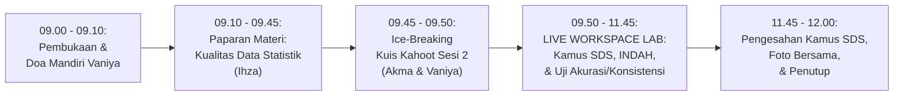

# MODUL PERTEMUAN 02: PENJAMINAN KUALITAS DATA STATISTIK
## Sesi 2 dari 4: Membalikkan 5 Indikator Kualitas Data dari Skor 1 ke Level 4/5, Kamus SDS, & Uji Konsistensi Logis

**Kode Dokumen:** `PSS2026-PLAN-S2`  
**Dasar Surat Resmi:** Surat Sekretaris Daerah Kabupaten Mempawah Nomor `500.14.1/7358/DISKOMINFO-C`  
**Waktu Pelaksanaan:** **Kamis, 5 November 2026 (09.00 – 12.00 WIB / 180 Menit)**  
**Tempat Penyelenggaraan:** **Mempawah Command Center (MCC)**, Dinas Komunikasi dan Informatika Kabupaten Mempawah  
**Sasaran Peserta (37 Orang):** 23 Tenaga Entri Data OPD, 4 Tim Walidata Diskominfo, 7 Pegawai Organik BPS, dan 3 Mahasiswa Magang BPS.  
**Pemateri Utama:** **Ihza Fikri Zaki Karunia, S.Tr.Stat.**  

**Panitia Bertugas:**
- **MC & Pemandu Doa Mandiri:** Vaniya
- **Operator Slide & Kuis Kahoot:** Akma
- **Registrasi & Presensi Peserta:** Mahasiswa Magang, Nadya, dan Rara
- **Dokumentasi Foto/Video:** Irfan
- **Pengadaan Snack & Hadiah Kahoot:** Vaniya
- **Rekapitulasi Berkas & SPJ:** Sukma
- **Tim Pendamping Teknis:** Tim 1 (Sukma & Nadya), Tim 2 (Ihza & Magang 1), Tim 3 (Listio & Irfan), Tim 4 (Aller & Rara), Tim 5 (Aul & Uma)

---

## 🎯 1. Target Kinerja Sesi 2: Dual Impact (TPSS 2026 x EPSS 2028)

Sesi 2 menyelesaikan tuntas indikator kualitas data statistik dan mengunci poin kedua sistem evaluasi:

### A. Penguncian Indikator IKU TPSS BPS Mempawah (Menuju Target Satker 99.09)
- **Indikator U232 (Materi Wajib Kualitas Data Statistik):** Langsung bernilai **100% (Membuka Poin Penuh)** begitu paparan Ihza selesai disajikan.
- **Poin Kenaikan TPSS:** Bertambah **+3.00%**, mengerek posisi kumulatif TPSS dari **73.71% menjadi 76.71%** (semakin memangkas defisit menuju target **99.09**).

### B. Penguncian Bukti Dukung EPSS Pemkab Mempawah 2028
- **Indikator 10101 (Standar Data Statistik - Level 4):** Dokumen Kamus SDS resmi disahkan Pembina Data BPS.
- **Indikator 10201 (Metadata Statistik - Level 4):** Registrasi Metadata Kegiatan (MS-Keg) dan Metadata Variabel (MS-Var) di Portal INDAH BPS.
- **Indikator 10301 (Interoperabilitas Data - Level 4):** Penyediaan data dalam format terstruktur dan terbuka (.csv/.xlsx).
- **Indikator 10401 (Kode Referensi & Data Induk - Level 4):** Pemadanan kode wilayah Kemendagri 9 kecamatan dan 67 desa/kelurahan Mempawah.
- **Indikator 20201 (Akurasi Data - Level 4):** Laporan 4 Tahap Pemeriksaan Akurasi Data + Berita Acara Rekonsiliasi / Sampling Ground Check (BPKAD & DPMPTSPKUKM).
- **Indikator 20501 (Keterbandingan Data - Level 4):** Laporan konsistensi metodologi tren data 3–5 tahun.
- **Indikator 20502 (Konsistensi Data - Level 4):** Lembar Verifikasi Uji Konsistensi Logis Searah 2 Variabel Terkait.

---

## ⏱️ 2. Susunan Acara & Alokasi Waktu (180 Menit / 3 Jam)



| Rentang Waktu | Durasi | Agenda Kegiatan di Mempawah Command Center (MCC) | Penanggung Jawab / Fasilitator |
|:---:|:---:|:---|:---|
| 09.00 – 09.10 | 10 Mnt | Pembukaan oleh MC (Vaniya), doa mandiri, dan review kilat progres penetapan lokus Sesi 1 | Vaniya & Ihza |
| 09.10 – 09.45 | 35 Mnt | **Paparan Materi: Kualitas Data Statistik & Menghapus Rekam Jejak Skor 1 di Pleno 2026** | **Ihza** (Operator: Akma) |
| 09.45 – 09.50 | 5 Mnt | **Ice-Breaking: Kuis Kahoot Interaktif Sesi 2** (Hadiah Rp40.000 untuk Juara 1) | Akma & Vaniya |
| 09.50 – 10.45 | 55 Mnt | **WORKSHOP LIVE 1: Penyusunan Kamus Standar Data Statistik (SDS) & INDAH BPS**<br>• Pengisian serentak Kamus Standar Data Statistik 23 OPD di Google Sheets bersama<br>• Pendampingan input form MS-Keg & MS-Var ke portal INDAH BPS | Mbak Uma, Ihza, & 5 Tim Pendamping |
| 10.45 – 11.45 | 60 Mnt | **WORKSHOP LIVE 2: Rekonsiliasi Akurasi 4 Tahap & Uji Konsistensi (2 Lokus Emas)**<br>• Pembuatan Laporan Akurasi 4 Tahap & BA Rekonsiliasi Kas/Belanja BPKAD<br>• Pembuatan Lembar Uji Konsistensi NIB OSS vs Investasi PMDN DPMPTSPKUKM | Ihza, Tim 1 (BPKAD), & Tim 2 (DPMPTSPKUKM) |
| 11.45 – 12.00 | 15 Mnt | Penandatanganan Lembar Pengesahan Kamus SDS oleh Pembina BPS & Penutupan | Ihza, Uma, & Sukma (SPJ) |

---

## 📚 3. Paparan Materi: Kualitas Data Statistik (Pemateri: Ihza - 35 Menit)

Ihza membedah secara gamblang dan jujur catatan Tim Penilai Provinsi EPSS 2026 agar tidak terulang di EPSS 2028:

### Slide 1: Mengapa Kualitas Data Mempawah Anjlok ke Skor 1 di Pleno 2026?
- Di pleno lalu, 5 indikator Domain 2 (Kualitas Data) Mempawah diberi nilai 1 karena:
  1. *Akurasi (20201):* Dinas hanya menyetor buku jadi tanpa ada dokumen proses pemeriksaan kesalahan atau uji petik.
  2. *Aktualitas (20301) & Ketepatan Waktu (20302):* Publikasi terbit terlambat lebih dari 1 tahun dari periode data.
  3. *Keterbandingan (20501) & Konsistensi (20502):* Angka antar publikasi berbeda dan tidak ada penjelasan korelasi logis.
- Hari ini di MCC, kita kunci bukti fisiknya agar semuanya naik ke **Level 4/5**!

### Slide 2: Empat Tahap Baku Pemeriksaan Akurasi Data (Quality Gates BPS)
1. **Tahap 1 (Completeness Check):** Memastikan 100% unit sumber data (seluruh SKPD untuk BPKAD / seluruh pemohon izin untuk DPMPTSP) telah menyetorkan data tanpa ada *missing values*.
2. **Tahap 2 (Anomali & Outlier Detection):** Memeriksa data ekstrem yang tidak wajar (misal: nilai belanja modal bernilai minus atau tanggal perizinan mendahului tanggal permohonan).
3. **Tahap 3 (Rekonsiliasi Wilayah & Silang Data):** Membandingkan data agregat dinas dengan data transaksi riil (kas daerah vs buku kas OPD / data OSS pusat vs register loket PTSP).
4. **Tahap 4 (Sampling Ground Check / Verifikasi Lapangan):** Melakukan uji petik faktual ke beberapa sampel transaksi untuk membuktikan integritas catatan.

### Slide 3: Mengunci Keterbandingan Waktu 5 Tahun (Indikator 20501)
- Data harus dapat dibandingkan antar-waktu (*time-series*) minimal 3–5 tahun terakhir (2021–2025).
- Jika ada perubahan regulasi atau perubahan sistem (misal: transisi SIMDA ke SIPD pada keuangan, atau transisi OSS 1.1 ke OSS-RBA pada perizinan), wajib dicantumkan **Catatan Metodologi Perubahan Sistem (*Methodological Footnote*)**.

### Slide 4: Mengunci Konsistensi Internal Statistik (Indikator 20502)
- Dua variabel yang saling berhubungan secara konseptual wajib memiliki pola pergerakan yang logis searah:
  - *Lokus BPKAD:* Kenaikan Realisasi Pendapatan Asli Daerah (PAD) berkorelasi positif dengan Kenaikan Realisasi Belanja Modal Infrastruktur Publik.
  - *Lokus DPMPTSPKUKM:* Kenaikan Jumlah Penerbitan NIB Usaha Mikro/Kecil berkorelasi positif dengan Kenaikan Realisasi Investasi Penanaman Modal Dalam Negeri (PMDN).

---

## 🏆 4. Ice-Breaking: Kuis Kahoot Sesi 2 (Operator: Akma & MC: Vaniya - 5 Menit)

- **Platform:** Kahoot.it (PIN di layar MCC).
- **Hadiah:** Uang pembinaan / voucher Rp40.000 untuk Juara 1.
- **Topik Kuis (5 Soal Cepat):**
  1. *Berapa tahap baku pemeriksaan akurasi data statistik menurut pedoman Quality Gates BPS?* (Jawaban: 4 Tahap).
  2. *Portal resmi BPS untuk pendaftaran Metadata Statistik Sektoral adalah...?* (Jawaban: INDAH BPS).
  3. *Apa yang harus dilakukan jika terjadi perubahan sistem aplikasi pencatatan data dalam deret waktu 5 tahun?* (Jawaban: Memberikan catatan metodologi perubahan sistem).
  4. *Jika pendapatan daerah naik drastis tetapi belanja modal dicatat turun drastis tanpa penjelasan, indikator kualitas apa yang terancam gugur?* (Jawaban: Konsistensi Statistik).
  5. *Apakah uji petik faktual lapangan (ground check) wajib didokumentasikan dalam berita acara?* (Jawaban: Wajib).

---

## 🛠️ 5. Live Action Lab Google Workspace & Otomasi AI (115 Menit)

### 5.1 Praktik 1: Pengisian Kamus SDS & Pendaftaran Metadata INDAH (55 Menit)
- Seluruh 23 tenaga entri data OPD membuka tab *Kamus SDS* di Google Sheets bersama.
- 5 Tim Pendamping mendampingi pengisian parameter: Variabel, Definisi Operasional, Satuan (Rupiah / Unit / Berkas / Orang), dan Klasifikasi Baku.
- Mbak Uma & Ihza memandu live pendaftaran akun dan submit Metadata Variabel (MS-Var) ke portal INDAH BPS (`indah.bps.go.id`).

### 5.2 Praktik 2: Rekonsiliasi Akurasi 4 Tahap & Uji Konsistensi (60 Menit)
- **Lokus 1 (BPKAD - PIC: ihzakarunia):**
  - Bersama Tim 1 (Sukma & Ihza), operator BPKAD menyusun:
    1. *Berita Acara Pemeriksaan Akurasi Data Keuangan Daerah:* Berisi rekonsiliasi data realisasi anggaran seluruh SKPD dengan Rekening Kas Umum Daerah (RKUD) dan Laporan Hasil Pemeriksaan (LHP) BPK RI ter-audit.
    2. *Lembar Uji Konsistensi Data Keuangan:* Memadankan variabel **Realisasi Pendapatan Asli Daerah (PAD)** dengan **Realisasi Belanja Modal Pembangunan**.
- **Lokus 2 (DPMPTSPKUKM - PIC: ihzakarunia):**
  - Bersama Tim 2 (Ihza), operator DPMPTSPKUKM menyusun:
    1. *Berita Acara Rekonsiliasi Data Perizinan:* Sandingan data transaksi sistem OSS-RBA Kementerian Investasi/BKPM vs register pelayanan izin non-berusaha SiCANTIK Cloud dan loket fisik PTSP Mempawah.
    2. *Lembar Uji Konsistensi Data Perizinan & Investasi:* Memadankan variabel **Jumlah Penerbitan NIB Usaha Mikro Kecil (UMK)** dengan **Nilai Realisasi Investasi PMDN Sektor UMKM**.
- **Eksekusi Generator Otomasi:**
  ```bash
  python3 scripts/kb_pss_automation.py generate-consistency \
    --opd "DPMPTSPKUKM" \
    --var1 "Jumlah Penerbitan NIB UMK via OSS" \
    --var2 "Nilai Realisasi Investasi PMDN" \
    --output Berkas_Uji_Konsistensi_DPMPTSP.md
  ```

---

## 📦 6. Deliverables Bukti Fisik yang Dihasilkan pada Sesi 2

1. **Dokumen Kamus Standar Data Statistik (SDS) 23 OPD Disahkan Pembina Data BPS:**  
   Mengunci **Indikator 10101 pada Level 4/5**.
2. **Tanda Bukti Registrasi Metadata Variabel (MS-Var) di Portal INDAH BPS:**  
   Mengunci **Indikator 10201 pada Level 4**.
3. **Laporan 4 Tahap Pengujian Akurasi Data + Berita Acara Rekonsiliasi (BPKAD & DPMPTSPKUKM):**  
   Mengunci **Indikator 20201 pada Level 4**.
4. **Lembar Hasil Uji Konsistensi Internal Logis Searah (BPKAD & DPMPTSPKUKM):**  
   Mengunci **Indikator 20502 pada Level 4**.
5. **Paket Dokumentasi Lengkap Sesi 2:**  
   Presensi 37 peserta, Notula, Foto Dokumentasi Irfan di MCC, dan Bukti Juara Kahoot Vaniya.

---

## 📌 7. Arahan Menuju Pertemuan 3 (Rabu, 11 November 2026 - Pukul 09.00 WIB)
1. Pertemuan ke-3 dilaksanakan minggu depan pada **Rabu, 11 November 2026** di MCC mulai pukul **09.00 WIB**.
2. Operator BPKAD dan DPMPTSPKUKM membawa tabel deret waktu (*time-series*) 5 tahun terakhir (2021–2025) untuk diolah menjadi publikasi analitis berbantuan AI bersama Kak Aul dan Ihza!