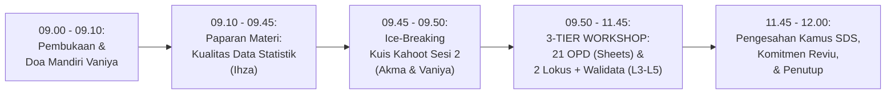

# MODUL PERTEMUAN 02: PENJAMINAN KUALITAS DATA STATISTIK
## Sesi 2 dari 4: Membalikkan 5 Indikator Kualitas Data dari Skor 1 ke Level 4/5, Kamus SDS, & Uji Konsistensi Logis

**Kode Dokumen:** `PSS2026-PLAN-S2`  
**Dasar Surat Resmi:** Surat Sekretaris Daerah Kabupaten Mempawah Nomor `500.14.1/7358/DISKOMINFO-C`  
**Waktu Pelaksanaan:** **Kamis, 5 November 2026 (09.00 – 12.00 WIB / 180 Menit)**  
**Tempat Penyelenggaraan:** **Mempawah Command Center (MCC)**, Dinas Komunikasi dan Informatika Kabupaten Mempawah  
**Sasaran Peserta (37 Orang):** 23 Tenaga Entri Data OPD, 4 Tim Walidata Diskominfo, 7 Pegawai Organik BPS, dan 3 Mahasiswa Magang BPS.  
**Pemateri Utama:** **Ihza Fikri Zaki Karunia, S.Tr.Stat.**  

**Panitia Bertugas:**
- **MC & Pemandu Doa Mandiri:** Vaniya
- **Operator Slide & Kuis Kahoot:** Akma
- **Registrasi & Presensi Peserta:** Mahasiswa Magang, Nadya, dan Rara
- **Dokumentasi Foto/Video:** Irfan
- **Pengadaan Snack & Hadiah Kahoot:** Vaniya
- **Rekapitulasi Berkas & SPJ:** Sukma
- **Tim Pendamping Teknis:** Tim 1 (Kak Sukma), Tim 2 (Bang Ihza), Tim 3 (Bg Listio), Tim 4 (Akma), Tim 5 (Aul)

---

## 🎯 1. Target Kinerja Sesi 2: Dual Impact (TPSS 2026 x EPSS 2028)

Sesi 2 menyelesaikan tuntas indikator kualitas data statistik dan mengunci poin kedua sistem evaluasi:

### A. Penguncian Indikator IKU TPSS BPS Mempawah (Menuju Target Satker 99.09)
- **Indikator U232 (Materi Wajib Kualitas Data Statistik):** Langsung bernilai **100% (Membuka Poin Penuh)** begitu paparan Ihza selesai disajikan.
- **Poin Kenaikan TPSS:** Bertambah **+3.00%**, mengerek posisi kumulatif TPSS dari **73.71% menjadi 76.71%** (semakin memangkas defisit menuju target **99.09**).

### B. Penguncian Bukti Dukung EPSS Pemkab Mempawah 2028 (Tangga Level 3 s.d. Level 5)
- **Level 2 (Terkelola):** Tersedianya bukti pelaksanaan pengujian akurasi (kelengkapan faskes/perusahaan, deteksi duplikasi) dan pengujian konsistensi 2 variabel runtun waktu 2021–2026 pada 2 Lokus Utama.
- **Level 3 (Terdefinisi):** Seluruh laporan akurasi (Template E) dan uji konsistensi (Template G) secara sah berlandaskan payung hukum resmi daerah: **SOP Kompilasi Produk Administrasi Pemkab Mempawah (SK Kepala Dinas Kominfo No. 03/SOP/DISKOMINFO/2023)** dan **Perbup Mempawah No. 71/2020 Pasal 14**.
- **Level 4 (Terpadu & Terukur):** Tersedianya **Notula Rapat Reviu & Evaluasi Berkala Penerapan SOP Kualitas Data** oleh Walidata (Dinas Kominfo) bersama Pembina Data (BPS) yang mengevaluasi pelaksanaan proses penjaminan kualitas data secara periodik.
- **Level 5 (Optimum):** Tersedianya **Matriks Laporan Tindak Lanjut Perbaikan Berkelanjutan (*Continuous Improvement*)** yang menyandingkan bukti konkret:
  - *Before (Kondisi Awal 2025):* Format pelaporan ad-hoc, tanpa Kamus SDS, rawan salah hitung, belum ada formula validasi otomatis di Excel.
  - *After (Kondisi Pasca-Pembinaan 2026):* Menggunakan Kamus SDS baku, klasifikasi KBLI/kodefikasi standar, dan formula validasi otomatis `=IF(L+P=Total, "VALID", "ERROR")`.

---

## ⏱️ 2. Susunan Acara & Alokasi Waktu (09.00 – 12.00 WIB / 180 Menit)

> 📑 **Berkas Rundown Resmi Mandiri:** [Rundown Lengkap Pertemuan 02](rundown/02-rundown-pertemuan-2-kamis-5-nov-2026.md)

| Rentang Waktu | Durasi | Agenda Kegiatan di Mempawah Command Center (MCC) | Penanggung Jawab / Fasilitator |
|:---:|:---:|:---|:---|
| 09.00 – 09.10 | 10 Mnt | Pembukaan oleh MC (Vaniya), doa mandiri, dan review kilat progres penetapan lokus Sesi 1 | Vaniya & Ihza |
| 09.10 – 09.45 | 35 Mnt | **Paparan Materi: Kualitas Data Statistik & Tangga Menuju Level 4/5 EPSS** | **Ihza** (Operator: Akma) |
| 09.45 – 09.50 | 5 Mnt | **Ice-Breaking: Kuis Kahoot Interaktif Sesi 2** (Hadiah Rp40.000 untuk Juara 1) | Akma & Vaniya |
| 09.50 – 10.35 | 45 Mnt | **WORKSHOP LIVE 1 (21 OPD Umum): Finalisasi Form LK-01 & Input Kamus Standar Data (SDS)** • Pengisian cepat nama kegiatan di tab `Form LK-01` dan 2–3 variabel kunci di tab `Kamus SDS` Google Sheets • Nol beban kertas; tuntas langsung di cloud | Mbak Uma, Ihza, & 5 Tim Pendamping |
| 10.35 – 11.45 | 70 Mnt | **WORKSHOP LIVE 2 (2 Lokus Utama & Walidata): Kunci Level 3, 4, & 5 EPSS** • BPKAD & DPMPTSP mengisi Template E (Akurasi) & Template G (Konsistensi) mengutip **SOP Kominfo No. 03/2023** (Level 3) • Walidata Diskominfo & BPS menyusun **Notula Reviu Berkala SOP Kualitas Data (Level 4)** dan **Matriks Tindak Lanjut Perbaikan Before vs After (Level 5)** | Ihza, Tim 1 (BPKAD), Tim 2 (DPMPTSP), & Tim Diskominfo |
| 11.45 – 12.00 | 15 Mnt | Penandatanganan Lembar Pengesahan Kamus SDS oleh Pembina BPS, Rekapitulasi Siklus Perbaikan, & Penutupan | Ihza, Uma, & Sukma (SPJ) |

---

## 📚 3. Paparan Materi: Kualitas Data Statistik (Pemateri: Ihza - 35 Menit)

Ihza membedah secara gamblang dan jujur catatan Tim Penilai Provinsi EPSS 2026 agar tidak terulang di EPSS 2028:

### Slide 1: Mengapa Kualitas Data Mempawah Anjlok ke Skor 1 di Pleno 2026?
- Di pleno lalu, 5 indikator Domain 2 (Kualitas Data) Mempawah diberi nilai 1 karena:
  1. *Akurasi (20201):* Dinas hanya menyetor buku jadi tanpa ada dokumen proses pemeriksaan kesalahan atau uji petik.
  2. *Aktualitas (20301) & Ketepatan Waktu (20302):* Publikasi terbit terlambat lebih dari 1 tahun dari periode data.
  3. *Keterbandingan (20501) & Konsistensi (20502):* Angka antar publikasi berbeda dan tidak ada penjelasan korelasi logis.
- Hari ini di MCC, kita kunci bukti fisiknya agar semuanya naik ke **Level 4/5**!

### Slide 2: Empat Tahap Baku Pemeriksaan Akurasi Data (Quality Gates BPS)
1. **Tahap 1 (Completeness Check):** Memastikan 100% unit sumber data (seluruh SKPD untuk BPKAD / seluruh pemohon izin untuk DPMPTSP) telah menyetorkan data tanpa ada *missing values*.
2. **Tahap 2 (Anomali & Outlier Detection):** Memeriksa data ekstrem yang tidak wajar (misal: nilai belanja modal bernilai minus atau tanggal perizinan mendahului tanggal permohonan).
3. **Tahap 3 (Rekonsiliasi Wilayah & Silang Data):** Membandingkan data agregat dinas dengan data transaksi riil (kas daerah vs buku kas OPD / data OSS pusat vs register loket PTSP).
4. **Tahap 4 (Sampling Ground Check / Verifikasi Lapangan):** Melakukan uji petik faktual ke beberapa sampel transaksi untuk membuktikan integritas catatan.

### Slide 3: Mengunci Keterbandingan Waktu 5 Tahun (Indikator 20501)
- Data harus dapat dibandingkan antar-waktu (*time-series*) minimal 3–5 tahun terakhir (2021–2025).
- Jika ada perubahan regulasi atau perubahan sistem (misal: transisi SIMDA ke SIPD pada keuangan, atau transisi OSS 1.1 ke OSS-RBA pada perizinan), wajib dicantumkan **Catatan Metodologi Perubahan Sistem (*Methodological Footnote*)**.

### Slide 4: Mengunci Konsistensi Internal Statistik (Indikator 20502)
- Dua variabel yang saling berhubungan secara konseptual wajib memiliki pola pergerakan yang logis searah:
  - *Lokus BPKAD:* Kenaikan Realisasi Pendapatan Asli Daerah (PAD) berkorelasi positif dengan Kenaikan Realisasi Belanja Modal Infrastruktur Publik.
  - *Lokus DPMPTSPKUKM:* Kenaikan Jumlah Penerbitan NIB Usaha Mikro/Kecil berkorelasi positif dengan Kenaikan Realisasi Investasi Penanaman Modal Dalam Negeri (PMDN).

---

## 🏆 4. Ice-Breaking: Kuis Kahoot Sesi 2 (Operator: Akma & MC: Vaniya - 5 Menit)

- **Platform:** Kahoot.it (PIN di layar MCC).
- **Hadiah:** Uang pembinaan / voucher Rp40.000 untuk Juara 1.
- **Topik Kuis (5 Soal Cepat):**
  1. *Berapa tahap baku pemeriksaan akurasi data statistik menurut pedoman Quality Gates BPS?* (Jawaban: 4 Tahap).
  2. *Portal resmi BPS untuk pendaftaran Metadata Statistik Sektoral adalah...?* (Jawaban: INDAH BPS).
  3. *Apa yang harus dilakukan jika terjadi perubahan sistem aplikasi pencatatan data dalam deret waktu 5 tahun?* (Jawaban: Memberikan catatan metodologi perubahan sistem).
  4. *Jika pendapatan daerah naik drastis tetapi belanja modal dicatat turun drastis tanpa penjelasan, indikator kualitas apa yang terancam gugur?* (Jawaban: Konsistensi Statistik).
  5. *Apakah uji petik faktual lapangan (ground check) wajib didokumentasikan dalam berita acara?* (Jawaban: Wajib).

---

## 🛠️ 5. Live Action Lab: Strategi 3 Lapis Penjaminan Kualitas (115 Menit)

### 5.1 Lapis 1: 21 OPD Umum (45 Menit) — Single Entry di Google Sheets
- **Fokus:** Melengkapi identifikasi kegiatan di tab `Form LK-01` dan 2–3 variabel kunci di tab `Kamus SDS` Google Sheets Master Radar.
- **Karakteristik:** Tuntas dalam 30–45 menit, langsung tersimpan di cloud, **bebas beban cetak dokumen fisik**.
- **Hasil:** Data hulu 21 OPD siap dijadikan dasar penyusunan metadata dan pemantauan aliran data daerah.

### 5.2 Lapis 2: Dua Lokus Utama (BPKAD & DPMPTSPKUKM) (70 Menit) — Mengunci Level 3 & Bahan Level 5
- **Lokus 1 (BPKAD - PIC: ihzakarunia):**
  - Menyusun **Template E Terpadu (Laporan Akurasi 4 Tahap Keuangan Daerah)**: Memuat tahapan pemeriksaan kelengkapan SKPD, deteksi anomali belanja modal, rekonsiliasi RKUD, dan audit BPK RI.
  - Menyusun **Template G Terpadu (Uji Konsistensi Keuangan)**: Memadankan tren PAD vs Belanja Modal 2021–2026.
  - **Payung Hukum:** Mencantumkan dasar hukum **SOP Kompilasi Produk Administrasi Pemkab Mempawah (SK Kadis Kominfo No. 03/SOP/DISKOMINFO/2023)**.
- **Lokus 2 (DPMPTSPKUKM - PIC: ihzakarunia):**
  - Menyusun **Template E Terpadu (Laporan Akurasi 4 Tahap Perizinan)**: Memuat tahapan verifikasi berkas permohonan, validasi KBLI 2020 5-digit, ground check penanaman modal, dan integrasi OSS-RBA.
  - Menyusun **Template G Terpadu (Uji Konsistensi Perizinan)**: Memadankan tren Penerbitan NIB UMK vs Nilai Realisasi Investasi PMDN 2021–2026.
  - **Payung Hukum:** Mengutip **SOP Kompilasi Produk Administrasi No. 03/2023** dan **Perbup Mempawah No. 71/2020 Pasal 14**.
- **Penyelamatan Bukti Mentah (*Before*):**
  - Operator BPKAD dan DPMPTSP menyerahkan 1 file rekapan lama (format 2024/2025 sebelum pembinaan) sebagai bahan bukti *Before* untuk penguncian Level 5.

### 5.3 Lapis 3: Tim Walidata (Diskominfo) & Pembina (BPS) — Mengunci Level 4 & Level 5
- **Instrumen Level 4 (Reviu Berkala):**
  - Menyepakati draf **Notula Rapat Reviu & Evaluasi Berkala Penerapan SOP Kualitas Data Sektoral Kabupaten Mempawah**: Mencatat hasil monitoring terhadap kepatuhan proses pengumpulan dan pemeriksaan data pada produsen data.
- **Instrumen Level 5 (Continuous Improvement / Before vs After):**
  - Menyusun **Matriks Laporan Tindak Lanjut Perbaikan Kualitas Data**:
    * *Before (Format 2025):* Format tidak seragam, tanpa Kamus SDS, rawan salah hitung, belum ada validasi formula.
    * *After (Format 2026):* Menggunakan Kamus SDS baku, klasifikasi KBLI 2020 standar, dan formula validasi otomatis di spreadsheet.

---

## 📦 6. Deliverables Bukti Fisik yang Dihasilkan pada Sesi 2

1. **Kamus Standar Data Statistik (SDS) & Rekapitulasi Form LK-01 23 OPD:**  
   Tuntas di Google Sheets bersama dan lembar 2 Lokus disahkan Pembina Data BPS (Indikator `10101` & `U2.2.1`).
2. **Laporan 4 Tahap Akurasi & Uji Petik 2 Lokus (Template E Terpadu):**  
   Sah berpayung hukum **SOP Kompilasi Produk Administrasi No. 03/2023** (Mengunci **Indikator 20201 pada Level 3**).
3. **Lembar Evaluasi Keterbandingan & Konsistensi Logis 5 Tahun (Template G Terpadu):**  
   Menyandingkan deret 2021–2026 bebas anomali (Mengunci **Indikator 20501 & 20502 pada Level 3**).
4. **Notula Reviu & Evaluasi Berkala SOP Kualitas Data (Walidata Diskominfo & BPS):**  
   Bukti reviu periodik terhadap proses SOP (Mengunci **Domain 2 Kualitas Data pada Level 4**).
5. **Matriks Laporan Tindak Lanjut Perbaikan Berkelanjutan (*Before vs After*):**  
   Menyandingkan screenshot/file format 2025 vs format 2026 (Mengunci **Domain 2 Kualitas Data pada Level 5**).
6. **Paket Dokumentasi Rapat Alami Sesi 2:**  
   Surat Undangan Sekda, Daftar Hadir MCC, Notula Sesi, dan Foto Kegiatan Irfan siap diunggah ke SPESIAL BPS (Indikator `40302` & `40303`).

---

## 📌 7. Arahan Menuju Pertemuan 3 (Rabu, 11 November 2026 - Pukul 09.00 WIB)
1. Pertemuan ke-3 dilaksanakan minggu depan pada **Rabu, 11 November 2026** di MCC mulai pukul **09.00 WIB**.
2. Operator BPKAD dan DPMPTSPKUKM membawa tabel deret waktu (*time-series*) 5 tahun terakhir (2021–2025) untuk diolah menjadi publikasi analitis berbantuan AI bersama Kak Aul dan Ihza!