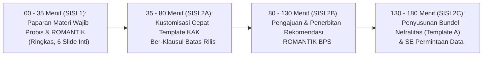

# MODUL PERTEMUAN 02: PERENCANAAN TERSTANDAR, REKOMENDASI ROMANTIK BPS, & PENJAMINAN NETRALITAS
## Sesi 2 dari 4: Mengunci Legalitas Metodologi & Mengeliminasi Skor 1 Indikator 40102
**Kode Dokumen:** `PSS2026-PLAN-S2`  
**Alokasi Waktu:** 180 Menit (3 Jam Penuh)  
**Tempat:** Ruang Rapat BPS Kabupaten Mempawah / Mempawah Command Centre (MCC)  
**Penyelenggara:** Tim Pembina Statistik Sektoral BPS Kabupaten Mempawah bersama Dinas Kominfo  
**Sasaran Peserta:** Operator Data & Pejabat Penanggung Jawab Kegiatan dari OPD Kegiatan Prioritas (Dinkes & Disperindagnaker), Tim Rekomendasi BPS, dan Walidata Diskominfo  

---

## 🎯 1. Target Kinerja Sesi 2 & Keterkaitan Indikator EPSS 2028

Pertemuan 2 memadatkan proses perencanaan, perizinan metodologi statistik, dan penjaminan etika profesionalitas:
- **Indikator 30101, 30102, 30103 (Perencanaan & Desain - Target Level 4):** KAK terstandarisasi dengan metodologi baku.
- **Indikator 50201 (Pelaksanaan Rekomendasi ROMANTIK - Target Level 4):** Pengajuan Form FS3 dan penerbitan Surat Rekomendasi Layak BPS.
- **Indikator 40102 (Penjaminan Netralitas & Objektivitas - Target Level 4):** Penyelamatan dari **Skor 1 menjadi Skor 4** melalui Surat Pernyataan Komitmen Netralitas Pimpinan OPD bermeterai Rp 10.000 (Template A).
- **Indikator 30201 & 40104 (Pengumpulan Data & Konfidensialitas - Target Level 4):** Surat Edaran permintaan data dan SOP Non-PII.
- **Fondasi Emas Indikator 20301 & 20302:** Klausul batas waktu rilis definitif pada KAK yang selaras dengan jadwal Romantik BPS.

---

## ⏱️ 2. Pembagian Waktu Sesi (Total 180 Menit)



---

## 📚 3. SISI 1: Paparan Materi Wajib Statistik Sektoral (35 Menit / 6 Slide Inti)

### Slide 1: Mengapa KAK Masa Lalu Ditolak Penilai EPSS?
- Pada evaluasi 2026, KAK dinilai cacat karena:
  1. Tidak mencantumkan batas waktu rilis yang mengikat (membuat Indikator 20301 Aktualitas Data jatuh ke Skor 1).
  2. Jadwal KAK tidak selaras dengan jadwal Surat Rekomendasi ROMANTIK BPS (membuat Indikator 20302 Ketepatan Waktu jatuh ke Skor 1).
  3. Dokumen KAK tidak ditandatangani basah oleh pimpinan dinas dan tidak berstempel resmi.

### Slide 2: Mengapa Indikator Netralitas (40102) Anjlok ke Skor 1?
- Pada pleno provinsi, evaluator menolak bukti Disperindag dan Dinkes karena hanya melampirkan tangkapan layar draf SOP umum.
- Penilai mewajibkan adanya **Surat Pernyataan Komitmen Netralitas Pimpinan OPD** yang menyatakan secara eksplisit bahwa penentuan metodologi bebas intervensi politik dan angka yang dihasilkan objektif.

### Slide 3: Kewajiban Hukum Rekomendasi Kegiatan Statistik (UU 16/1997)
- Setiap penyelenggaraan statistik sektoral wajib memberitahukan rancangannya kepada BPS sebelum kegiatan dimulai.
- BPS memeriksa rancangan tersebut untuk mencegah duplikasi dan memastikan kepatuhan standar.
- Status kelayakan dibuktikan dengan terbitnya **Surat Rekomendasi Statistik Sektoral (Status: Layak)**.

### Slide 4: Tahap Pengumpulan Data & Penjaminan Konfidensialitas (40104)
- Pengumpulan data kompromin harus memiliki jejak audit resmi melalui Surat Edaran Permintaan Data dari Kepala Dinas ke unit pelapor (puskesmas/perusahaan).
- Perlindungan Data Pribadi: Data mentah perseorangan (Nama/NIK pasien/pencari kerja) wajib dilindungi dan hasil publikasi **hanya disajikan dalam bentuk agregat (Non-PII)**.

### Slide 5: Alur Kerja Cepat (Fast-Track) Hari Ini
- Operator dinas tidak perlu mengarang teks KAK atau surat dinas dari nol.
- BPS telah menyiapkan dokumen yang sudah diformat standar: operator cukup mengisi identitas dinas dan angka target, lalu sistem otomasi mencetak dokumen legalnya.

### Slide 6: Target Capaian Akhir Hari Ini
- 4 dokumen legal selesai: (1) KAK Ber-klausul Rilis, (2) Surat Rekomendasi Romantik Layak, (3) Surat Pernyataan Netralitas (Template A), dan (4) Surat Edaran Permintaan Data.

---

## 🛠️ 4. SISI 2: Workshop Rendah Beban Kognitif & Otomasi Dokumen (145 Menit)

### 4.1 Tahap A: Pengisian Parameter Cepat Template KAK Plug-and-Play (45 Menit)
Operator OPD membuka template file KAK yang telah disiapkan BPS dan hanya perlu melengkapi 4 isian sederhana:
1. Nama Program & Anggaran DPA Dinas Tahun 2026.
2. Nama & NIP Kepala Dinas.
3. Daftar Unit Pelapor (14 Puskesmas / 27 Perusahaan Mitra).
4. Menyetujui Klausul Batas Waktu Rilis Baku: **"Publikasi wajib dirilis di portal Satu Data Mempawah paling lambat 31 Oktober 2026."**

*Otomasi CLI Alternatif:*
```bash
python3 scripts/kb_pss_automation.py generate-kak \
  --opd "Dinas Kesehatan" \
  --kegiatan "Kompilasi Data Profil Kesehatan Kabupaten Mempawah Tahun 2026" \
  --deadline "2026-10-31" \
  --output ./output_kak_dinkes.md
```

### 4.2 Tahap B: Pengajuan & Penerbitan Rekomendasi ROMANTIK BPS (50 Menit)
- Operator melakukan login ke portal ROMANTIK (`https://romantik.web.bps.go.id/`).
- Didampingi mentor BPS, operator menginput Form FS3 (isian telah diselaraskan dengan dokumen KAK yang baru saja disahkan).
- Tim Pemeriksa Rekomendasi BPS Kabupaten Mempawah meninjau isian secara langsung (*instant approval*).
- Kepala BPS menerbitkan **Surat Rekomendasi Kegiatan Statistik Sektoral (Status: LAYAK)** lengkap dengan Nomor Registrasi BPS (contoh: `K-26.6104.001`).

### 4.3 Tahap C: Penyusunan Bundel Netralitas (Template A) & SE Permintaan Data (50 Menit)
- Menggunakan **Template A Resmi**, operator mencetak Surat Pernyataan Komitmen Netralitas Pimpinan OPD pada kertas berkop dinas.
- Membubuhkan materai Rp 10.000 untuk siap ditandatangani basah oleh Kepala Dinas.
- Menyusun draf Surat Edaran Permintaan Data Resmi dari Kepala Dinas kepada seluruh unit sumber data.
- Menyiapkan lampiran penjelasan rujukan metodologi standar BPS (Perka BPS No. 5/2020) yang telah di-generate otomatis.

---

## 📦 5. Deliverables Bukti Fisik yang Dihasilkan pada Sesi 2

1. **Dokumen Kerangka Acuan Kerja (KAK) Final Ber-Klausul Batas Rilis:**
   - Ditandatangani basah Kepala Dinas dan menjadi dasar pembuktian **Indikator 20301 (Aktualitas) dan 30101 (Perencanaan)**.
2. **Surat Rekomendasi Kegiatan Statistik Sektoral Resmi dari BPS (Status: Layak):**
   - Memuat Nomor Registrasi BPS dan menjadi bukti fisik utama untuk **Indikator 50201 (Rekomendasi Romantik)** serta dasar pembanding **Indikator 20302 (Ketepatan Waktu)**.
3. **Bundel Bukti Dukung Penjaminan Netralitas & Objektivitas (Template A):**
   - Surat Pernyataan bermeterai Rp 10.000 TTD Kadis + Lembar Penjelasan Metodologi BPS.
   - **Kunci mutlak mengubah Indikator 40102 dari Skor 1 menjadi Skor 4!**
4. **Surat Edaran Permintaan Data Resmi ke Unit Pelapor:**
   - Bukti fisik mutlak untuk **Indikator 30201 (Pengumpulan Data)**.
5. **Paket Dokumentasi Sesi 2 untuk Portal SPESIAL:**
   - Undangan BPS, Daftar Hadir, Notula, Materi Paparan, dan Foto Dokumentasi.

---

## 📌 6. Arahan Menuju Pertemuan 3 (Beban Operator Sangat Ringan)
Untuk Pertemuan 3 minggu depan:
1. Membawa kembali lembar KAK dan Surat Pernyataan Netralitas yang telah ditandatangani basah dan dicap dinas oleh Kepala Dinas masing-masing.
2. Membawa file Excel berisi **tabel data mentah hasil pengumpulan data 2026** serta **data historis 5 tahun terakhir (2021–2025)**.
3. *Tidak perlu membuat ulasan narasi apapun di rumah, seluruh analisis tren akan dibantu secara otomatis oleh Mesin AI pada Pertemuan 3!*
