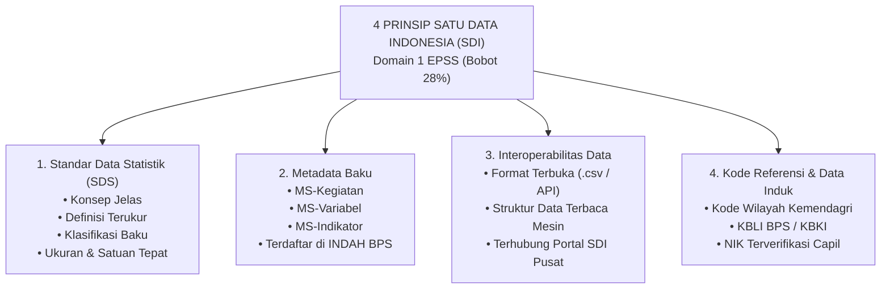

# MODUL PERTEMUAN 02: PENERAPAN 4 PRINSIP SATU DATA INDONESIA & ARSITEKTUR METADATA SEKTORAL
## Rencana Kerja 2 (RK 2) Pembinaan Statistik Sektoral 2026
**Kode Dokumen:** `PSS2026-PLAN-02`  
**Waktu Pelaksanaan:** Minggu Ke-2 Pembinaan  
**Durasi Efektif:** 180 Menit (3 Jam)  
**Tempat:** Laboratorium Komputer / Mempawah Command Centre (MCC)  
**Penyelenggara:** BPS Kabupaten Mempawah bersama Dinas Kominfo (Walidata)  
**Sasaran Peserta:** Operator Data dari 2 Kegiatan Statistik Prioritas (Dinkes & Disperindagnaker), Operator OPD Terkait (Pertanian, Dinsos, Disdikbud, Disdukcapil), dan Tim Pengelola Portal SDI Diskominfo  

---

## 🎯 1. Tujuan Pertemuan & Keterkaitan Indikator EPSS 2028

### 1.1 Urgensi Domain 1 EPSS (Bobot Terbesar: 28%)
Domain 1 (Prinsip Satu Data Indonesia) adalah **komponen penentu nilai paling masif dalam EPSS** dengan kontribusi bobot sebesar **28% terhadap Indeks Pembangunan Statistik (IPS)**. Pada EPSS 2026, Kabupaten Mempawah mencatatkan prestasi gemilang pada Indikator 10101 dengan meraih **Nilai 4 (Tertinggi di Seluruh Kalimantan Barat)**. 

Tujuan Pertemuan 2 adalah:
1. Mempertahankan dan mengunci predikat unggul Domain 1 agar seluruh 4 indikator mencapai **Level 4 (Terpadu dan Terukur)** pada EPSS 2028.
2. Membimbing operator OPD secara langsung dalam menyusun dokumen **Standar Data Statistik (SDS)** untuk seluruh variabel kegiatan prioritas.
3. Memastikan operator data mampu menyusun **Metadata Kegiatan (MS-Keg)** dan **Metadata Variabel (MS-Var)** sesuai standar nasional pada Portal INDAH BPS (`https://indah.bps.go.id/`).
4. Mengintegrasikan aliran data dan kode referensi ke dalam **Portal Satu Data Indonesia Kabupaten Mempawah**.

### 1.2 Pemetaan Indikator EPSS 2028 & Target Kematangan Domain 1

| Kode Indikator | Nama Indikator EPSS | Bobot di Domain 1 | Bobot Relatif Total | Capaian 2026 | Target EPSS 2028 | Syarat Pemenuhan Bukti Dukung Level 4 |
|:---:|:---|:---:|:---:|:---:|:---:|:---|
| **10101** | Penerapan Standar Data Statistik (SDS) | 25% | **7.00%** | Level 4 | **Level 4 / 5** | Dokumen Standar Data mencakup 4 elemen baku (Konsep, Definisi, Klasifikasi, Ukuran/Satuan) yang ditetapkan Pembina Data dan diterapkan terpadu di seluruh tahapan pengolahan data. |
| **10201** | Penerapan Metadata Statistik | 25% | **7.00%** | Level 3 | **Level 4** | Tersedianya dokumen MS-Keg dan MS-Var yang telah diunggah dan berstatus Disetujui (*Approved*) di Portal INDAH BPS serta terhubung ke Portal SDI Daerah. |
| **10301** | Penerapan Interoperabilitas Data | 25% | **7.00%** | Level 3 | **Level 4** | Ketersediaan format data terbuka (.csv, .xlsx, API web service) yang memungkinkan pertukaran data otomatis antarsistem elektronik pemda tanpa intervensi manual. |
| **10401** | Penerapan Kode Referensi dan Data Induk | 25% | **7.00%** | Level 3 | **Level 4** | Seluruh dataset menggunakan kode referensi baku nasional (Kode Wilayah Kemendagri, KBLI, KBKI, NIK Capil) secara konsisten di seluruh tabel. |

---

## 📚 2. Ringkasan Materi Teknis untuk Operator OPD

### 2.1 Empat Pilar Prinsip Satu Data Indonesia (Perpres No. 39 Tahun 2019)



### 2.2 Komponen Baku Standar Data Statistik (SDS)
Setiap variabel yang dikumpulkan OPD wajib memiliki spesifikasi 4 pilar SDS:
1. **Konsep:** Rancangan atau ide abstrak mengenai objek yang diukur (contoh: *Tenaga Kerja*, *Penyakit Menular*, *Pasar Rakyat*).
2. **Definisi:** Penjelasan operasional yang memberikan batasan teknis yang jelas agar tidak ambigu (contoh: *Tenaga kerja adalah setiap orang yang mampu melakukan pekerjaan guna menghasilkan barang dan/atau jasa*).
3. **Klasifikasi:** Pengelompokan kategori yang terstandarisasi secara nasional atau internasional (contoh: *Klasifikasi Baku Lapangan Usaha Indonesia / KBLI 2020*, *Klasifikasi Penyakit ICD-10 Kemenkes*, *Klasifikasi Baku Jabatan Indonesia / KBJI*).
4. **Ukuran dan Satuan:** Besaran metrik dan unit pengukuran yang digunakan (contoh: *jiwa*, *persen (%)*, *orang*, *unit usaha*, *kasus*).

### 2.3 Mengenal Tiga Tingkat Metadata Statistik (Portal INDAH BPS)
Metadata adalah informasi terstruktur yang mendeskripsikan suatu data agar data tersebut dapat dipahami dan digunakan secara benar:
1. **Metadata Kegiatan (MS-Keg):** Menjelaskan identitas penyelenggara, tujuan kegiatan, cara pengumpulan data, cakupan wilayah, metode penarikan sampel, jadwal pelaksanaan, hingga anggaran.
2. **Metadata Variabel (MS-Var):** Menjelaskan setiap butir data yang dikumpulkan (nama variabel, konsep, definisi, referensi waktu, tipe data, aturan validasi).
3. **Metadata Indikator (MS-Ind):** Menjelaskan angka ringkasan atau indikator turunan yang dihasilkan (rumus matematis penghitungan, sumber data pembilang/penyebut, interpretasi arah capaian).

---

## 🛠️ 3. Rangkaian Kegiatan Sesi Pembinaan (Rundown 180 Menit)

### 3.1 Sesi 1: Penjelasan Teknis 4 Prinsip SDI & Bedah Kasus EPSS 2026 (45 Menit)
- Fasilitator BPS membedah alasan Indikator 10101 Mempawah berhasil meraih Nilai 4 pada tahun 2026 dan bagaimana cara menaikkan Indikator 10201, 10301, dan 10401 ke Level 4.
- Penjelasan teknis pengisian kamus SDS dan pentingnya penggunaan kode wilayah Kemendagri (bukan penulisan nama desa manual yang rentan typo).
- Demonstrasi live pengisian formulir Metadata Statistik di portal INDAH BPS (`https://indah.bps.go.id/`).

### 3.2 Sesi 2: Hands-on Workshop Penyusunan Dokumen Standar Data (SDS) (50 Menit)
- Operator data membuka draf tabel yang dihasilkan pada kegiatan masing-masing.
- Bersama pendamping fungsional BPS, operator menyusun tabel Kamus Standar Data Statistik untuk minimal 10 variabel kunci pada kegiatan prioritasnya.
- Memeriksa kesesuaian klasifikasi: apakah kegiatan ketenagakerjaan sudah memakai KBLI 2020? Apakah data profil kesehatan sudah memakai ICD-10?

### 3.3 Sesi 3: Praktik Pengisian Metadata Statistik Variabel (MS-Var) (50 Menit)
- Operator menginput metadata variabel ke dalam template MS-Var resmi format BPS.
- Tim Pembina BPS langsung memverifikasi draf isian dan memberikan catatan telaah perbaikan seketika (*instant review*).
- Operator melakukan simulasi *submit* ke portal INDAH / membuat berkas formulir pengesahan metadata.

### 3.4 Sesi 4: Uji Interoperabilitas Portal SDI & Penandatanganan Berkas (35 Menit)
- Tim Walidata Diskominfo mendemonstrasikan proses pengunggahan dataset format terbuka (.csv / .xlsx) ke Portal Satu Data Mempawah.
- Memverifikasi ketersediaan *REST-API endpoint* pada portal daerah agar terhubung dengan portal Satu Data Indonesia tingkat pusat.
- Pembina BPS bersama Walidata menandatangani Dokumen Lembar Pengesahan Standar Data Statistik dan Metadata Kegiatan Prioritas 2026.

---

## 📋 4. Lembar Kerja Praktik Operator (Worksheet LK-02)

### 4.1 Lembar Kerja Kamus Standar Data Statistik (SDS)
Operator OPD melengkapi tabel kamus data berikut untuk variabel-variabel kunci kegiatan:

```markdown
KAMUS STANDAR DATA STATISTIK SEKTORAL
KEGIATAN: ................................................................
PRODUSEN DATA: DINAS .....................................................

| No | Nama Variabel | Konsep Baku | Definisi Operasional | Klasifikasi yang Digunakan | Satuan / Ukuran | Keterangan / Kode Referensi |
|:--:|:---|:---|:---|:---|:---|:---|
| 1  | Jumlah Pencari Kerja Terdaftar | Pencari Kerja | Penduduk usia kerja yang terdaftar pada dinas yang membidangi ketenagakerjaan dan memiliki kartu AK-1 aktif. | • Golongan Umur (15-24, 25-34, 35-49, 50+)<br>• Pendidikan (SD, SMP, SMA/SMK, Diploma, S1+)<br>• Jenis Kelamin (L/P) | Jiwa / Orang | Sesuai KBJI 2014 & Kemnaker |
| 2  | Jumlah Tenaga Kerja Ditempatkan | Penempatan Naker | Pencari kerja yang telah diterima bekerja di perusahaan mitra industri dan telah dilaporkan kontrak kerjanya. | • Lapangan Usaha KBLI 2020 (Pertanian, Industri, Perdagangan, Jasa)<br>• Jenis Kelamin (L/P) | Orang | KBLI 2020 (Perka BPS No. 2/2020) |
| 3  | Cakupan Kunjungan K4 Ibu Hamil | Pelayanan Antenatal | Ibu hamil yang mendapatkan pelayanan antenatal sesuai standar paling sedikit 4 kali selama kehamilan di faskes. | • Puskesmas Pembina (14 Puskesmas)<br>• Status Jaminan (BPJS / Non-BPJS) | Persen (%) | Permenkes No. 1171/2011 |
| 4  | Kasus Kematian Ibu (Maternal Death) | Kematian Maternal | Kematian wanita saat hamil atau dalam periode 42 hari setelah penghentian kehamilan akibat penyebab terkait kehamilan. | • Wilayah Kecamatan (9 Kecamatan)<br>• Penyebab Kematian (Pendarahan, Eklamsia, Infeksi, dll.) | Kasus | Klasifikasi ICD-10 Kemenkes |
```

---

## 📦 5. Artefak Bukti Fisik yang Wajib Dihasilkan (Deliverables Pertemuan 2)

### 5.1 Deliverable Teknis Statistik (Bukti EPSS Domain 1)
1. **Dokumen Kamus Standar Data Statistik (SDS) Kegiatan Prioritas Tahun 2026:**
   - Ditandatangani oleh Kepala Produsen Data (Kepala Dinas) dan disahkan oleh Kepala BPS Kabupaten Mempawah selaku Pembina Data Statistik Daerah.
   - Menjadi bukti fisik mutlak untuk mengunci **Indikator 10101 pada Level 4/5**.
2. **Lembar Rekapitulasi Metadata Variabel (MS-Var) & Kegiatan (MS-Keg) Berformat Baku INDAH BPS:**
   - Formulir MS-Var lengkap untuk minimal 15 variabel utama, disertai tangkapan layar status pengajuan di portal INDAH BPS / tanda terima verifikasi Pembina Data.
   - Menjadi bukti fisik mutlak pemenuhan **Indikator 10201 pada Level 4**.
3. **Dokumen Arsitektur & Bukti Tayang Interoperabilitas Portal SDI Mempawah:**
   - Berisi dokumentasi teknis struktur data terbuka (.csv dan API endpoint), struktur JSON, dan tangkapan layar ketersediaan data terbuka di portal resmi pemda.
   - Menjadi bukti fisik mutlak pemenuhan **Indikator 10301 (Interoperabilitas)** dan **10401 (Kode Referensi & Data Induk)** pada **Level 4**.

### 5.2 Deliverable Administrasi Pembinaan (Portal SPESIAL)
1. Surat Undangan Pertemuan 2 dari Kepala BPS Kabupaten Mempawah.
2. Daftar Hadir bertandatangan peserta.
3. Notula Pertemuan yang mendokumentasikan pembahasan standar konsep dan klasifikasi data sektoral.
4. Materi Paparan Standar Data & Metadata Statistik (PDF).
5. Dokumentasi Foto pelaksanaan bimbingan teknis per meja.

---

## 📝 6. Format Lembar Pengesahan Standar Data Statistik (Siap Cetak)

```markdown
LEMBAR PENGESAHAN
STANDAR DATA STATISTIK SEKTORAL KABUPATEN MEMPAWAH
TAHUN ANGGARAN 2026

Nama Kegiatan Statistik : ..............................................................
Nama Produsen Data      : Dinas ........................................................
Jumlah Variabel Terdata : ...... (........................) Variabel Statistik

Berdasarkan hasil verifikasi dan penelaahan teknis yang dilakukan oleh Tim Pembina Statistik Sektoral Badan Pusat Statistik Kabupaten Mempawah terhadap rancangan Standar Data Statistik yang diajukan oleh Produsen Data, dokumen Standar Data Statistik yang meliputi:
1. Konsep operasional statistik;
2. Definisi teknis variabel;
3. Klasifikasi baku yang mengacu pada standar nasional (KBLI/KBKI/Kemendagri/Kemenkes); serta
4. Ketetapan ukuran dan satuan data,

DINYATAKAN TELAH MEMENUHI PRINSIP SATU DATA INDONESIA
sebagaimana diatur dalam Peraturan Presiden Nomor 39 Tahun 2019 tentang Satu Data Indonesia dan Peraturan Kepala BPS tentang Standar Data Statistik, serta dapat dipergunakan sebagai pedoman baku penyelenggaraan kegiatan statistik sektoral di lingkungan Pemerintah Kabupaten Mempawah.

Mempawah, .............................. 2026

Disetujui Oleh:                            Disahkan Oleh:
Kepala Dinas ...........................   Kepala Badan Pusat Statistik
Selaku Produsen Data,                      Kabupaten Mempawah Selaku Pembina Data,
(tanda tangan & cap dinas)                 (tanda tangan & cap dinas)


........................................   ........................................
NIP. ...................................   NIP. ...................................

Mengetahui:
Kepala Dinas Komunikasi dan Informatika Kabupaten Mempawah
Selaku Walidata Daerah,
(tanda tangan & cap dinas)


........................................
NIP. ...................................
```

---

## 📌 7. Tindak Lanjut Operator Menuju Pertemuan 3
Menjelang **Pertemuan 3 (Desain Kegiatan & Rekomendasi Statistik ROMANTIK)**, operator OPD wajib:
1. Mengonfirmasikan dokumen Standar Data Statistik yang telah disahkan ke pimpinan dinas masing-masing.
2. Membawa draf Kerangka Acuan Kerja (KAK / TOR) kegiatan statistik tahun 2026 yang tercantum dalam DPA dinas.
3. Menyiapkan draf rincian jadwal pelaksanaan dari tahap pengumpulan hingga publikasi.
