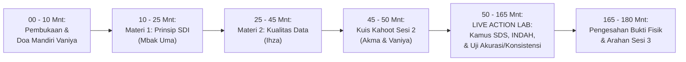

# MODUL PERTEMUAN 02: PRINSIP SATU DATA INDONESIA & PENJAMINAN KUALITAS DATA
## Sesi 2 dari 4: Mengunci Domain 1 (Prinsip SDI) & Membalikkan 5 Indikator Kualitas Data dari Skor 1 ke Level 4/5

**Kode Dokumen:** `PSS2026-PLAN-S2`  
**Waktu Pelaksanaan:** Rabu, 4 November 2026 (08.30 – 11.30 WIB / 180 Menit)  
**Tempat:** Ruang Rapat BPS / Mempawah Command Centre (MCC) Diskominfo  
**Pemateri Resmi:**
- **Materi 1 (Prinsip SDI):** **Mbak Uma (Sukmawati, S.E.)**
- **Materi 2 (Kualitas Data Statistik):** **Ihza Fikri Zaki Karunia, S.Tr.Stat.**

**Panitia Bertugas:**
- **MC & Pemandu Doa Mandiri:** Vaniya
- **Operator Slide & Kuis Kahoot:** Akma
- **Registrasi & Presensi:** Mahasiswa Magang, Nadya, dan Rara
- **Dokumentasi Foto/Video:** Irfan
- **Pengadaan Snack & Hadiah Kahoot:** Vaniya
- **Rekapitulasi Berkas & SPJ:** Sukma
- **Tim Pendamping Teknis:** Tim 1 (Sukma), Tim 2 (Ihza), Tim 3 (Listio), Tim 4 (Aller), Tim 5 (Aul & Uma)

---

## 🎯 1. Target Kinerja Sesi 2 & Bukti Dukung EPSS Terkunci

Sesi 2 menyelesaikan tuntas **Domain 1 (Prinsip SDI - Bobot 12%)** dan **Domain 2 (Kualitas Data - Bobot 23%)**:
- **Indikator 10101 (Standar Data Statistik - Level 4):** Dokumen Kamus SDS resmi disahkan Pembina BPS.
- **Indikator 10201 (Metadata Statistik - Level 4):** Registrasi Metadata Kegiatan (MS-Keg) dan Metadata Variabel (MS-Var) di Portal INDAH BPS.
- **Indikator 10301 (Interoperabilitas Data - Level 4):** Penyediaan data dalam format terstruktur dan terbuka (.csv/.xlsx).
- **Indikator 10401 (Kode Referensi & Data Induk - Level 4):** Pemadanan kode wilayah Kemendagri 9 kecamatan dan 67 desa/kelurahan Mempawah.
- **Indikator 20201 (Akurasi Data - Level 4):** Laporan 4 Tahap Pemeriksaan Akurasi Data + Berita Acara Sampling Ground Check.
- **Indikator 20501 (Keterbandingan Data - Level 4):** Laporan konsistensi metodologi tren data 3–5 tahun.
- **Indikator 20502 (Konsistensi Data - Level 4):** Lembar Verifikasi Uji Konsistensi Logis Searah 2 Variabel Terkait.

---

## ⏱️ 2. Susunan Acara & Alokasi Waktu (180 Menit / 3 Jam)



| Rentang Waktu | Durasi | Agenda Kegiatan | Fasilitator / Penanggung Jawab |
|:---:|:---:|:---|:---|
| 08.30 – 08.40 | 10 Mnt | Pembukaan oleh MC (Vaniya), doa mandiri, dan review kilat progres Sesi 1 | Vaniya & Ihza |
| 08.40 – 08.55 | 15 Mnt | **Materi 1: Empat Prinsip Satu Data Indonesia (Perpres 39/2019)** | **Mbak Uma** (Operator: Akma) |
| 08.55 – 09.15 | 20 Mnt | **Materi 2: Membedah Kualitas Data & Menghapus Rekam Jejak Skor 1 di Pleno 2026** | **Ihza** (Operator: Akma) |
| 09.15 – 09.20 | 5 Mnt | **Ice-Breaking: Kuis Kahoot Interaktif Sesi 2** (Hadiah Rp40.000 untuk Juara 1) | Akma & Vaniya |
| 09.20 – 10.30 | 70 Mnt | **WORKSHOP LIVE GOOGLE WORKSPACE 1: Kamus SDS & Metadata INDAH**<br>• Pengisian serentak Kamus Standar Data Statistik 23 OPD<br>• Pendampingan input form MS-Keg & MS-Var ke portal INDAH BPS | Mbak Uma, Ihza, & 5 Tim Pendamping |
| 10.30 – 11.15 | 45 Mnt | **WORKSHOP LIVE GOOGLE WORKSPACE 2: Uji Akurasi & Konsistensi (2 Lokus Emas)**<br>• Pembuatan Berita Acara Uji Akurasi 4 Tahap + Sampling Ground Check Dinkes & Disperindag<br>• Penyusunan Lembar Uji Konsistensi Logis Searah berbantuan Script Otomasi | Ihza, Tim 2 (Dinkes), & Tim 3 (Disperindag) |
| 11.15 – 11.30 | 15 Mnt | Penandatanganan Lembar Pengesahan Kamus SDS oleh Pembina BPS & Penutupan | Ihza, Uma, & Sukma (SPJ) |

---

## 📚 3. Paparan Materi Sesi 2

### 3.1 Materi 1: Empat Prinsip Satu Data Indonesia (Pemateri: Mbak Uma - 15 Menit)
1. **Standar Data Statistik (SDS):** Data wajib memiliki Konsep, Definisi, Satuan baku, Ukuran, dan Klasifikasi baku. (Contoh: Konsep "Pencari Kerja Terdaftar", Satuan "Orang", Klasifikasi "KBLI/KBJI").
2. **Metadata Statistik:** Informasi yang menjelaskan latar belakang data. Terdapat 3 jenis: Metadata Kegiatan (MS-Keg), Metadata Variabel (MS-Var), dan Metadata Indikator (MS-Ind).
3. **Interoperabilitas Data:** Data tidak boleh terkunci dalam file PDF mati. Wajib disimpan dalam format terbuka tabular (.xlsx, .csv) yang siap diintegrasikan melalui REST API Portal Satu Data Mempawah.
4. **Kode Referensi & Data Induk:** Menggunakan kode wilayah resmi Kemendagri (61.04.xx.xxxx). Tidak boleh lagi menulis nama desa beda ejaan yang merusak integrasi basis data.

### 3.2 Materi 2: Membedah Kualitas Data & Belajar dari Evaluasi 2026 (Pemateri: Ihza - 20 Menit)
Ihza membedah secara jujur catatan Tim Penilai Provinsi EPSS 2026 agar tidak terulang di EPSS 2028:
1. **Indikator 20201 (Akurasi Data - Skor 1 di 2026):**  
   *Penyebab:* Dinas hanya mengunggah buku profil jadi, tanpa lampiran bukti proses uji akurasi.  
   *Solusi Pasti 2028:* Wajib membuat **Laporan 4 Tahap Akurasi Data** (Validasi Input $\rightarrow$ Deteksi Outlier $\rightarrow$ Rekonsiliasi Wilayah $\rightarrow$ Sampling Ground Check).
2. **Indikator 20301 (Aktualitas) & 20302 (Ketepatan Waktu - Skor 1 di 2026):**  
   *Penyebab:* Data tahun 2024 baru terbit di akhir 2025, dan tidak ada jadwal rilis yang diumumkan ke publik.  
   *Solusi Pasti 2028:* Mengunci jadwal rilis resmi (ARC) di portal Satu Data dan menyusun laporan pemantauan penyandingan jadwal rencana vs realisasi.
3. **Indikator 20501 (Keterbandingan) & 20502 (Konsistensi - Skor 1 di 2026):**  
   *Penyebab:* Angka di dinas berbeda dengan angka di kecamatan, atau angka kliping data disajikan tanpa penjelasan korelasi logis.  
   *Solusi Pasti 2028:* Menyusun **Lembar Hasil Uji Konsistensi Logis Searah 2 Variabel Terkait** (Contoh: Peningkatan Cakupan Imunisasi berbanding lurus logis dengan Penurunan Kasus Penyakit Menular).

---

## 🏆 4. Ice-Breaking: Kuis Kahoot Sesi 2 (Operator: Akma & MC: Vaniya - 5 Menit)

- **Platform:** Kahoot.it
- **Hadiah:** Uang tunai / voucher belanja Rp40.000 untuk 1 pemenang skor tertinggi.
- **Topik Kuis (5 Soal Cepat):**
  1. *Apa saja 4 Prinsip Satu Data Indonesia menurut Perpres 39/2019?*
  2. *Portal resmi BPS untuk mendaftarkan Metadata Statistik Sektoral adalah...?* (Jawaban: INDAH BPS).
  3. *Berapa tahap baku pengujian akurasi data yang disyaratkan EPSS?* (Jawaban: 4 Tahap).
  4. *Format file data manakah yang TIDAK memenuhi prinsip interoperabilitas?* (Jawaban: Dokumen PDF scan gambar miring).
  5. *Jika angka balita gizi buruk naik, apakah logis jika angka balita stunting dilaporkan turun drastis tanpa catatan metodologi?* (Jawaban: Tidak logis / Tidak konsisten).

---

## 🛠️ 5. Live Action Lab Google Workspace & Otomasi AI (115 Menit)

### 5.1 Praktik 1: Pengisian Kamus SDS & Pendaftaran Metadata INDAH (70 Menit)
- Seluruh 23 OPD membuka tab *Kamus SDS* di Google Sheets bersama.
- 5 Tim Pendamping mengawal pengisian parameter:
  - Variabel Utama, Definisi Operasional, Satuan (Orang / Ton / Jiwa / Persen), dan Klasifikasi.
- **Mbak Uma & Ihza** memandu live registrasi 1 akun produsen data di Portal INDAH BPS (`indah.bps.go.id`).
- Mengunggah draf MS-Var hasil ekspor sheet dan mencetak Bukti Registrasi Metadata.

### 5.2 Praktik 2: Penyusunan Bukti Akurasi & Uji Konsistensi 2 Lokus Utama (45 Menit)
- **Lokus 1 (Dinkes-PPKB):**
  - Bersama Tim 2 (Ihza), operator Dinkes menyusun dokumen:
    1. *Berita Acara Pemeriksaan Akurasi Data Pelayanan Puskesmas:* Berisi rekapitulasi data dari 14 Puskesmas dan catatan verifikasi uji petik lapangan (*ground check*) di Puskesmas Mempawah Hilir dan Sungai Pinyuh.
    2. *Lembar Uji Konsistensi Data:* Memadankan variabel **Jumlah Kunjungan Balita ke Posyandu (K4)** dengan **Cakupan Penimbangan Balita (D/S)**.
- **Lokus 2 (Disperindagnaker):**
  - Bersama Tim 3 (Listio), operator Disperindag menyusun dokumen:
    1. *Berita Acara Rekonsiliasi Data AK-1 Pencari Kerja:* Sandingan register fisik loket pelayanan naker vs rekapitulasi digital bulanan.
    2. *Lembar Uji Konsistensi Data Tenaga Kerja:* Memadankan variabel **Jumlah Pencari Kerja Terdaftar** dengan **Jumlah Penempatan Tenaga Kerja Antarkerja Antardaerah (AKAD/AKAL)**.
- **Eksekusi Generator Otomasi:**
  ```bash
  python3 scripts/kb_pss_automation.py generate-consistency \
    --opd "Dinas Kesehatan" \
    --variabel "Cakupan Imunisasi Dasar vs Penurunan Kasus PD3I" \
    --output Berkas_Uji_Konsistensi_Dinkes.md
  ```

---

## 📦 6. Deliverables Bukti Fisik yang Dihasilkan pada Sesi 2

1. **Dokumen Kamus Standar Data Statistik (SDS) 23 OPD Disahkan Pembina Data BPS:**  
   Mengunci **Indikator 10101 pada Level 4/5**.
2. **Tanda Bukti Registrasi Metadata Variabel (MS-Var) di Portal INDAH BPS:**  
   Mengunci **Indikator 10201 pada Level 4**.
3. **Laporan 4 Tahap Pengujian Akurasi Data + Berita Acara Sampling Ground Check (Dinkes & Disperindag):**  
   Mengunci **Indikator 20201 pada Level 4**.
4. **Lembar Hasil Uji Konsistensi Internal Logis Searah (Dinkes & Disperindag):**  
   Mengunci **Indikator 20502 pada Level 4**.
5. **Paket Dokumentasi Lengkap Sesi 2:**  
   Presensi 37 peserta, Notula, Foto Dokumentasi Irfan, dan Bukti Juara Kahoot Vaniya.

---

## 📌 7. Arahan Menuju Pertemuan 3 (Rabu, 11 November 2026)
1. Operator Lokus Dinkes dan Disperindag membawa tabel data deret waktu (*time-series*) 5 tahun terakhir (2021–2025) untuk diolah menjadi publikasi analitis berbantuan AI.
2. Membawa nomor DPA / SK Tim Pelaksana Kegiatan untuk penyusunan KAK berstandar ROMANTIK BPS bersama Kak Aul.