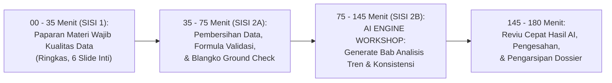

# MODUL PERTEMUAN 03: PENGOLAHAN DATA, 4 TAHAP AKURASI, & ANALISIS TREN AI ENGINE
## Sesi 3 dari 4: Menuntaskan 4 Indikator Kritis Skor 1 Melalui Otomasi Cerdas
**Kode Dokumen:** `PSS2026-PLAN-S3`  
**Alokasi Waktu:** 180 Menit (3 Jam Penuh)  
**Tempat:** Laboratorium Komputer Diskominfo / Mempawah Command Centre (MCC)  
**Penyelenggara:** Tim Pembina Statistik Sektoral BPS Kabupaten Mempawah bersama Dinas Kominfo  
**Sasaran Peserta:** Operator Data, Staf Pengolah Spreadsheet, dan Penulis Publikasi dari OPD Kegiatan Prioritas (Dinkes & Disperindagnaker), serta Tim Telaah Data Bapperida  

---

## 🎯 1. Target Kinerja Sesi 3 & Keterkaitan Indikator EPSS 2028

Pertemuan 3 adalah **sesi paling krusial untuk menyelamatkan nilai teknis data** dan menaikkan 4 indikator yang sebelumnya anjlok ke Skor 1 menjadi **Level 4 (Terpadu dan Terukur)**:
- **Indikator 20201 (Penilaian Akurasi Data - Skor 1 Naik ke Level 4):** Penerapan 4 tahapan audit akurasi, Berita Acara uji petik faktual (*ground check*), dan pembuktian matriks *before-after cleaning*.
- **Indikator 30301 (Pengolahan Data - Target Level 4):** Aturan validasi rumus otomatis dan proteksi formula agregasi pada spreadsheet.
- **Indikator 30302 (Analisis Data - Skor 1 Naik ke Level 4):** Penyusunan Bab Analisis Deskriptif lengkap (analisis komposisi, tren 5 tahun, etiologi sebab-akibat, dan rekomendasi kebijakan) berbantuan **AI Engine (LLM API)**.
- **Indikator 20501 (Keterbandingan Data - Skor 1 Naik ke Level 4):** Penyajian runtun waktu 5 tahun (2021–2026) dan perbandingan 9 kecamatan di Mempawah berkonsep baku (KBLI/Permenkes).
- **Indikator 20502 (Konsistensi Statistik - Skor 1 Naik ke Level 4):** Lembar verifikasi korelasi searah logis antar-variabel bebas anomali.

---

## ⏱️ 2. Pembagian Waktu Sesi (Total 180 Menit)



---

## 📚 3. SISI 1: Paparan Materi Wajib Statistik Sektoral (35 Menit / 6 Slide Inti)

### Slide 1: Refleksi "Bencana Nilai 1" Domain Kualitas Data pada EPSS 2026
- Mengapa Akurasi Data (20201), Keterbandingan (20501), Konsistensi (20502), dan Analisis Data (30302) seluruhnya jatuh ke Nilai 1?
- Di masa lalu:
  1. Disperindag tidak mengunggah bukti pemeriksaan akurasi (folder kosong total).
  2. Dinkes tidak memiliki narasi tahapan audit dan screenshot validasi rumus.
  3. Laporan yang disajikan hanya tabel angka mentah 3 halaman tanpa narasi ulasan tren.
  4. Grafik yang disajikan tidak mencantumkan kepatuhan konsep baku dan tidak ada uji konsistensi logis.

### Slide 2: Empat Tahapan Baku Pemeriksaan Akurasi Data (Anti-Skor 1 Indikator 20201)
1. **Tahap 1: Completeness Check:** Memastikan 100% unit sumber data (14 puskesmas / 27 perusahaan) telah mengirimkan laporan tanpa ada kolom kosong.
2. **Tahap 2: Ground Check / Uji Petik Faktual:** Mengambil sampel acak ke lapangan untuk mencocokkan laporan dengan register primer buku/kartu fisik.
3. **Tahap 3: Data Cleaning & De-duplication:** Menghapus pencatatan ganda (berdasarkan NIK/Nama) dan mengoreksi salah input klasifikasi.
4. **Tahap 4: Formula Validation:** Mengunci formula penjumlahan otomatis agar hasil rekapitulasi bebas dari salah hitung manual.

### Slide 3: Keterbandingan Data Antarwaktu & Antarwilayah (20501)
- Data harus dapat dibandingkan secara sah (*apple-to-apple*):
  - *Antarwaktu:* Menyajikan deret waktu (*time-series*) 5 tahun berturut-turut (2021–2026) dengan metodologi konsisten.
  - *Antarwilayah:* Menyajikan perbandingan 9 kecamatan di Mempawah.
  - *Catatan Kaki Wajib:* Wajib mencantumkan rujukan klasifikasi standar: KBLI 2020, KBJI, atau Permenkes 1171/2011.

### Slide 4: Uji Konsistensi Logis Internal (20502)
- Menguji keselarasan dua variabel berkorelasi:
  - *Dinkes:* Kenaikan cakupan antenatal K4 harus selaras secara logis dengan penurunan kasus kematian ibu ($K4 \le K1$).
  - *Disperindag:* Penempatan tenaga kerja tidak boleh melebihi jumlah lowongan kerja terdaftar ($\text{Penempatan} \le \text{Lowongan}$), dengan rasio pemenuhan 85%–95%.

### Slide 5: Standar Penulisan Bab Analisis Statistik Deskriptif (30302)
- Sebuah publikasi resmi wajib memiliki Bab Analisis yang memuat 4 unsur:
  1. Ulasan komposisi menurut sektor/gender/kelompok umur.
  2. Tren perkembangan pertumbuhan 5 tahun.
  3. Analisis etiologi sebab-akibat fenomena di Kabupaten Mempawah.
  4. Rekomendasi kebijakan nyata bagi penganggaran program dinas.

### Slide 6: Solusi AI Engine BPS (Zero Cognitive Burden)
- Menulis ulasan tren dan analisis sebab-akibat sering menjadi momok berat bagi operator dinas.
- Hari ini BPS menghadirkan **Mesin Otomasi AI (LLM API)**: operator cukup memasukkan angka tabel 5 tahun, sistem AI akan menyusunkan draf naskah analisis deskriptif lengkap berstandar BPS dalam hitungan detik!

---

## 🛠️ 4. SISI 2: Workshop Rendah Beban Kognitif & Otomasi AI Engine (145 Menit)

### 4.1 Tahap A: Pembersihan Data Spreadsheet & Blangko Ground Check (40 Menit)
- Operator membuka file spreadsheet data 2026.
- Menerapkan template Excel BPS:
  - *Conditional Formatting:* Seluruh NIK/Nama yang terdaftar ganda langsung menyala merah otomatis.
  - *Formula Validation:* Seluruh rumus penjumlahan terkunci dengan formula `=IF(Total_L + Total_P = Total, "VALID", "ERROR")`.
- Mengambil tangkapan layar (*screenshot*) formula validasi untuk bukti audit Indikator 20201.
- Mencetak naskah dinas **Laporan 4 Tahap Pemeriksaan Akurasi (Template E)** dan **Berita Acara Uji Petik Faktual Ground Check (Template F)** yang telah terisi otomatis.

### 4.2 Tahap B: Workshop AI Engine — Meng-Generate Bab Analisis Tren Deskriptif (50 Menit)
- Operator menginputkan angka agregat 5 tahun (2021–2026) ke dalam file data sederhana (`data_input.json` atau tabel ringkas).
- **Eksekusi Mesin Otomasi AI (`scripts/kb_pss_automation.py`)**:
  ```bash
  python3 scripts/kb_pss_automation.py generate-analysis \
    --opd "Dinas Kesehatan" \
    --kegiatan "Kompilasi Data Profil Kesehatan Kabupaten Mempawah Tahun 2026" \
    --data-file data_profilkes.json \
    --output ./BAB_III_Analisis_Deskriptif_Dinkes.md
  ```
- **Hasil Luaran AI Seketika:**
  - AI menghasilkan narasi 3 halaman lengkap:
    1. *Subbab 3.1:* Analisis Komposisi Distribusi Data menurut wilayah 9 kecamatan.
    2. *Subbab 3.2:* Tren Pertumbuhan Runtun Waktu 5 Tahun (laju pertumbuhan tahunan).
    3. *Subbab 3.3:* Analisis Faktor Sebab-Akibat (etiologi fenomena di Mempawah).
    4. *Subbab 3.4:* Implikasi dan Rekomendasi Kebijakan Konkret untuk APBD 2027.

### 4.3 Tahap C: Workshop AI Engine — Meng-Generate Uji Konsistensi Internal (20 Menit)
- Operator menjalankan modul konsistensi pada script otomasi:
  ```bash
  python3 scripts/kb_pss_automation.py generate-consistency \
    --opd "Dinas Kesehatan" \
    --var1 "Cakupan Pemeriksaan K4 Ibu Hamil (%)" \
    --var2 "Jumlah Kasus Kematian Ibu (Kasus)" \
    --data-file data_kia.json \
    --output ./Lembar_Uji_Konsistensi_Dinkes.md
  ```
- Script secara otomatis menghitung koefisien korelasi ($r$), menyajikan tabel runtun waktu 2021–2026, dan merumuskan paragraf penjelasan pola korelasi searah logis bebas anomali!

### 4.4 Tahap D: Reviu Bersama & Pengesahan Berkas (35 Menit)
- Operator dan mentor BPS mereviu hasil naskah analisis yang di-generate AI untuk memastikan kesesuaian konteks lokal dinas.
- Menandatangani naskah Bab Analisis Deskriptif dan Lembar Uji Konsistensi Internal.
- Mengarsipkan seluruh dokumen ke folder Google Drive Master EPSS 2028.

---

## 📦 5. Deliverables Bukti Fisik yang Dihasilkan pada Sesi 3

1. **Laporan Resmi 4 Tahapan Pemeriksaan Akurasi Data (Template E):**
   - Menjadi bukti fisik mutlak untuk mengubah **Indikator 20201 dari Skor 1 menjadi Skor 4!**
2. **Berita Acara Uji Petik Faktual Lapangan (*Ground Check*) Asli (Template F):**
   - Dilengkapi cap stempel dan tanda tangan dari unit faskes/perusahaan sampel.
3. **Bab Analisis Deskriptif dan Ulasan Tren Publikasi Lengkap (Template D):**
   - Berisi narasi mendalam 4 subbab hasil generate AI yang telah disetujui dinas.
   - Menjadi bukti fisik mutlak untuk mengubah **Indikator 30302 dari Skor 1 menjadi Skor 4!**
4. **Laporan Penjaminan Keterbandingan Data Antarwaktu & Antarwilayah (Template H):**
   - Runtun waktu 5 tahun dan komparasi 9 kecamatan berkonsep baku KBLI/Permenkes.
   - Menjadi bukti fisik mutlak untuk mengubah **Indikator 20501 dari Skor 1 menjadi Skor 4!**
5. **Lembar Hasil Verifikasi Uji Konsistensi Internal Data (Template G):**
   - Tabel korelasi logis dan narasi korelasi searah bebas kontradiksi matematis.
   - Menjadi bukti fisik mutlak untuk mengubah **Indikator 20502 dari Skor 1 menjadi Skor 4!**
6. **Paket Dokumentasi Sesi 3 untuk Portal SPESIAL:**
   - Undangan BPS, Daftar Hadir, Notula, Materi Paparan Kualitas Data, dan Foto Dokumentasi Workshop.

---

## 📌 6. Arahan Menuju Pertemuan 4 (Sesi Penutup & Gelar Pasukan)
Untuk Pertemuan 4 minggu depan:
1. Membawa draf buku/laporan publikasi dinas yang telah disisipkan Bab Analisis Deskriptif hasil generate AI.
2. Menyiapkan file dataset tabular format terbuka (`.csv` dan `.xlsx`) untuk proses rilis di Portal Satu Data Mempawah.
3. Seluruh dokumen bukti fisik Pertemuan 1, 2, dan 3 yang telah bertandatangan basah dibawa dalam binder fisik dinas untuk audit final.
