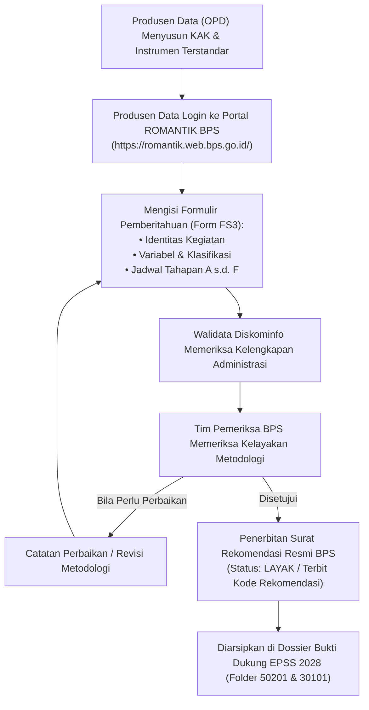

# MODUL PERTEMUAN 03: PERENCANAAN STATISTIK, STANDARISASI KAK BER-JADWAL RILIS, & REKOMENDASI STATISTIK (ROMANTIK)
## Rencana Kerja 4 (Probis) & Rencana Kerja 6 (SSN) Pembinaan Statistik Sektoral 2026
**Kode Dokumen:** `PSS2026-PLAN-03`  
**Waktu Pelaksanaan:** Minggu Ke-3 Pembinaan  
**Durasi Efektif:** 180 Menit (3 Jam)  
**Tempat:** Ruang Rapat BPS Kabupaten Mempawah / Mempawah Command Centre (MCC)  
**Penyelenggara:** Tim Pembina Statistik Sektoral BPS Kabupaten Mempawah bersama Dinas Kominfo  
**Sasaran Peserta:** Operator Data & Pejabat Pembuat Komitmen (PPK) / Pengelola Anggaran dari OPD Produsen Data Kegiatan Prioritas (Dinkes & Disperindagnaker), OPD Pendukung, dan Tim Rekomendasi Statistik BPS  

---

## 🎯 1. Tujuan Pertemuan & Keterkaitan Indikator EPSS 2028

### 1.1 Mengatasi Kesalahan Fatal EPSS Masa Lalu
Pada EPSS 2026, dua indikator kritis jatuh ke Nilai 1 akibat dokumen perencanaan yang cacat:
1. **Indikator 20301 (Aktualitas Data - Skor 1):** KAK yang diunggah OPD tidak memuat klausul batas waktu penyelesaian dan rilis data yang tegas, sehingga jeda waktu (*time lag*) antara periode data dan tanggal penerbitan tidak dapat dijustifikasi.
2. **Indikator 20302 (Ketepatan Waktu Diseminasi - Skor 1):** Evaluator TPB menolak dokumen perbandingan karena jadwal pada KAK tidak disandingkan dengan **jadwal tahapan rilis resmi pada Surat Rekomendasi ROMANTIK BPS**.
3. **Indikator 30101 s.d. 30103:** KAK yang diajukan sebelumnya sering kali belum ditandatangani basah oleh Kepala Dinas, tidak ada cap resmi, dan tidak memuat metodologi desain statistik yang baku.

Tujuan Pertemuan 3 adalah:
1. Menstandarisasi dokumen **Kerangka Acuan Kerja (KAK / TOR)** kegiatan statistik sektoral seluruh OPD agar memuat metodologi ilmiah dan klausul jadwal rilis yang mengikat secara hukum.
2. Membimbing operator OPD dalam mengajukan permohonan **Rekomendasi Kegiatan Statistik Sektoral (ROMANTIK)** melalui portal BPS (`https://romantik.web.bps.go.id/`).
3. Menerbitkan **Surat Rekomendasi Kegiatan Statistik Resmi (Status Layak)** dari BPS Kabupaten Mempawah sebagai bukti legalitas metodologi nasional.
4. Mengunci target skor **Level 4 pada Indikator 50201, 30101, 30102, 30103**, sekaligus menyiapkan fondasi emas untuk Indikator 20301 dan 20302.

### 1.2 Pemetaan Indikator EPSS 2028 & Target Kematangan

| Kode Indikator | Nama Indikator EPSS | Bobot Relatif | Kondisi 2026 | Target EPSS 2028 | Syarat Pemenuhan Bukti Dukung Level 4 |
|:---:|:---|:---:|:---:|:---:|:---|
| **30101** | Pendefinisian Kebutuhan Statistik | 2.01% | Level 3 | **Level 4** | Dokumen KAK memuat identifikasi kebutuhan pengguna, variabel spesifik, alokasi sumber daya, dan batasan operasional yang terukur. |
| **30102** | Desain Statistik | 2.01% | Level 3 | **Level 4** | Desain statistik (cakupan populasi, metode sampling/kompromin, klasifikasi) dirancang sistematis mengacu pada kaidah keilmuan statistik resmi. |
| **30103** | Penyiapan Instrumen | 2.07% | Level 3 | **Level 4** | Tersedianya draf instrumen (kuesioner/blanko kompromin), buku pedoman pengisian, dan mekanisme pre-test/uji coba instrumen. |
| **50201** | Pelaksanaan Rekomendasi Statistik (ROMANTIK) | **3.96%** | Level 3 | **Level 4 (Terpadu)** | Produsen data mengajukan rancangan kegiatan ke BPS melalui Romantik, memperoleh Surat Rekomendasi Layak, dan mengimplementasikannya secara konsisten. |
| *20301* | *Penjaminan Aktualitas Data (Fondasi)* | *2.52%* | *Skor 1* | *Level 4* | *KAK memuat klausul batas waktu rilis yang tegas untuk menjamin aktualitas data.* |
| *20302* | *Pemantauan Ketepatan Waktu Diseminasi (Fondasi)* | *2.52%* | *Skor 1* | *Level 4* | *Jadwal rilis pada KAK selaras 100% dengan jadwal rilis di Surat Rekomendasi ROMANTIK BPS.* |

---

## 📚 2. Ringkasan Materi Teknis untuk Operator OPD

### 2.1 Kewajiban Hukum Rekomendasi Kegiatan Statistik
Berdasarkan **Undang-Undang Nomor 16 Tahun 1997 tentang Statistik** Pasal 12 dan **Peraturan Pemerintah Nomor 51 Tahun 1999**:
- Setiap instansi pemerintah (K/L/Pemda) yang akan menyelenggarakan kegiatan statistik sektoral **wajib memberitahukan rancangan penyelenggaraannya kepada BPS**.
- BPS memeriksa rancangan tersebut untuk mencegah terjadinya duplikasi kegiatan statistik dan menjamin metodologi yang digunakan memenuhi kaidah statistik yang dapat dipertanggungjawabkan.
- Output dari proses ini adalah diterbitkannya **Surat Rekomendasi Kegiatan Statistik Sektoral**.

### 2.2 Alur Pengajuan ROMANTIK (Aplikasi & Manual)



### 2.3 Standarisasi Klausul KAK yang "Tahan Audit EPSS"
Sebuah KAK dinyatakan lengkap dan lolos audit EPSS jika memenuhi 5 klausul wajib:
1. **Identitas Legal:** DPA OPD, dasar hukum urusan pemerintahan, dan nama kegiatan statistik resmi sesuai kaidah BPS.
2. **Klausul Metodologi Statistik:** Cakupan populasi (seluruh unit atau sampel), teknik pengumpulan data (kompromin/survei), dan klasifikasi standar yang digunakan (KBLI/ICD-10/Permenkes).
3. **Klausul Batas Waktu Rilis (Anti-Skor 1 Indikator 20301):** Pasal tegas yang menyebutkan: *"Hasil kompilasi/survei data tahun $T$ wajib selesai diolah, diverifikasi, dan dirilis kepada publik selambat-lambatnya pada bulan [Bulan] tahun $T+1$."*
4. **Klausul Sinkronisasi Romantik (Anti-Skor 1 Indikator 20302):** Jadwal rilis KAK harus identik dengan jadwal pada Surat Rekomendasi Romantik Tahap E (Penyajian/Diseminasi).
5. **Legalisasi Sah:** Wajib ditandatangani oleh Kepala Dinas/Pejabat Berwenang dan dibubuhi cap dinas basah (bukan sekadar draf tanpa tanda tangan).

---

## 🛠️ 3. Rangkaian Kegiatan Sesi Pembinaan (Rundown 180 Menit)

### 3.1 Sesi 1: Penjelasan Regulasi & Bedah Format KAK Terstandar (45 Menit)
- Pemaparan regulasi rekomendasi statistik dan mengapa dokumen KAK masa lalu ditolak oleh penilai provinsi.
- Menunjukkan contoh naskah KAK yang benar vs naskah KAK yang keliru.
- Penjelasan pasal batas waktu rilis dan integrasinya ke dalam jadwal Romantik.

### 3.2 Sesi 2: Workshop Perbaikan & Finalisasi KAK OPD (50 Menit)
- Operator didampingi tim fungsional BPS membuka file dokumen KAK kegiatan prioritas masing-masing.
- Menambahkan pasal-pasal wajib: metodologi statistik, klasifikasi baku, aturan de-duplikasi, dan tanggal batas rilis definitif.
- Mencetak draf final KAK untuk proses penandatanganan Kepala Dinas.

### 3.3 Sesi 3: Praktik Penginputan pada Aplikasi ROMANTIK BPS (50 Menit)
- Operator melakukan login ke portal ROMANTIK (`https://romantik.web.bps.go.id/`).
- Memasukkan isian formulir rancangan kegiatan statistik (Form FS3):
  - Bagian I: Penyelenggara Kegiatan.
  - Bagian II: Penanggung Jawab dan Narahubung.
  - Bagian III: Rincian Kegiatan Statistik (Tujuan, Variabel yang Dikumpulkan, Cara Pengumpulan, Rancangan Sampel / Cakupan Kompromin).
  - Bagian IV: Rencana Jadwal Pelaksanaan (Tahap Perencanaan, Pengumpulan, Pengolahan, Analisis, Diseminasi, Evaluasi).
- Melakukan unggah berkas KAK dan draf kuesioner/blanko pengumpulan data.

### 3.4 Sesi 4: Verifikasi Tim Pembina & Penerbitan Rekomendasi (35 Menit)
- Tim Pemeriksa Rekomendasi BPS Kabupaten Mempawah meninjau isian di sistem secara langsung (*real-time verification*).
- Memberikan asistensi telaah metodologi jika terdapat variabel yang belum terdefinisi secara jelas.
- Menerbitkan draf **Surat Rekomendasi Kegiatan Statistik Sektoral (Status: Layak)** lengkap dengan Nomor Registrasi Rekomendasi BPS.

---

## 📋 4. Format Klausul Wajib dalam KAK (Template Mandatori)

Operator OPD wajib menyisipkan pasal berikut ke dalam Kerangka Acuan Kerja (KAK) kegiatan masing-masing:

```markdown
KERANGKA ACUAN KERJA (KAK) / TERMS OF REFERENCE (TOR)
KEGIATAN: KOMPILASI DATA PROFIL KESEHATAN KABUPATEN MEMPAWAH TAHUN 2026
(atau: KOMPILASI DATA PENDAFTARAN PENCARI KERJA DAN PENEMPATAN NAKER 2026)

[... Bagian Pendahuluan, Dasar Hukum, dan Maksud & Tujuan ...]

BAB III. METODOLOGI PENYELENGGARAAN STATISTIK
1. Cara Pengumpulan Data:
   Kegiatan ini dilaksanakan dengan metode Kompilasi Produk Administrasi (KOMPROMIN) yang bersumber dari catatan operasional 14 Puskesmas dan RSUD dr. Rubini di seluruh Kabupaten Mempawah.
2. Standar Data dan Klasifikasi Baku:
   Seluruh data dan indikator yang dikumpulkan mengacu pada Standar Data Statistik (SDS) dan klasifikasi baku nasional, yaitu Peraturan Menteri Kesehatan Nomor 1171/2011 dan International Classification of Diseases versi 10 (ICD-10) Kementerian Kesehatan RI.
3. Penjaminan Kualitas dan Akurasi:
   Sebelum dilakukan agregasi data tingkat kabupaten, Tim Pengelola Data Dinas melaksanakan 4 tahapan penjaminan akurasi: pemeriksaan kelengkapan (completeness), verifikasi uji petik lapangan (ground check), pembersihan anomali/data ganda, dan validasi rumus otomatis.

BAB IV. JADWAL PELAKSANAAN DAN PENJAMINAN KETEPATAN WAKTU RILIS
1. Tahapan Kegiatan:
   a. Tahap Perencanaan & Penyiapan Blanko  : Januari - Februari 2026
   b. Tahap Pengumpulan Data dari Faskes/Unit: Maret - April 2026
   c. Tahap Pengolahan & Validasi Rumus    : Mei - Juni 2026
   d. Tahap Analisis Tren & Penyusunan Draf: Juli - Agustus 2026
   e. Tahap Pemeriksaan Mutu oleh Walidata : September 2026
   f. Tahap Diseminasi & Rilis Publikasi   : Selambat-lambatnya 31 Oktober 2026

2. Klausul Komitmen Batas Waktu Rilis (Aktualitas Data):
   Guna menjamin prinsip aktualitas data statistik sektoral dan ketersediaan data tepat waktu untuk perencanaan daerah, Dinas Kesehatan, Pengendalian Penduduk dan KB Kabupaten Mempawah berkomitmen bahwa Buku Profil Kesehatan Tahun 2026 wajib dirilis dan dipublikasikan secara resmi melalui portal Satu Data Indonesia Kabupaten Mempawah selambat-lambatnya pada tanggal 31 Oktober 2026. Jadwal rilis ini mengikat dan selaras dengan jadwal diseminasi yang disetujui dalam Surat Rekomendasi Kegiatan Statistik BPS.

Mempawah,      Februari 2026
Mengetahui / Mengesahkan:
Kepala Dinas .........................................
Kabupaten Mempawah,
(tanda tangan basah & cap dinas)

......................................................
NIP. .................................................
```

---

## 📦 5. Artefak Bukti Fisik yang Wajib Dihasilkan (Deliverables Pertemuan 3)

### 5.1 Deliverable Teknis Statistik (Bukti EPSS 2028)
1. **Dokumen Kerangka Acuan Kerja (KAK) Final yang Telah Disahkan:**
   - Memuat klausul batas waktu rilis yang tegas, ditandatangani basah Kepala Dinas, dan dibubuhi cap dinas resmi.
   - Disimpan di: `03_DOMAIN_3_PROSES_BISNIS_STATISTIK/30101_Pendefinisian_Kebutuhan/` dan menjadi dasar pembuktian **Indikator 20301 (Aktualitas)** dan **30101 (Kebutuhan Data)**.
2. **Formulir Pemberitahuan Kegiatan Statistik Sektoral (Form FS3 ROMANTIK):**
   - Bukti isian lengkap rancangan kegiatan yang diunduh dari portal ROMANTIK BPS.
   - Disimpan di: `05_DOMAIN_5_STATISTIK_NASIONAL/50201_Pelaksanaan_Rekomendasi_ROMANTIK/`.
3. **Surat Rekomendasi Kegiatan Statistik Sektoral dari BPS (Status: Layak):**
   - Memuat Nomor Rekomendasi resmi BPS (contoh format: `B-XX/61040/VS.100/2026` dan nomor kode kegiatan: `K-26.6104.XXX`).
   - Berisi persetujuan atas metodologi, instrumen, dan rincian jadwal pelaksanaan (Tahap A s.d. F).
   - Menjadi bukti fisik mutlak untuk meraih **Nilai 4 pada Indikator 50201 (Pelaksanaan Rekomendasi Statistik)** dan bukti rujukan jadwal resmi untuk **Indikator 20302 (Ketepatan Waktu Diseminasi)**.
4. **Tangkapan Layar (Screenshots) Aplikasi ROMANTIK BPS:**
   - Menampilkan status pengajuan *"Rekomendasi Diterbitkan"* pada dashboard akun dinas.

### 5.2 Deliverable Administrasi Pembinaan (Portal SPESIAL)
1. Surat Undangan Pertemuan 3 dari Kepala BPS Kabupaten Mempawah.
2. Daftar Hadir peserta pembinaan (OPD, Walidata, Tim BPS).
3. Notula Pertemuan yang merangkum hasil penelaahan KAK dan rekomendasi metodologi BPS.
4. Materi Paparan Mekanisme Romantik & Desain Statistik Sektoral.
5. Dokumentasi Foto pelaksanaan asistensi penginputan aplikasi.

---

## 📝 6. Format Surat Rekomendasi Statistik BPS (Arsip Acuan)

```markdown
BADAN PUSAT STATISTIK KABUPATEN MEMPAWAH
Jalan Raden Kusno, Mempawah, Kalimantan Barat 78912
Telepon: (0561) 691024, Email: bps6104@bps.go.id

SURAT REKOMENDASI KEGIATAN STATISTIK SEKTORAL
Nomor: B- ... / 61040 / VS.100 / 2026
Kode Rekomendasi BPS: K-26.6104.001

Kepala Badan Pusat Statistik Kabupaten Mempawah, berdasarkan Undang-Undang Nomor 16 Tahun 1997 tentang Statistik dan Peraturan Pemerintah Nomor 51 Tahun 1999 tentang Penyelenggaraan Statistik, telah melakukan penelaahan dan pemeriksaan terhadap rancangan kegiatan statistik sektoral yang diajukan oleh:

Instansi Pemohon       : Dinas Kesehatan, Pengendalian Penduduk dan KB Kabupaten Mempawah
Judul Kegiatan Statistik: Kompilasi Data Profil Kesehatan Kabupaten Mempawah Tahun 2026
Cara Pengumpulan Data  : Kompilasi Produk Administrasi (KOMPROMIN)
Cakupan Wilayah        : Seluruh Fasilitas Pelayanan Kesehatan se-Kabupaten Mempawah

Berdasarkan hasil pemeriksaan metodologi, rancangan kegiatan tersebut di atas DINYATAKAN:
[ X ] LAYAK
[   ] LAYAK DENGAN CATATAN
[   ] TIDAK LAYAK

Dengan rincian jadwal penyelenggaraan statistik yang disepakati:
- Tahap A. Perencanaan Data      : 01 Januari - 28 Februari 2026
- Tahap B. Pengumpulan Data      : 01 Maret - 30 April 2026
- Tahap C. Pemeriksaan & Cleaning: 01 Mei - 30 Juni 2026
- Tahap D. Analisis Data         : 01 Juli - 31 Agustus 2026
- Tahap E. Diseminasi & Rilis    : 01 September - 31 Oktober 2026

Penyelenggara kegiatan diwajibkan menyerahkan salinan hasil publikasi dan metadata kegiatan kepada BPS Kabupaten Mempawah serta menyebarluaskan data melalui Portal Satu Data Indonesia Kabupaten Mempawah selambat-lambatnya sesuai batas waktu Tahap E di atas.

Diterbitkan di Mempawah, pada tanggal .................... 2026

Kepala Badan Pusat Statistik Kabupaten Mempawah,
(tanda tangan basah & cap dinas)


MUNAWIR, SE., MM.
NIP. ........................................
```

---

## 📌 7. Tindak Lanjut Operator Menuju Pertemuan 4
Sebelum hadir pada **Pertemuan 4 (Pengumpulan Data & Penjaminan Netralitas Metodologi)**, operator OPD wajib:
1. Menyerahkan salinan KAK yang telah ditandatangani Kepala Dinas ke sekretariat pembinaan.
2. Membawa draf formulir/kuesioner pengumpulan data atau format template Excel yang dikirimkan ke unit pelapor (Puskesmas / Perusahaan).
3. Menyiapkan draf Surat Edaran Permintaan Data Resmi dari Kepala Dinas kepada seluruh unit sumber data.
