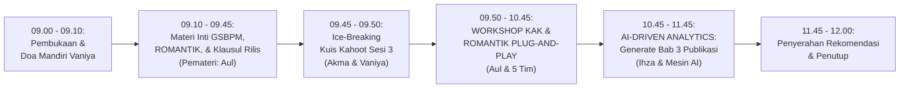

# MODUL PERTEMUAN 03: PROSES BISNIS STATISTIK & ANALISIS DATA BERBANTUAN AI
## Sesi 3 dari 4: Penerapan GSBPM, KAK Ber-klausul Batas Rilis (ROMANTIK), & AI-Driven Descriptive Analytics

**Kode Dokumen:** `PSS2026-PLAN-S3`  
**Dasar Surat Resmi:** Surat Sekretaris Daerah Kabupaten Mempawah Nomor `500.14.1/7358/DISKOMINFO-C`  
**Waktu Pelaksanaan:** **Rabu, 11 November 2026 (09.00 – 12.00 WIB / 180 Menit)**  
**Tempat Penyelenggaraan:** **Mempawah Command Center (MCC)**, Dinas Komunikasi dan Informatika Kabupaten Mempawah  
**Sasaran Peserta (37 Orang):** 23 Tenaga Entri Data OPD, 4 Tim Walidata Diskominfo, 7 Pegawai Organik BPS, dan 3 Mahasiswa Magang BPS.  
**Pemateri Utama:** **Aulia, S.Tr.Stat. (Aul)**  
**Fasilitator Pendamping Analisis AI:** **Ihza Fikri Zaki Karunia, S.Tr.Stat.**  

**Panitia Bertugas:**
- **MC & Pemandu Doa Mandiri:** Vaniya
- **Operator Slide & Kuis Kahoot:** Akma
- **Registrasi & Presensi:** Mahasiswa Magang, Nadya, dan Rara
- **Dokumentasi Foto/Video:** Irfan
- **Pengadaan Snack & Hadiah Kahoot:** Vaniya
- **Rekapitulasi Berkas & SPJ:** Sukma
- **Tim Pendamping Teknis:** Tim 1 (Sukma & Nadya), Tim 2 (Ihza & Magang 1), Tim 3 (Listio & Irfan), Tim 4 (Aller & Rara), Tim 5 (Aul & Uma)

---

## 🎯 1. Target Kinerja Sesi 3 & Bukti Dukung EPSS Terkunci

Sesi 3 mengunci **Domain 3 (Proses Bisnis Statistik - Bobot 19%)** dan membalikkan 3 indikator kritis EPSS:
- **Indikator 20301 (Aktualitas Data - Target Level 4):** Penyelenggaraan rilis data dengan rentang waktu $\le 6$ bulan pasca periode data berakhir.
- **Indikator 20302 (Ketepatan Waktu Diseminasi - Target Level 4):** Adanya klausul batas rilis di KAK dan dokumen pemantauan kesesuaian jadwal.
- **Indikator 30102 (Desain Statistik - Target Level 4):** Dokumen rancangan kerangka sampel dan metodologi baku.
- **Indikator 30103 (Pengembangan Desain - Target Level 4):** Penyempurnaan kuesioner dan alur pengumpulan data.
- **Indikator 30201 (Pengumpulan Data - Target Level 4):** SOP pengumpulan data dan surat edaran permintaan data dinas.
- **Indikator 30302 (Analisis Data Statistik - Target Level 4/5):** Publikasi resmi dinas yang dilengkapi **Bab Analisis Deskriptif Mendalam** (Tren 5 tahun, perbandingan spasial, ulasan sebab-akibat, dan rekomendasi kebijakan), bukan sekadar tabel kosong!
- **Indikator 50201 (Rekomendasi Statistik ROMANTIK - Target Level 4/5):** Surat Rekomendasi Statistik Layak Resmi BPS.
- **Indikator 50301 (Perencanaan Statistik - Target Level 4):** Dokumen KAK statistik terintegrasi dalam DPA OPD.

---

## ⏱️ 2. Susunan Acara & Alokasi Waktu (180 Menit / 3 Jam)



| Rentang Waktu | Durasi | Agenda Kegiatan di Mempawah Command Center (MCC) | Penanggung Jawab / Fasilitator |
|:---:|:---:|:---|:---|
| 09.00 – 09.10 | 10 Mnt | Pembukaan oleh MC (Vaniya), doa mandiri, dan kilas balik progres Sesi 2 | Vaniya |
| 09.10 – 09.45 | 35 Mnt | **Paparan Materi: Proses Bisnis Statistik (GSBPM) & Standar KAK Ber-Rekomendasi BPS** | **Aul** (Operator: Akma) |
| 09.45 – 09.50 | 5 Mnt | **Ice-Breaking: Kuis Kahoot Interaktif Sesi 3** (Hadiah Rp40.000 untuk Juara 1) | Akma & Vaniya |
| 09.50 – 10.45 | 55 Mnt | **WORKSHOP 1: Penyusunan KAK Plug-and-Play Ber-klausul Batas Rilis Resmi**<br>• Pengisian template KAK standar BPS di Google Docs<br>• Pengisian draf instrumen ROMANTIK BPS (FS3) | Aul, Sukma, Listio, Aller, & Uma |
| 10.45 – 11.45 | 60 Mnt | **WORKSHOP 2 (KAWALAN IHZA): AI-Driven Descriptive Analytics Engine**<br>• Input data time-series 5 tahun 2 Lokus Emas (BPKAD & DPMPTSPKUKM)<br>• Eksekusi tool AI Generator (`scripts/kb_pss_automation.py`)<br>• Pembentukan naskah Bab III Analisis Deskriptif Lengkap 4 Subbab | **Ihza** & Tim 1 (BPKAD) serta Tim 2 (DPMPTSPKUKM) |
| 11.45 – 12.00 | 15 Mnt | Penandatanganan KAK oleh operator/pejabat, pengesahan draf rekomendasi, & penutupan | Aul, Ihza, & Sukma |

---

## 📚 3. Paparan Materi: Proses Bisnis Statistik & GSBPM (Pemateri: Aul - 35 Menit)

Aul memaparkan standar baku internasional GSBPM (*Generic Statistical Business Process Model*) yang diadopsi BPS ke dalam bahasa kerja dinas daerah:

### Slide 1: Mengenal GSBPM (Mengapa BPS Sangat Tertib Probis?)
- Statistik berkualitas bukan hasil sulap. Ada 8 fase yang harus dilalui:
  1. *Perencanaan (Specify Needs)* $\rightarrow$ 2. *Desain (Design)* $\rightarrow$ 3. *Pembangunan (Build)* $\rightarrow$ 4. *Pengumpulan (Collect)* $\rightarrow$ 5. *Pengolahan (Process)* $\rightarrow$ 6. *Analisis (Analyse)* $\rightarrow$ 7. *Diseminasi (Disseminate)* $\rightarrow$ 8. *Evaluasi (Evaluate)*.
- TPB EPSS akan mengecek: **Apakah OPD punya dokumen KAK, SOP pengumpulan data, dan bukti analisisnya?**

### Slide 2: Rekomendasi Kegiatan Statistik (ROMANTIK BPS)
- Sesuai UU No. 16 Tahun 1997 dan PP No. 51 Tahun 1999: Setiap instansi pemerintah yang menyelenggarakan kegiatan statistik sektoral **WAJIB memberitahukan dan meminta rekomendasi kepada BPS**.
- Melalui aplikasi ROMANTIK BPS (`romantik.bps.go.id`), BPS menerbitkan **Surat Rekomendasi Statistik Layak** lengkap dengan Nomor Registrasi resmi.
- Rekomendasi ini adalah bukti mutlak **Indikator 50201 pada Level 4/5**!

### Slide 3: Kunci Sukses KAK: Klausul Batas Rilis Diseminasi Resmi
- Kesalahan fatal Mempawah di masa lalu: KAK tidak mencantumkan kapan buku profil harus terbit, atau jarak rilisnya molor setahun lebih dari pengumpulan data.
- Mulai hari ini, setiap KAK OPD wajib menyematkan **Klausul Mengikat:**
  > *"Penyelenggara menjamin publikasi data diseminasi akan diterbitkan dan dapat diakses publik selambat-lambatnya tanggal **31 Agustus 2026 (BPKAD)** / **30 November 2026 (DPMPTSPKUKM)** (atau selambat-lambatnya 6 bulan setelah berakhirnya periode pencacahan/kompilasi data)."*
- Klausul ini langsung mengunci **Indikator 20301 (Aktualitas)** dan **20302 (Ketepatan Waktu)**!

### Slide 4: Mengapa Indikator 30302 (Analisis Data) Anjlok ke Skor 1 di 2026?
- Di pleno 2026, buku profil data dinas Mempawah dinilai TPB **hanya berupa kompilasi tabel angka** (*tabel buta*).
- Syarat Level 4/5 EPSS: Publikasi harus memiliki **ulasan naratif** yang menjelaskan:
  1. Tren perubahan angka selama 3–5 tahun terakhir (naik/turun berapa persen).
  2. Perbandingan spasial antar-kecamatan (kecamatan mana tertinggi dan terendah).
  3. Ulasan korelasi sebab-akibat (*insight policy*).
  4. Rekomendasi aksi bagi pengambil kebijakan daerah.

### Slide 5: Solusi Pintar: AI-Driven Analytics Generator BPS
Operator OPD tidak perlu panik harus menulis esai statistik puluhan lembar. BPS Mempawah menghadirkan mesin AI cerdas: serahkan datanya, narasi analisisnya keluar otomatis!

---

## 🏆 4. Ice-Breaking: Kuis Kahoot Sesi 3 (Operator: Akma & MC: Vaniya - 5 Menit)

- **Platform:** Kahoot.it
- **Hadiah:** Uang tunai / voucher belanja Rp40.000 untuk 1 pemenang skor tertinggi.
- **Topik Kuis (5 Soal Cepat):**
  1. *Aplikasi resmi BPS untuk mengajukan Rekomendasi Statistik Sektoral adalah...?* (Jawaban: ROMANTIK).
  2. *Berapa fase baku dalam GSBPM?* (Jawaban: 8 Fase).
  3. *Berapa bulan batas toleransi aktualitas rilis data agar dinilai tepat waktu oleh EPSS?* (Jawaban: Maksimal 6 Bulan).
  4. *Apakah buku publikasi yang HANYA berisi tabel angka tanpa penjelasan naratif bisa mendapatkan Skor 4 di EPSS?* (Jawaban: Tidak bisa / Jatuh ke Skor 1 atau 2).
  5. *Dokumen apakah yang memuat rincian latar belakang, jadwal, dan anggaran kegiatan statistik di dinas?* (Jawaban: Kerangka Acuan Kerja / KAK).

---

## 🛠️ 5. Workshop Terpandu & Eksekusi Otomasi AI (115 Menit)

### 5.1 Workshop 1: KAK Plug-and-Play Ber-klausul Batas Rilis (Aul & 5 Tim - 55 Menit)
- Aul mendemonstrasikan pengisian Template Master KAK di Google Docs.
- 5 Tim Pendamping mendampingi OPD dampingannya:
  - Mengisi Nama Program APBD / DPA 2026.
  - Mengisi Judul Baku Kegiatan Statistik.
  - Memilih Cara Pengumpulan (Kompromin / Survei).
  - Mengunci Klausul Batas Rilis: **31 Agustus 2026 (BPKAD)** dan **30 November 2026 (DPMPTSPKUKM)**.
- Menghasilkan naskah KAK resmi siap dicetak dan ditandatangani Kepala OPD.

### 5.2 Workshop 2 (Kawalan Ihza): AI-Driven Analytics Generator (Ihza - 60 Menit)
Ihza mendemonstrasikan secara langsung cara kerja generator AI kepada seluruh peserta:
1. Operator BPKAD dan DPMPTSPKUKM menyalin tabel angka historis 5 tahun ke dalam format tabel sederhana.
2. Ihza menjalankan perintah otomasi CLI:
   ```bash
   python3 scripts/kb_pss_automation.py generate-analysis \
     --opd "DPMPTSPKUKM" \
     --kegiatan "Kompilasi Data Realisasi Pelayanan Perizinan Kabupaten Mempawah Tahun 2026" \
     --output Bab3_Analisis_Perizinan_DPMPTSP.md
   ```
3. Dalam hitungan detik, naskah Bab III Analisis Deskriptif tersusun lengkap dengan 4 subbab:
   - **Subbab 3.1:** Analisis Perkembangan & Tren Historis 5 Tahun (pertumbuhan NIB OSS / Realisasi LKPD).
   - **Subbab 3.2:** Disagregasi Spasial Antar-Kecamatan (sebaran unit usaha dan realisasi belanja per wilayah).
   - **Subbab 3.3:** Ulasan Faktor Determinan Sebab-Akibat (dampak proyek strategis smelter Sungai Kunyit & efisiensi perizinan OSS).
   - **Subbab 3.4:** Rekomendasi Kebijakan Konkret bagi Pimpinan Pemkab Mempawah.
4. Naskah langsung disalin ke draf dokumen publikasi dinas di Google Docs bersama.

---

## 📦 6. Deliverables Bukti Fisik yang Dihasilkan pada Sesi 3

1. **Dokumen KAK Final 2 Lokus Utama (BPKAD & DPMPTSPKUKM) Ber-klausul Batas Rilis Diseminasi:**  
   Mengunci **Indikator 20301 (Aktualitas)**, **20302 (Ketepatan Waktu)**, dan **50301 (Perencanaan Statistik)** pada Level 4.
2. **Draf Pengajuan Surat Rekomendasi Statistik Layak (ROMANTIK BPS):**  
   Mengunci **Indikator 50201 pada Level 4/5**.
3. **Naskah Lengkap Bab III Analisis Deskriptif Publikasi Hasil Generate AI:**  
   Mengunci **Indikator 30302 (Analisis Data Statistik) pada Level 4/5**.
4. **SOP Pengumpulan Data Rutin Dinas (Template E):**  
   Mengunci **Indikator 30201 (Pengumpulan Data) pada Level 4**.
5. **Paket Dokumentasi Sesi 3 untuk Portal SPESIAL:**  
   Presensi 37 peserta, Notula, Foto Dokumentasi Irfan, dan Bukti Juara Kahoot Vaniya.

---

## 📌 7. Arahan Menuju Pertemuan 4 (Selasa, 17 November 2026)
1. Membawa meterai Rp10.000 (disiapkan dinas atau difasilitasi) untuk penandatanganan **Surat Pernyataan Komitmen Netralitas Pimpinan OPD (Template A)**.
2. Tim Walidata Diskominfo menyiapkan draf lembar pemeriksaan mutu data untuk simulasi **Quality Gate Walidata Daerah** bersama Kak Aller dan Bg Listio.