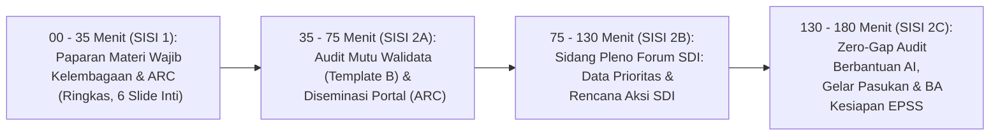

# MODUL PERTEMUAN 04: DISEMINASI MULTI-KANAL (ARC), MUTU WALIDATA, FORUM SDI, & GELAR PASUKAN EPSS 2028
## Sesi 4 dari 4: Mengunci Tata Kelola Kelembagaan, Zero-Gap Audit, & Predikat SANGAT BAIK
**Kode Dokumen:** `PSS2026-PLAN-S4`  
**Alokasi Waktu:** 180 Menit (3 Jam Penuh)  
**Tempat:** Mempawah Command Centre (MCC) / Aula Utama Kantor Bupati Mempawah  
**Penyelenggara:** Tim Pembina Statistik Sektoral BPS bersama Diskominfo (Walidata) dan Bapperida (Koordinator SDI)  
**Sasaran Peserta:** Sekretaris Daerah (Koordinator Forum SDI), Kepala Diskominfo (Ketua TPI), Kepala Bapperida, Kepala BPS, Seluruh Kepala OPD Produsen Data, dan Operator Data  

---

## 🎯 1. Target Kinerja Sesi 4 & Keterkaitan Indikator EPSS 2028

Pertemuan 4 adalah **sesi penutup dan puncak audit kesiapan (*final readiness check*)** yang memadatkan aspek diseminasi data, kendali mutu Walidata, kelembagaan forum, dan simulasi skor akhir:
- **Indikator 20301 (Aktualitas Data) & 20302 (Ketepatan Waktu Diseminasi):** Keduanya naik dari **Skor 1 menjadi Level 4** melalui Kalender Rilis Resmi (ARC) dan Laporan Pemantauan berbasis ROMANTIK BPS.
- **Indikator 40103 (Penjaminan Kualitas Walidata):** Naik dari **Skor 1 menjadi Level 4** melalui Lembar Checklist Mutu Walidata 5 Kriteria Baku (Template B).
- **Indikator 40302 (Penyelenggaraan Forum SDI):** Naik dari **Skor 2 menjadi Level 4** melalui paket berkas Sidang Pleno Forum SDI dan Berita Acara Kesepakatan Data Prioritas (Template J).
- **Indikator 50103 (Sosialisasi & Literasi Statistik):** Naik dari **Skor 1 menjadi Level 4** melalui paket lengkap 5 bukti literasi publik (bimtek, infografis, videotron, dashboard).
- **Indikator 50301 (Perencanaan Pembangunan Statistik):** Naik dari **Skor 1 menjadi Level 4** melalui penetapan Dokumen Rencana Aksi SDI Kabupaten Mempawah 2026–2028 (Template K).
- **Zero-Gap Audit 38 Indikator & Proyeksi Matematis:** Mengunci capaian Indeks Pembangunan Statistik **$\text{IPS} \ge 3.65$ (Predikat: SANGAT BAIK)**.

---

## ⏱️ 2. Pembagian Waktu Sesi (Total 180 Menit)



---

## 📚 3. SISI 1: Paparan Materi Wajib Statistik Sektoral (35 Menit / 6 Slide Inti)

### Slide 1: Mengapa Aktualitas (20301) dan Pemantauan Waktu (20302) Diberi Skor 1?
- Pada evaluasi 2026, bukti rilis portal Disperindagnaker tidak terunggah dan Dinkes tidak memiliki dokumen perbandingan jadwal resmi.
- **Rekomendasi Mutlak Pleno BPS Kalbar:** Pembuktian ketepatan waktu diseminasi wajib menyandingkan **jadwal rilis pada Surat Rekomendasi ROMANTIK BPS** dengan **tanggal realisasi rilis faktual di portal/buku publikasi**.

### Slide 2: Mengapa Penjaminan Mutu Walidata (40103) Bernilai 1?
- Diskominfo selaku Walidata Daerah dinilai tidak memiliki instrumen kendali mutu tertulis.
- Penilai EPSS mewajibkan tersedianya **Lembar Hasil Pemeriksaan Kualitas Data (Quality Checklist 5 Kriteria Baku)** yang ditandatangani fungsional statistisi pemeriksa dan Kepala Diskominfo sebelum data dirilis.

### Slide 3: Mengapa Forum SDI (40302) dan Rencana Aksi (50301) Turun Nilai?
- Berkas forum data masa lalu tidak terhimpun lengkap, dan surat alasan efisiensi anggaran Inpres 1/2025 sempat menurunkan nilai.
- Mempawah belum memiliki Dokumen Rencana Aksi SDI Daerah multisektoral yang sah.
- Solusi: Menyelenggarakan Sidang Pleno Forum SDI berkala, mengesahkan Berita Acara Data Prioritas, dan menetapkan Rencana Aksi SDI 2026–2028.

### Slide 4: Konsep Kalender Rilis Resmi (Advance Release Calendar / ARC) & Literasi
- ARC adalah kalender publik yang mengumumkan jadwal rilis publikasi dinas sebelum tahun berjalan berakhir.
- Literasi data (50103) bukan sekadar foto videotron, melainkan paket edukasi: bimtek pemahaman data, dashboard interaktif di MCC, infografis medsos, dan siaran pers.

### Slide 5: Quality Gate & Kedaulatan Walidata Daerah
- Mekanisme *Quality Gate*: Produsen Data menyerahkan data $\rightarrow$ Walidata menguji 5 kriteria $\rightarrow$ Jika lulus, terbit Lembar Mutu (Template B) $\rightarrow$ Data ditayangkan di portal.

### Slide 6: Sasaran Puncak Sesi 4
- Menuntaskan seluruh sisa bukti dukung kelembagaan, mengunci 100% kelengkapan 38 indikator, dan menandatangani Berita Acara Kesiapan EPSS 2028 dengan proyeksi predikat Sangat Baik.

---

## 🛠️ 4. SISI 2: Workshop Rendah Beban Kognitif, Otomasi AI, & Gelar Pasukan (145 Menit)

### 4.1 Tahap A: Audit Mutu Walidata (Template B) & Diseminasi Portal (40 Menit)
1. **Audit Mutu Cepat (Quality Gate):**
   - Tim Walidata Diskominfo bersama fungsional statistisi BPS melakukan verifikasi kelayakan atas data final Dinkes dan Disperindagnaker yang telah disiapkan pada Pertemuan 3.
   - Mengisi dan menandatangani **Lembar Hasil Pemeriksaan Kualitas Data (Quality Checklist Template B)**.
   - Menandatangani **Berita Acara Serah Terima Data (Template L)**.
2. **Diseminasi & Pengesahan Kalender ARC:**
   - Menayangkan dataset tabular format terbuka (`.csv` dan `.xlsx`) pada Portal Satu Data Indonesia Kabupaten Mempawah (`data.mempawahkab.go.id`).
   - Menerbitkan **Dokumen Kalender Rilis Resmi (ARC) Pemkab Mempawah 2026** di portal pemda.
   - Mengisi dan menandatangani **Laporan Pemantauan Ketepatan Waktu Diseminasi Berbasis ROMANTIK BPS (Template H)** yang membuktikan rilis *On-Time*!

### 4.2 Tahap B: Sidang Pleno Forum SDI — Penetapan Data Prioritas & Rencana Aksi (55 Menit)
- Dipimpin oleh Sekretaris Daerah selaku Koordinator Forum SDI.
- **Penetapan Daftar Data Prioritas Daerah 2026:**
  - Forum menyepakati 50+ dataset strategis yang mencakup SPM Kesehatan, Ketenagakerjaan, Pangan, dan Kemiskinan.
  - Penandatanganan **Berita Acara Kesepakatan Hasil Sidang Pleno Forum SDI (Template J)** oleh Sekda, Kepala Bapperida, Kepala Diskominfo, Kepala BPS, dan Kepala OPD.
- **Pengesahan Rencana Aksi SDI 2026–2028 (Template K):**
  - Mengesahkan Matriks 6 Program Kerja Strategis Pembangunan Statistik Daerah 2026–2028 (mengikat seluruh dinas dan mengunci **Indikator 50301 pada Level 4**).
- **Kompilasi Bukti Literasi Statistik (50103):**
  - Menghimpun bundel 5 bukti literasi: surat undangan bimtek, daftar hadir, notula, infografis medsos dinas, dan dokumentasi penayangan di videotron publik Taman Mempawah.

### 4.3 Tahap C: Zero-Gap Audit Berbantuan AI & Gelar Pasukan EPSS (50 Menit)
- Menjalankan perintah audit kesiapan berbasis AI/CLI:
  ```bash
  python3 scripts/kb_pss_automation.py audit-epss \
    --drive-folder "/root/projects/knowledge-base/kegiatan/evaluasi-epss/2026/dokumen-perbaikan"
  ```
- **Hasil Audit Mesin:**
  - Memeriksa keterisian 38 subfolder indikator pada Google Drive Master EPSS 2028.
  - Memverifikasi keberadaan 11 dokumen penyelamat indikator kritis.
  - Menampilkan hasil kalkulasi matematis simulasi SIMBATIK:
    $$\textbf{Proyeksi IPS Kabupaten Mempawah 2028} = \mathbf{3.970} \quad \textbf{(Predikat: SANGAT BAIK)}$$
- Seluruh Kepala Dinas, Ketua TPI (Kadis Kominfo), Koordinator TPI (Sekda), dan Kepala BPS menandatangani **Berita Acara Kesiapan Kabupaten Mempawah Menghadapi EPSS 2028**.
- Master Dossier Portofolio (Binder Fisik dan Cloud Drive) disegel dan siap digunakan kapan pun evaluasi dibuka.

---

## 📦 5. Deliverables Bukti Fisik yang Dihasilkan pada Sesi 4

1. **Dokumen Kalender Rilis Resmi (Advance Release Calendar / ARC) Pemkab Mempawah 2026:**
   - Bukti publikasi di portal resmi daerah untuk mengunci **Indikator 20302 (Ketepatan Waktu)**.
2. **Laporan Pemantauan Ketepatan Waktu Diseminasi berbasis ROMANTIK BPS (Template H):**
   - Matriks penyandingan rilis ROMANTIK vs faktual bertandatangan Kadis, mengunci **Indikator 20301 & 20302 pada Level 4**.
3. **Lembar Hasil Pemeriksaan Kualitas Data Statistik Sektoral (Quality Checklist Template B):**
   - Ditandatangani Fungsional Statistisi Diskominfo dan Kepala Dinas Komunikasi dan Informatika.
   - **Kunci mutlak mengubah Indikator 40103 dari Skor 1 menjadi Skor 4!**
4. **Paket Berkas Sidang Pleno Forum SDI & Berita Acara Kesepakatan Data Prioritas 2026 (Template J):**
   - Ditandatangani Sekda, Bapperida, Kominfo, BPS, dan OPD, mengunci **Indikator 40302 pada Level 4**.
5. **Dokumen Resmi Rencana Aksi SDI Kabupaten Mempawah 2026–2028 (Template K):**
   - Matriks 6 program kerja pembangunan statistik daerah, mengunci **Indikator 50301 pada Level 4**.
6. **Paket Lengkap 5 Bukti Dukung Literasi Statistik Publik:**
   - Bimtek, Infografis Medsos, Dashboard MCC, dan Tayangan Videotron, mengunci **Indikator 50103 pada Level 4**.
7. **Berita Acara Kesiapan Menghadapi EPSS 2028:**
   - Ditandatangani seluruh pemangku kepentingan daerah, melampirkan matriks audit 38 indikator lengkap.
8. **Paket Dokumentasi Sesi 4 untuk Portal SPESIAL:**
   - Undangan, Daftar Hadir, Notula Sidang Pleno, Materi Paparan, dan Foto Gelar Pasukan.

---

## 🏆 6. Status Kesiapan Akhir Pasca 4 Pertemuan

Dengan tuntasnya Sesi 4 ini:
1. **100% Kewajiban Juknis PSS 2026 Terpenuhi:** Seluruh 6 Rencana Kerja Wajib terekam rapi di portal SPESIAL BPS RI.
2. **Beban Operator OPD Tetap Ringan:** Seluruh naskah metodologi dan narasi analisis dihasilkan melalui template siap pakai dan mesin otomasi AI tanpa membuat operator stres.
3. **100% Bukti Dukung EPSS 2028 Terkunci:** Seluruh 38 Indikator memiliki bukti fisik sah, dan 10 indikator yang sebelumnya bernilai 1 telah dijamin naik ke Level 4.
4. **Pemerintah Kabupaten Mempawah siap mengamankan Predikat SANGAT BAIK pada EPSS 2028!**
