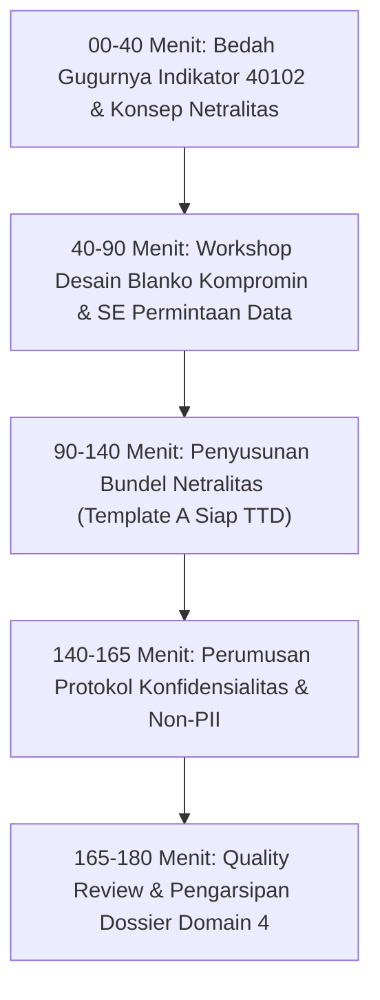

# MODUL PERTEMUAN 04: PENGUMPULAN DATA, INSTRUMEN KOMPROMIN, & PENJAMINAN NETRALITAS-OBJEKTIVITAS
## Rencana Kerja 4 (Probis) & Rencana Kerja 5 (Kelembagaan) Pembinaan Statistik Sektoral 2026
**Kode Dokumen:** `PSS2026-PLAN-04`  
**Waktu Pelaksanaan:** Minggu Ke-4 Pembinaan  
**Durasi Efektif:** 180 Menit (3 Jam)  
**Tempat:** Ruang Rapat Dinas Kominfo / Mempawah Command Centre (MCC)  
**Penyelenggara:** Tim Pembina Statistik Sektoral BPS Kabupaten Mempawah bersama Dinas Kominfo  
**Sasaran Peserta:** Operator Data, Staf Teknis Pengumpul Data Lapangan dari OPD Produsen Data Kegiatan Prioritas (Dinkes & Disperindagnaker), OPD Terkait, dan Fungsional Statistisi Diskominfo  

---

## 🎯 1. Tujuan Pertemuan & Keterkaitan Indikator EPSS 2028

### 1.1 Penyelamatan Indikator Kritis 40102 (Skor 1 pada EPSS 2026)
Pada Rapat Pleno Provinsi EPSS 2026, **Indikator 40102 (Penjaminan Netralitas dan Objektivitas)** Kabupaten Mempawah mengalami penurunan tragis dari Nilai 2 menjadi **Nilai 1 (Tingkat Kematangan Terendah)**. 
- *Akar Masalah Evaluasi 2026:* Kedua OPD sampel (Dinkes dan Disperindag) hanya melampirkan tangkapan layar draf SOP umum tanpa bukti legalitas. Tim Penilai Badan menolak bukti tersebut karena **tidak ada Surat Pernyataan Komitmen Netralitas yang ditandatangani oleh Kepala OPD** dan **tidak ada dokumen penjelasan rujukan metodologi standar nasional**.
- *Catatan Hasil Interviu:* Evaluator mempertanyakan apakah ada bukti tertulis yang menjamin bahwa penentuan metodologi bebas dari intervensi politik dan menghasilkan angka riil lapangan.

Tujuan Pertemuan 4 adalah:
1. Memastikan seluruh rangkaian instrumen pengumpulan data (blanko kompromin / kuesioner) telah dirancang sesuai kaidah keilmuan statistik (GSBPM Fase 3 *Build* dan Fase 4 *Collect*).
2. Membimbing operator dalam menyusun **Surat Permintaan Data Resmi** dari Kepala Dinas ke seluruh unit sumber data (Puskesmas, RSUD, perusahaan industri).
3. Menyusun dan melegalkan **Bundel Dokumen Penjaminan Netralitas & Objektivitas Metodologi** lengkap dengan tanda tangan basah Kepala Dinas (Template A) untuk membalikkan skor Indikator 40102 dari **Skor 1 menjadi Skor 4 (Terpadu dan Terukur)** pada EPSS 2028.
4. Menegakkan **Protokol Penjaminan Konfidensialitas Data (Indikator 40104)** guna melindungi kerahasiaan identitas individual (*privacy protection & non-PII*).

### 1.2 Pemetaan Indikator EPSS 2028 & Target Kematangan

| Kode Indikator | Nama Indikator EPSS | Bobot Relatif | Kondisi 2026 | Target EPSS 2028 | Syarat Pemenuhan Bukti Dukung Level 4 |
|:---:|:---|:---:|:---:|:---:|:---|
| **30201** | Pengumpulan Data / Akuisisi Data | **4.94%** | Level 3 | **Level 4** | Tersedianya instrumen baku, surat tugas pengumpul data, surat edaran resmi permintaan data, serta sistem monitoring respons rate unit pengirim. |
| **40101** | Penjaminan Transparansi Informasi | 1.49% | Level 3 | **Level 4** | Informasi metodologi, sumber data, dan keterbatasan data dipublikasikan secara terbuka dan dapat diakses publik. |
| **40102** | Penjaminan Netralitas & Objektivitas | 1.49% | **Skor 1 (Kritis)** | **Level 4 (Terpadu)** | Surat Pernyataan Komitmen Netralitas Pimpinan OPD bertandatangan basah & bermaterai, disertai Lembar Penjelasan Rujukan Metodologi Standar Nasional BPS (Perka BPS No. 5/2020). |
| **40104** | Penjaminan Konfidensialitas Data | 1.49% | Level 3 | **Level 4** | Dokumen regulasi/SOP perlindungan kerahasiaan data mikro perseorangan, klausul non-disclosure agreement petugas, dan pembuktian rilis data dalam format agregat. |

---

## 📚 2. Ringkasan Materi Teknis untuk Operator OPD

### 2.1 Manajemen Pengumpulan Data Kompilasi Produk Administrasi (KOMPROMIN)
Sebagian besar kegiatan statistik sektoral di OPD adalah kompromin. Agar proses akuisisi data diakui pada EPSS Level 4, tahapan pengumpulan data harus memiliki jejak audit resmi (*audit trail*):
1. **Surat Edaran Permintaan Data Resmi:** Diterbitkan diawal tahun oleh Kepala Dinas kepada seluruh unit sumber data (contoh Dinkes: Surat Edaran ke 14 Kepala Puskesmas; contoh Disperindag: Surat Edaran Pelaporan Ketenagakerjaan ke 27 Perusahaan Industri).
2. **Keseragaman Instrumen (Blanko Pengumpulan Data):** Format tabel pengumpulan data harus seragam (menggunakan template Excel yang terkunci rumusnya) agar data yang dikirim dari 14 puskesmas atau 27 perusahaan memiliki struktur kolom yang identik.
3. **Buku Petunjuk Pengisian Instrumen:** Pedoman ringkas yang menjelaskan cara mengisi setiap kolom pada blanko, termasuk definisi variabel dan batasan data.
4. **Logbook Pemantauan Pengumpulan Data (Response Rate Tracking):** Catatan tanggal penerimaan berkas dari masing-masing unit pelapor untuk memantau unit mana yang belum mengirimkan data (*non-response follow-up*).

### 2.2 Penjaminan Netralitas dan Objektivitas Metodologi
Sesuai prinsip statistik resmi PBB (*Fundamental Principles of Official Statistics*) dan Peraturan BPS No. 5 Tahun 2020:
- Penentuan metode penarikan data, konsep yang diukur, dan formula indikator **harus semata-mata didasarkan pada pertimbangan profesional dan kaidah keilmuan statistik**, bebas dari intervensi kepentingan politik atau tekanan target program dinas.
- Angka yang dihasilkan harus mencerminkan fakta lapangan apa adanya (objektif).
- Bukti pemenuhannya adalah **Surat Pernyataan Komitmen Netralitas Pimpinan OPD** yang menyatakan secara tertulis independensi metodologi tersebut.

### 2.3 Penjaminan Konfidensialitas Data (Perlindungan Data Pribadi)
Sesuai amanat UU No. 16 Tahun 1997 dan UU No. 27 Tahun 2022 tentang Pelindungan Data Pribadi (PDP):
- Data perseorangan yang mencantumkan *Personally Identifiable Information* (PII)—seperti Nama Lengkap Pasien, NIK, Alamat Detail RT/RW, Riwayat Penyakit Menular, atau Besaran Gaji Individu—**wajib dirahasiakan dan dilindungi**.
- Dokumen publikasi resmi **HANYA BOLEH menyajikan data dalam bentuk agregat** (tabel rekapitulasi per kecamatan, per kelompok umur, atau per sektor industri) guna menjamin tidak ada identitas individu yang dapat dilacak (*Statistical Disclosure Control*).

---

## 🛠️ 3. Rangkaian Kegiatan Sesi Pembinaan (Rundown 180 Menit)



### 3.1 Sesi 1: Evaluasi Kegagalan Indikator 40102 & Kaidah Netralitas (40 Menit)
- Fasilitator BPS memaparkan catatan wawancara penilai EPSS yang menolak bukti screenshot draf SOP tanpa tanda tangan pimpinan OPD.
- Menjelaskan arti penting independensi statistik dan mengapa Surat Pernyataan Netralitas ber-Kop Dinas menjadi dokumen wajib mutlak.
- Pembahasan prinsip transparansi metodologi (Indikator 40101).

### 3.2 Sesi 2: Workshop Desain Blanko Kompromin & Surat Edaran Data (50 Menit)
- Operator memeriksa format template Excel pengumpulan data yang selama ini dikirimkan ke unit sumber data.
- Menstandarkan format kolom agar mencakup: Kode Wilayah Kemendagri, Nama Fasilitas, Periode Data, Variabel Standar, dan Kolom Tanda Tangan Verifikator Unit.
- Menyusun draf naskah dinas **Surat Edaran Permintaan Data Resmi** bertandatangan Kepala Dinas.

### 3.3 Sesi 3: Penyusunan Bundel Bukti Dukung Netralitas (50 Menit)
- Operator menyusun naskah **Surat Pernyataan Komitmen Netralitas Pimpinan OPD (Template A)** lengkap dengan kop dinas dan nomor surat dinas.
- Menyusun naskah **Lembar Penjelasan Rujukan Metodologi Standar Nasional BPS** yang menguraikan rujukan ke Perka BPS No. 5/2020 dan standar teknis kementerian induk (Kemenkes / Kemnaker).
- Melampirkan tangkapan layar status persetujuan rancangan kegiatan dari BPS (hasil Pertemuan 3).
- Bundel 5 halaman siap dicetak untuk proses tanda tangan basah dan cap dinas oleh Kepala Dinas masing-masing.

### 3.4 Sesi 4: Perumusan Protokol Konfidensialitas Data (25 Menit)
- Merumuskan klausul perlindungan data rahasia pada SOP pengumpulan data.
- Memastikan bahwa file data mentah yang memuat NIK/Nama pasien/pekerja disimpan di folder terproteksi (*restricted access*) dan tidak pernah diunggah mentah-mentah ke portal publik.
- Pembina BPS memverifikasi kepatuhan seluruh draf dokumen sebelum disahkan.

---

## 📋 4. Format Naskah Bukti Fisik Netralitas (Template Mandatori)

### 4.1 Template A: Surat Pernyataan Netralitas & Objektivitas (Halaman 1)
*(Dicetak pada kertas berkop resmi dinas, diberi tanggal, dan ditandatangani basah oleh Kepala Dinas)*

```markdown
KOP RESMI DINAS KESEHATAN / DISPERINDAGNAKER
KABUPATEN MEMPAWAH

SURAT PERNYATAAN KOMITMEN PENJAMINAN NETRALITAS DAN OBJEKTIVITAS
PENYELENGGARAAN KEGIATAN STATISTIK SEKTORAL TAHUN 2026
Nomor: ... / ... / DINAS / 2026

Saya yang bertanda tangan di bawah ini:
Nama        : dr. David V. R. Sianipar, M.Kes / Johana Saragih, S.H.
NIP         : ..............................................................
Jabatan     : Kepala Dinas Kesehatan, PPKB / Kepala Disperindagnaker Kabupaten Mempawah
Alamat Dinas: Jalan ........................................................

Dengan ini menyatakan dengan sesungguhnya bahwa dalam rangka penyelenggaraan kegiatan statistik sektoral "Kompilasi Data Profil Kesehatan Kabupaten Mempawah Tahun 2026" (atau: "Kompilasi Data Pencari Kerja Terdaftar dan Penempatan Tenaga Kerja Kabupaten Mempawah Tahun 2026"):

1. Menjamin netralitas, independensi, dan objektivitas penuh dalam seluruh tahapan penentuan metodologi, pengumpulan data, pengolahan, verifikasi, hingga penyajian data statistik sektoral.
2. Menjamin bahwa metodologi yang digunakan bebas dari segala bentuk intervensi politik, benturan kepentingan, rekayasa data, maupun manipulasi angka dari pihak manapun demi kepentingan tertentu.
3. Seluruh data dan angka yang disajikan bersumber secara sah dari fakta operasional lapangan unit pelapor dan dihimpun mengacu pada Norma, Standar, Prosedur, dan Kriteria (NSPK) statistik resmi yang berlaku.
4. Apabila di kemudian hari ditemukan adanya penyimpangan atau ketidaksesuaian terhadap prinsip objektivitas dan integritas data ini, kami siap bertanggung jawab sesuai ketentuan peraturan perundang-undangan.

Demikian Surat Pernyataan ini dibuat dengan penuh kesadaran dan tanggung jawab untuk dipergunakan sebagaimana mestinya sebagai bukti komitmen penjaminan kualitas statistik sektoral di lingkungan Pemerintah Kabupaten Mempawah.

Mempawah,      Februari 2026
Kepala Dinas ...................................,
(meterai Rp 10.000, tanda tangan basah & cap dinas)


................................................
NIP. ...........................................
```

### 4.2 Lembar Penjelasan Rujukan Metodologi Standar Nasional (Halaman 2)

```markdown
LAMPIRAN SURAT PERNYATAAN KOMITMEN NETRALITAS
NOMOR: ... / ... / DINAS / 2026

LEMBAR PENJELASAN RUJUKAN METODOLOGI STANDAR NASIONAL
KEGIATAN STATISTIK SEKTORAL TAHUN 2026

Dalam rangka memastikan objektivitas dan validitas keilmuan statistik, penyelenggaraan kegiatan statistik sektoral ini mengacu pada kerangka standar nasional dan internasional sebagai berikut:

1. Rujukan Peraturan Badan Pusat Statistik:
   - Peraturan BPS Nomor 4 Tahun 2019 tentang Norma, Standar, Prosedur, dan Kriteria Penyelenggaraan Statistik Sektoral.
   - Peraturan BPS Nomor 5 Tahun 2020 tentang Petunjuk Teknis Penyelenggaraan Kegiatan Statistik Sektoral.
   - Peraturan Kepala BPS tentang Klasifikasi Baku Lapangan Usaha Indonesia (KBLI) dan Klasifikasi Baku Jabatan Indonesia (KBJI).

2. Rujukan Standar Teknis Kementerian Induk:
   - Peraturan Menteri Kesehatan RI Nomor 1171/MENKES/PER/VI/2011 tentang Sistem Informasi Rumah Sakit dan Standar Pelayanan Minimal (SPM) Bidang Kesehatan.
   - Peraturan Menteri Ketenagakerjaan RI tentang Tata Cara Pelaporan Pelayanan Antarkerja dan Penempatan Tenaga Kerja Dalam Negeri.

3. Kepatuhan Status Rekomendasi Pembina Data BPS:
   Rancangan metodologi kegiatan ini telah diajukan dan diverifikasi oleh Badan Pusat Statistik Kabupaten Mempawah melalui aplikasi ROMANTIK BPS dengan status DITERBITKAN REKOMENDASI (LAYAK) Nomor: K-26.6104.XXX tertanggal ... .

Mempawah,      Februari 2026
Kepala Bidang Pengelola Data,                Statistisi / Pengelola Data OPD,
(tanda tangan)                              (tanda tangan)


.......................................     .......................................
NIP. ..................................     NIP. ..................................
```

---

## 📦 5. Artefak Bukti Fisik yang Wajib Dihasilkan (Deliverables Pertemuan 4)

### 5.1 Deliverable Teknis Statistik (Bukti EPSS 2028)
1. **Bundel Lengkap Bukti Dukung Netralitas dan Metodologi (Format PDF 5 Halaman):**
   - Halaman 1: Surat Pernyataan Komitmen Netralitas Pimpinan OPD bermeterai Rp 10.000 dan cap basah dinas.
   - Halaman 2: Lembar Penjelasan Rujukan Metodologi Standar Nasional BPS dan Kementerian Induk.
   - Halaman 3–5: Tangkapan layar status persetujuan rekomendasi di portal ROMANTIK BPS / metadata di portal INDAH BPS.
   - Disimpan di: `04_DOMAIN_4_KELEMBAGAAN/40102_Netralitas_dan_Objektivitas/` *(Kunci Utama Membalik Skor 1 Jadi Skor 4!)*.
2. **Surat Edaran Permintaan Data Resmi ke Unit Sumber Data:**
   - Surat resmi berkop dinas ditujukan ke 14 Puskesmas / RSUD / 27 Perusahaan Mitra.
   - Menjadi bukti fisik mutlak untuk **Indikator 30201 (Pengumpulan Data)**.
3. **Instrumen Pengumpulan Data / Blanko Kompromin Terstandar:**
   - Formulir kuesioner / template spreadsheet resmi yang memuat kolom kode wilayah dan identitas pengirim.
   - Menjadi bukti dukung **Indikator 30103 (Penyiapan Instrumen)** dan **30201**.
4. **Dokumen SOP Perlindungan Konfidensialitas Data (Format PDF):**
   - Menjelaskan tata cara pengamanan data individu dan kewajiban rilis dalam format agregat.
   - Disimpan di: `04_DOMAIN_4_KELEMBAGAAN/40104_Konfidensialitas_Data/`.

### 5.2 Deliverable Administrasi Pembinaan (Portal SPESIAL)
1. Surat Undangan Pertemuan 4 dari Kepala BPS.
2. Daftar Hadir bertandatangan seluruh peserta.
3. Notula Pertemuan yang mencatat pembahasan etika statistik dan netralitas pengumpulan data.
4. Materi Paparan Pengumpulan Data & Netralitas Metodologi.
5. Dokumentasi Foto pelaksanaan bimbingan teknis perancangan instrumen.

---

## 📌 6. Tindak Lanjut Operator Menuju Pertemuan 5
Sebelum hadir pada **Pertemuan 5 (Pengolahan Data, Cleaning, & Penilaian Akurasi Data)**, operator OPD wajib:
1. Memproses tanda tangan basah dan cap dinas atas Surat Pernyataan Netralitas (Template A) kepada Kepala Dinas masing-masing.
2. Membawa sampel file Excel data mentah hasil pengumpulan data dari unit sumber data.
3. Menyiapkan daftar potensi anomali data (misal: data pencari kerja ganda, salah input angka pada laporan puskesmas) untuk dipraktikkan proses pembersihannya.
