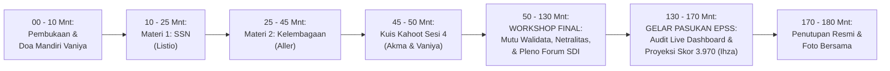

# MODUL PERTEMUAN 04: SSN, KELEMBAGAAN SEKTORAL, & GELAR DOSSIER EPSS 2028
## Sesi 4 dari 4: Mengunci Domain 4 (Kelembagaan) & Domain 5 (SSN), Quality Gate Walidata, Pakta Netralitas, dan Audit Final Proyeksi Sangat Baik (IPS 3.970)

**Kode Dokumen:** `PSS2026-PLAN-S4`  
**Waktu Pelaksanaan:** Selasa, 17 November 2026 (08.30 – 11.30 WIB / 180 Menit)  
**Tempat:** Mempawah Command Centre (MCC) Diskominfo / Aula Praja Utama Kantor Bupati Mempawah  
**Pemateri Resmi:**
- **Materi 1 (Sistem Statistik Nasional / SSN):** **Listio, S.Tr.Stat. (Bg Tio)**
- **Materi 2 (Kelembagaan Statistik Sektoral):** **Aller, S.Tr.Stat.**
- **Pemandu Gelar Pasukan & Audit Akhir EPSS:** **Ihza Fikri Zaki Karunia, S.Tr.Stat.**

**Panitia Bertugas:**
- **MC & Pemandu Doa Mandiri:** Vaniya
- **Operator Slide & Kuis Kahoot:** Akma
- **Registrasi & Presensi:** Mahasiswa Magang, Nadya, dan Rara
- **Dokumentasi Foto/Video:** Irfan
- **Pengadaan Snack & Hadiah Kahoot:** Vaniya
- **Rekapitulasi Berkas & SPJ Final:** Sukma
- **Tim Pendamping Teknis:** Tim 1 (Sukma), Tim 2 (Ihza), Tim 3 (Listio), Tim 4 (Aller), Tim 5 (Aul & Uma)

---

## 🎯 1. Target Kinerja Sesi 4 & Bukti Dukung EPSS Terkunci

Sesi 4 adalah puncak pembinaan yang mengunci **Domain 4 (Kelembagaan - Bobot 26%)** dan **Domain 5 (Statistik Nasional - Bobot 20%)**:
- **Indikator 40102 (Penjaminan Netralitas & Objektivitas - Target Level 4):** Surat Pernyataan Komitmen Netralitas Penyelenggaraan bermeterai Rp10.000 ditandatangani Kepala OPD.
- **Indikator 40103 (Penjaminan Kualitas oleh Walidata - Target Level 4):** Lembar Checklist & Berita Acara Pemeriksaan Mutu Data Walidata Diskominfo (Template B).
- **Indikator 40302 (Forum Satu Data Indonesia - Target Level 4):** Notula Lengkap & Berita Acara Kesepakatan Sidang Pleno Forum SDI Mempawah 2026.
- **Indikator 50101 & 50102 (Penyebarluasan & Aksesibilitas Data - Target Level 4):** Publikasi kalender rilis resmi (ARC) di portal Satu Data Mempawah.
- **Indikator 50103 (Literasi Statistik Publik & Inovasi - Target Level 5):** Inovasi Live Workspace "Radar EPSS Mempawah" dan paket 5 infografis diseminasi publik.
- **Indikator 50303 (Rencana Aksi SDI Daerah - Target Level 4):** Dokumen Matriks Rencana Aksi SDI Kabupaten Mempawah Periode 2026–2028.

---

## ⏱️ 2. Susunan Acara & Alokasi Waktu (180 Menit / 3 Jam)



| Rentang Waktu | Durasi | Agenda Kegiatan | Penanggung Jawab / Fasilitator |
|:---:|:---:|:---|:---|
| 08.30 – 08.40 | 10 Mnt | Pembukaan oleh MC (Vaniya), doa mandiri, dan pengantar puncak pembinaan | Vaniya |
| 08.40 – 08.55 | 15 Mnt | **Materi 1: Penguatan Sistem Statistik Nasional (SSN) & Ekosistem Data Daerah** | **Listio** (Operator: Akma) |
| 08.55 – 09.15 | 20 Mnt | **Materi 2: Kelembagaan Statistik Sektoral, Penjaminan Netralitas, & Peran Walidata** | **Aller** (Operator: Akma) |
| 09.15 – 09.20 | 5 Mnt | **Ice-Breaking: Kuis Kahoot Interaktif Sesi 4** (Hadiah Rp40.000 untuk Juara 1) | Akma & Vaniya |
| 09.20 – 10.10 | 50 Mnt | **WORKSHOP 1: Quality Gate Walidata Diskominfo & Pakta Netralitas Kepala OPD**<br>• Pengisian Berita Acara Pemeriksaan Mutu Walidata 5 Kriteria (Template B)<br>• Penempelan meterai & penandatanganan Surat Pernyataan Netralitas (Template A) | Aller, Tim Diskominfo, & 5 Tim Pendamping |
| 10.10 – 10.40 | 30 Mnt | **WORKSHOP 2: Simulasi Sidang Pleno Forum SDI Mempawah 2026**<br>• Penetapan Daftar Data Prioritas Daerah Tahun 2026<br>• Penyusunan Dokumen Rencana Aksi SDI 2026–2028 (Template K) | Bapperida, Diskominfo, BPS, & 23 OPD |
| 10.40 – 11.20 | 40 Mnt | **SESI SPESIAL GELAR PASUKAN KAWALAN IHZA: Zero-Gap Audit & Simulasi Skor EPSS**<br>• Proyeksi Live Dashboard Google Sheets "Radar EPSS Mempawah"<br>• Verifikasi 100% lampu hijau untuk 38 indikator 2 Lokus Emas<br>• Eksekusi simulasi kalkulator resmi EPSS: **Proyeksi IPS 3.970 (Sangat Baik)** | **Ihza Fikri Zaki Karunia** & Seluruh Tim BPS |
| 11.20 – 11.30 | 10 Mnt | Penyerahan Piagam Apresiasi Pembinaan, foto bersama seluruh peserta, & penutupan | Vaniya, Sukma (SPJ), & Irfan (Foto) |

---

## 📚 3. Paparan Materi Sesi 4

### 3.1 Materi 1: Sistem Statistik Nasional (SSN) (Pemateri: Listio - 15 Menit)
Listio menjelaskan ekosistem statistik Indonesia berdasarkan UU No. 16 Tahun 1997 dan Perpres No. 39 Tahun 2019:
1. **Tripartit Penyelenggara Data Daerah:**
   - **BPS:** Pembina Data Statistik (menetapkan standar, membina metodologi, memberikan rekomendasi).
   - **Bapperida:** Koordinator Forum Satu Data Indonesia (menyelaraskan data dengan perencanaan RPJMD/RKPD).
   - **Diskominfo:** Walidata Daerah (mengumpulkan, memeriksa mutu, mengelola portal Satu Data, dan mendiseminasikan data).
   - **23 OPD:** Produsen Data (mengumpulkan data sesuai tugas fungsi dan standar pembina).
2. **Pemanfaatan Data Statistik:** Data bukan hanya untuk arsip lemari, melainkan dasar mutlak alokasi anggaran, perencanaan pembangunan, dan evaluasi kinerja kepala daerah.

### 3.2 Materi 2: Kelembagaan & Netralitas Statistik (Pemateri: Aller - 20 Menit)
Aller membedah 2 indikator kelembagaan yang menjadi ganjalan di evaluasi masa lalu:
1. **Penjaminan Netralitas & Objektivitas (Indikator 40102 - Skor 1 di Pleno 2026):**
   - *Akar Masalah:* TPB menemukan belum ada komitmen tertulis dari pimpinan OPD bahwa angka statistik bebas dari intervensi politis atau manipulasi target.
   - *Solusi Baku:* Setiap Kepala OPD lokus menandatangani **Surat Pernyataan Komitmen Penjaminan Netralitas Metodologi bermeterai Rp10.000** (Template A).
2. **Quality Gate Walidata Daerah (Indikator 40103 - Skor 1 di Pleno 2026):**
   - *Akar Masalah:* Diskominfo belum memiliki bukti berita acara bahwa mereka benar-benar melakukan verifikasi kepatuhan prinsip SDI sebelum data dipublikasikan.
   - *Solusi Baku:* Diskominfo menerbitkan **Lembar Checklist Pemeriksaan Mutu Data Walidata (Template B)** yang mencakup 5 kriteria pengujian.
3. **Sidang Pleno Forum SDI (Indikator 40302):**
   - Forum SDI wajib menghasilkan 2 output resmi: **Berita Acara Kesepakatan Daftar Data Prioritas Daerah Tahun 2026** dan **Dokumen Rencana Aksi SDI 2026–2028**.

---

## 🏆 4. Ice-Breaking: Kuis Kahoot Puncak Sesi 4 (Operator: Akma & MC: Vaniya - 5 Menit)

- **Platform:** Kahoot.it
- **Hadiah:** Uang tunai / voucher belanja Rp40.000 untuk 1 pemenang skor tertinggi.
- **Topik Kuis (5 Soal Pamungkas):**
  1. *Siapakah instansi yang berperan sebagai Walidata di tingkat Pemerintah Kabupaten?* (Jawaban: Dinas Komunikasi dan Informatika / Diskominfo).
  2. *Siapakah yang bertindak sebagai Koordinator Forum Satu Data Indonesia di Kabupaten Mempawah?* (Jawaban: Bapperida).
  3. *Apa nama dokumen yang memuat komitmen kepala dinas bahwa pengumpulan data bebas dari intervensi kepentingan?* (Jawaban: Surat Pernyataan Netralitas).
  4. *Berapa kriteria baku yang wajib diperiksa Walidata saat melakukan Quality Gate data statistik?* (Jawaban: 5 Kriteria).
  5. *Berapakah target predikat capaian EPSS Kabupaten Mempawah tahun 2028?* (Jawaban: Sangat Baik / Memuaskan).

---

## 🛠️ 5. Workshop Terpandu & Gelar Pasukan EPSS 2028 (110 Menit)

### 5.1 Pengisian Quality Gate Walidata & Penandatanganan Pakta Netralitas (50 Menit)
1. **Diskominfo sebagai Walidata Daerah (Template B):**
   - Tim Diskominfo (4 personil) bersama Tim 5 BPS memeriksa draf publikasi LKPD Audited 2026 (BPKAD) dan Realisasi Pelayanan Perizinan 2026 (DPMPTSPKUKM).
   - Mengisi Checklist Mutu: Kesesuaian SDS (Ada), Kesesuaian Metadata (Ada), Interoperabilitas (Format .csv siap), Kode Referensi Kemendagri (Sesuai), dan Jadwal Rilis (Tepat Waktu).
   - Penandatanganan Berita Acara Quality Gate oleh Kepala Diskominfo Mempawah.
2. **Penjaminan Netralitas Kepala OPD (Template A):**
   - Menempelkan meterai Rp10.000 pada draf Surat Pernyataan Netralitas BPKAD dan DPMPTSPKUKM.
   - Ditandatangani resmi oleh Kepala BPKAD dan Kepala DPMPTSPKUKM untuk menjamin integritas angka bebas intervensi.

### 5.2 Simulasi Sidang Pleno Forum SDI Mempawah 2026 (30 Menit)
- BPS Mempawah, Bapperida, Diskominfo, dan seluruh 23 OPD memformalkan kesepakatan:
  1. Pengesahan **Daftar Data Statistik Prioritas Daerah Kabupaten Mempawah Tahun 2026** (mencakup 100+ variabel strategis dari 23 OPD).
  2. Penandatanganan Berita Acara Kesepakatan Forum SDI 2026 (Template J).
  3. Pengesahan **Dokumen Rencana Aksi SDI Kabupaten Mempawah Periode 2026–2028** (Template K).

### 5.3 SESI SPESIAL GELAR PASUKAN KAWALAN IHZA: Zero-Gap Audit & Simulasi Skor Akhir (40 Menit)
Ihza memimpin review komprehensif di depan seluruh hadirin melalui layar proyektor aula:
1. **Pengecekan Dashboard Google Sheets "Radar EPSS Mempawah 2026–2028":**
   - Menunjukkan bahwa tab **Lokus 1 (BPKAD)** dan **Lokus 2 (DPMPTSPKUKM)** telah memiliki **100% lampu indikator HIJAU** (seluruh 38 indikator telah memiliki tautan dokumen fisik/digital di Google Drive).
   - Menunjukkan bahwa seluruh 23 OPD telah memiliki nama kegiatan baku dan kamus standar data.
2. **Eksekusi Mesin Audit EPSS (`scripts/kb_pss_automation.py`):**
   ```bash
   python3 scripts/kb_pss_automation.py audit-epss
   ```
3. **Pengumuman Hasil Proyeksi Kinerja:**
   - Di hadapan Kepala BPS, Kadiskominfo, Kepala Bapperida, dan seluruh operator OPD, Ihza menampilkan hasil proyeksi resmi EPSS Mempawah:
     - **Skor Indeks Pembangunan Statistik (IPS):** $\mathbf{3.970}$
     - **Predikat Kinerja:** **SANGAT BAIK (Predikat Memuaskan)**
     - **Lompatan Peningkatan:** Naik drastis **+1.412 poin (+55.2%)** dari baseline evaluasi 2026 (2.558 - Cukup).
   - Tepuk tangan apresiasi dan pengesahan Berita Acara Kesiapan Bersama.

---

## 📦 6. Deliverables Master Dossier EPSS 2028 yang Dikunci pada Sesi 4

1. **Surat Pernyataan Komitmen Penjaminan Netralitas Kepala OPD bermeterai (Template A):**  
   Mengunci **Indikator 40102 pada Level 4/5**.
2. **Berita Acara Quality Gate Pemeriksaan Mutu Walidata Diskominfo (Template B):**  
   Mengunci **Indikator 40103 pada Level 4/5**.
3. **Notula & Berita Acara Kesepakatan Sidang Pleno Forum SDI 2026 (Template J):**  
   Mengunci **Indikator 40302 pada Level 4**.
4. **Dokumen Matriks Rencana Aksi SDI Kabupaten Mempawah 2026–2028 (Template K):**  
   Mengunci **Indikator 50303 pada Level 4**.
5. **Paket 5 Bukti Literasi Statistik Publik & Sistem Inovasi "Radar EPSS":**  
   Mengunci **Indikator 50103 pada Level 5**.
6. **Master Dossier Digital EPSS 2028 di Google Drive Bersama BPS & Diskominfo:**  
   38 folder terstruktur yang siap diserahkan kepada Tim Penilai Badan saat evaluasi 2028 dibuka!

---

## 📌 7. Keberlanjutan Sistem Paska-Pembinaan (*Post-Event Roadmap*)
1. **Penyimpanan Permanen:** Seluruh berkas digital tersimpan aman di Google Drive bersama antara Tim Pembina BPS dan Tim Walidata Diskominfo.
2. **Monitoring Berkala:** Setiap semester, Tim Pembina BPS bersama Diskominfo membuka kembali *Radar EPSS Mempawah* untuk memastikan realisasi diseminasi rilis data lokus tepat waktu sesuai klausul KAK.
3. **Kesiapan Panen 2028:** Ketika penilaian mandiri EPSS 2028 dimulai, Pemerintah Kabupaten Mempawah tidak lagi disibukkan dengan pembuatan dokumen dadakan, melainkan tinggal mengunggah bukti dukung yang telah sempurna dipersiapkan sejak tahun 2026!