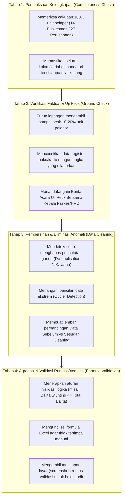

# MODUL PERTEMUAN 05: PENGOLAHAN DATA, VALIDASI RUMUS, GROUND CHECK, & PENILAIAN AKURASI DATA
## Rencana Kerja 3 (Kualitas Data) & Rencana Kerja 4 (Probis) Pembinaan Statistik Sektoral 2026
**Kode Dokumen:** `PSS2026-PLAN-05`  
**Waktu Pelaksanaan:** Minggu Ke-5 Pembinaan  
**Durasi Efektif:** 180 Menit (3 Jam)  
**Tempat:** Laboratorium Komputer Diskominfo / Mempawah Command Centre (MCC)  
**Penyelenggara:** Tim Pembina Statistik Sektoral BPS Kabupaten Mempawah bersama Dinas Kominfo  
**Sasaran Peserta:** Operator Data, Fungsional Statistisi, dan Staf Pengolah Data Spreadsheet dari OPD Produsen Data Kegiatan Prioritas (Dinkes & Disperindagnaker), serta Tim Pengawas Data Walidata  

---

## 🎯 1. Tujuan Pertemuan & Keterkaitan Indikator EPSS 2028

### 1.1 Penyelamatan Indikator Kritis 20201 (Akurasi Data - Skor 1 pada EPSS 2026)
Pada EPSS 2026, **Indikator 20201 (Penilaian Akurasi Data)** Kabupaten Mempawah terjun bebas dari Nilai 3 (pada tahun 2024) menjadi **Nilai 1 (Tingkat Kematangan Terendah)**.
- *Akar Masalah Evaluasi 2026:* 
  - Pada Disperindagnaker, folder bukti dukung interviu **kosong total (0 berkas)** karena operator tidak mendokumentasikan proses verifikasi data.
  - Pada Dinas Kesehatan, berkas yang diunggah dinilai evaluator BPS Ketapang hanya mencerminkan *"proses memindahkan angka dari laporan puskesmas ke spreadsheet komputer"* tanpa ada bukti tertulis mengenai tahapan audit akurasi, validasi rumus, dan eliminasi data ganda.
  - Catatan pleno provinsi menegaskan: **Harus ada pembuktian fisik bahwa data telah diuji sebelum diagregasikan!**

Tujuan Pertemuan 5 adalah:
1. Membimbing operator OPD dalam menyusun dan menerapkan **4 Tahapan Baku Pemeriksaan Akurasi Data Sektoral**.
2. Membekali operator dengan teknik praktis pembuatan aturan validasi data otomatis (*Data Validation & Automated Error Detection*) pada spreadsheet pengolahan.
3. Menyusun dokumen **Berita Acara Uji Petik Lapangan (*Ground Check*)** sebagai bukti fisik konfirmasi faktual ke unit sumber data.
4. Menghasilkan **Laporan Resmi Tahapan Pemeriksaan Akurasi Data** dan **Matriks Perbandingan Data *Before-After Cleaning*** untuk menaikkan skor Indikator 20201 dan 30301 langsung ke **Level 4 (Terpadu dan Terukur)** pada EPSS 2028.

### 1.2 Pemetaan Indikator EPSS 2028 & Target Kematangan

| Kode Indikator | Nama Indikator EPSS | Bobot Relatif | Kondisi 2026 | Target EPSS 2028 | Syarat Pemenuhan Bukti Dukung Level 4 |
|:---:|:---|:---:|:---:|:---:|:---|
| **20201** | Penilaian Akurasi Data | **3.84%** | **Skor 1 (Kritis)** | **Level 4 (Terpadu)** | Laporan resmi 4 tahapan pemeriksaan akurasi data (completeness, ground check, de-duplication, formula validation), Berita Acara uji petik lapangan, dan tangkapan layar aturan validasi rumus otomatis. |
| **30301** | Pengolahan Data | 2.00% | Level 3 | **Level 4** | SOP pengolahan data terpadu, pemanfaatan sistem pengolahan berbasis komputer, dan integrasi penanganan nilai hilang (*missing data imputation*). |

---

## 📚 2. Ringkasan Materi Teknis untuk Operator OPD

### 2.1 Empat Tahapan Baku Pemeriksaan Akurasi Data (Prosedur Anti-Skor 1)



### 2.2 Teknik Praktis Spreadsheet untuk Operator Data
Pembina BPS mengajarkan fitur-fitur Excel yang wajib diterapkan pada lembar kerja operator:
1. **Aturan Validasi Input (*Data Validation*):** Membatasi rentang angka yang sah (misal: umur pencari kerja harus antara 15 s.d. 65 tahun; persentase imunisasi antara 0 s.d. 100%).
2. **Penanda Data Ganda Otomatis (*Conditional Formatting Duplicate Values*):** Memberikan warna merah otomatis jika terdapat NIK atau nomor identitas ganda.
3. **Rumus Pengecekan Konsistensi Baris (*Cross-Validation Formula*):**
   - `=IF(Total_Laki + Total_Perempuan = Total_Jumlah, "VALID", "ERROR JUMLAH")`
   - `=IF(K4 > K1, "ERROR: K4 TIDAK BOLEH LEBIH BESAR DARI K1", "VALID")`
   - `=IF(Penempatan > Lowongan, "ERROR: PENEMPATAN MELEBIHI LOWONGAN", "VALID")`
4. **Log Perubahan Data (*Audit Trail*):** Menandai setiap angka yang dikoreksi dan mencatat alasan perubahannya (misal: koreksi atas konfirmasi via telepon tanggal sekian).

---

## 🛠️ 3. Rangkaian Kegiatan Sesi Pembinaan (Rundown 180 Menit)

### 3.1 Sesi 1: Bedah Kasus Penolakan Bukti Akurasi EPSS 2026 (35 Menit)
- Fasilitator BPS menampilkan catatan evaluasi TPB BPS Ketapang yang menyatakan tidak ada bukti proses pemeriksaan data di Disperindag dan Dinkes.
- Menjelaskan perbedaan antara *"sekadar mengetik data"* dengan *"proses penjaminan akurasi berjenjang"*.
- Pengenalan 4 tahapan pemeriksaan akurasi baku.

### 3.2 Sesi 2: Workshop Pembersihan Data & Validasi Rumus Excel (55 Menit)
- Operator membuka file data riil masing-masing di laptop.
- Praktik langsung menerapkan formula deteksi anomali dan *data validation rule* pada tabel data 2026.
- Menemukan data ganda atau data salah input pada dataset dinas dan melakukan koreksi terstruktur.
- Mengambil tangkapan layar (*screenshot*) layar kerja Excel yang menampilkan kotak dialog *Data Validation* dan *Formula Bar* untuk diarsipkan sebagai bukti dukung.

### 3.3 Sesi 3: Praktik Penyusunan Berita Acara Uji Petik Lapangan (45 Menit)
- Operator menyusun naskah dinas **Berita Acara Uji Petik / Ground Check Lapangan**.
- Menetapkan jadwal pelaksanaan uji petik ke minimal 3 puskesmas (untuk Dinkes) atau 5 perusahaan mitra (untuk Disperindagnaker).
- Menyiapkan lembar checklist konfirmasi data lapangan.

### 3.4 Sesi 4: Finalisasi Laporan Akurasi Data & Pengesahan Berkas (45 Menit)
- Operator menyusun naskah lengkap **Laporan Tahapan Pemeriksaan Akurasi Data (Template C1)** yang merangkum hasil Tahap 1 s.d. Tahap 4.
- Melampirkan matriks tabel perbandingan *Before vs After Cleaning*.
- Tim Pembina BPS memeriksa kelengkapan naskah sebelum diajukan tanda tangan ke pimpinan dinas.

---

## 📋 4. Format Laporan Resmi Pemeriksaan Akurasi Data (Template Mandatori)

Operator OPD wajib menyusun laporan resmi berikut berkop dinas:

```markdown
LAPORAN HASIL PELAKSANAAN PEMERIKSAAN DAN VALIDASI AKURASI DATA
KEGIATAN: KOMPILASI DATA PENDAFTARAN PENCARI KERJA DAN PENEMPATAN NAKER 2026
(atau: KOMPILASI DATA PROFIL KESEHATAN KABUPATEN MEMPAWAH TAHUN 2026)
DINAS PERINDUSTRIAN, PERDAGANGAN DAN TENAGA KERJA KABUPATEN MEMPAWAH

I. PENDAHULUAN
Dalam rangka menjamin integritas, keandalan, dan akurasi data statistik sektoral tahun 2026, Bidang Tenaga Kerja telah melaksanakan rangkaian proses verifikasi dan validasi data secara terpadu melalui 4 (empat) tahapan pemeriksaan berstandar nasional.

II. TAHAPAN DAN HASIL PEMERIKSAAN AKURASI

1. Tahap I: Pemeriksaan Kelengkapan Isian (Completeness Check)
   Petugas memverifikasi kelengkapan administrasi pada 1.250 formulir pendaftaran pencari kerja (AK-1) yang masuk selama periode berjalan.
   - Hasil: Sebanyak 1.185 berkas dinyatakan lengkap 100%, sedangkan 65 berkas dikembalikan ke pemohon untuk dilengkapi nomor NIK dan riwayat pendidikan terakhir. Seluruh berkas telah lengkap sebelum diproses ke tahap berikutnya.

2. Tahap II: Verifikasi Lapangan dan Uji Petik Faktual (Ground Check)
   Tim Teknis Dinas melaksanakan kunjungan uji petik langsung (ground check) pada tanggal 12–15 Mei 2026 terhadap 10 perusahaan industri sampel di Mempawah Hilir dan Sungai Kunyit (mencakup 37% dari total 27 perusahaan mitra industri).
   - Hasil: Pencocokan data laporan penempatan tenaga kerja dengan register kontrak kerja riil di perusahaan menunjukkan tingkat kesesuaian faktual sebesar 98,4%. Selisih 1,6% telah dikoreksi sesuai dokumen kontrak kerja terbaru di lapangan (Berita Acara Uji Petik terlampir).

3. Tahap III: Pembersihan Data dan Eliminasi Pencatatan Ganda (Data Cleaning & De-duplication)
   Pengolahan data menggunakan sistem spreadsheet dengan algoritma penanda otomatis nilai duplikat berdasarkan variabel kunci NIK dan Nama Lengkap.
   - Hasil Pembersihan Data:
     • Ditemukan sebanyak 14 pencatatan ganda (double counting) akibat pencari kerja mendaftar ulang pada semester berikutnya. Data ganda telah dieliminasi.
     • Ditemukan 3 salah input kode klasifikasi jabatan (KBJI). Telah diperbaiki sesuai klasifikasi baku.
     • Matriks data Sebelum vs Sesudah Cleaning disajikan pada Lampiran 1.

4. Tahap IV: Agregasi dan Penguncian Formula Validasi (Formula Validation)
   Agregasi data menurut sektor lapangan usaha (KBLI) dan jenis kelamin diproteksi menggunakan aturan rumus otomatis (Data Validation & IF Logic Rule).
   - Hasil: Seluruh sel formula terkunci bebas anomali perhitungan, menjamin bahwa total penjumlahan per kecamatan dan per sektor identik 100% dengan total akumulasi kabupaten (Tangkapan layar rumus terlampir).

III. KESIMPULAN
Berdasarkan 4 tahapan pemeriksaan di atas, dataset dinyatakan AKURAT, VALID, dan MEMENUHI STANDAR KUALITAS untuk diproses ke tahap analisis serta diserahkan kepada Walidata Daerah.

Mempawah,      Juni 2026
Petugas Pemeriksa Akurasi Data,              Mengetahui:
Statistisi / Pengelola Data OPD,             Kepala Bidang Tenaga Kerja,
(tanda tangan)                               (tanda tangan)


........................................     ........................................
NIP. ...................................     NIP. ...................................
```

---

## 📋 5. Format Berita Acara Uji Petik Lapangan (Ground Check)

```markdown
BERITA ACARA VERIFIKASI FAKTUAL / UJI PETIK (GROUND CHECK)
DATA STATISTIK SEKTORAL KABUPATEN MEMPAWAH TAHUN 2026

Pada hari ini, ................ tanggal ..... bulan ............... tahun 2026, Tim Verifikasi Akurasi Data Dinas Kesehatan (atau Disperindagnaker) Kabupaten Mempawah telah melaksanakan verifikasi lapangan dan uji petik faktual (ground check) bertempat di:
Nama Unit Pelapor / Faskes / Perusahaan : Puskesmas Sungai Pinyuh / PT. .................
Alamat                                  : Jalan .......................................
Penanggung Jawab Unit                   : Kepala Puskesmas / Manajer HRD ..............

Pelaksanaan uji petik bertujuan untuk mencocokkan kesesuaian antara angka yang dilaporkan dalam laporan kompromin berkala dengan dokumen fisik sumber data primer di unit pelapor.

Hasil Uji Petik Sampel:
| No | Variabel yang Diverifikasi | Angka pada Laporan Tertulis | Angka Faktual Register Primer | Tingkat Kesesuaian (%) | Keterangan / Tindak Lanjut |
|:--:|:---|:---:|:---:|:---:|:---|
| 1  | Jumlah Kunjungan K4 Ibu Hamil | 142 | 142 | 100% | Sesuai Buku Register KIA |
| 2  | Kasus Stunting Terdeteksi | 18 | 17 | 94,4% | 1 Balita telah pindah domisili, data laporan dikoreksi |
| 3  | Tenaga Kerja Ditempatkan | 35 | 35 | 100% | Sesuai arsip Kontrak Kerja PKWT |

Kesimpulan Hasil Uji Petik:
Data yang dilaporkan dinyatakan VALID dan SESUAI dengan bukti fisik operasional di lapangan. Catatan penyesuaian telah disepakati bersama untuk dimutakhirkan pada basis data pengolahan tingkat kabupaten.

Pihak Unit Sumber Data,                     Tim Pemeriksa Akurasi Data Dinas,
Kepala Faskes / Pimpinan Perusahaan,         Statistisi / Pengelola Data,
(tanda tangan & cap stempel)                 (tanda tangan)


........................................     ........................................
NIP. ...................................     NIP. ...................................
```

---

## 📦 6. Artefak Bukti Fisik yang Wajib Dihasilkan (Deliverables Pertemuan 5)

### 6.1 Deliverable Teknis Statistik (Bukti EPSS Indikator 20201 & 30301)
1. **Laporan Resmi Tahapan Pemeriksaan Akurasi Data (Format PDF):**
   - Menjelaskan secara naratif dan kronologis 4 tahapan audit akurasi (Completeness, Ground Check, De-duplication, Formula Validation).
   - Ditandatangani oleh Petugas Pengolah Data dan Kepala Bidang Teknis OPD.
   - Disimpan di: `02_DOMAIN_2_KUALITAS_DATA/20201_Penilaian_Akurasi_Data/` *(Kunci Mutlak Naik ke Level 4!)*.
2. **Berita Acara Uji Petik Lapangan (*Ground Check*) Asli:**
   - Dilengkapi tabel sampel konfirmasi dan tanda tangan basah serta cap stempel dari unit pelapor (Puskesmas/Perusahaan).
   - Disimpan sebagai lampiran pembuktian faktual Indikator 20201.
3. **Bundel Tangkapan Layar (Screenshots) Aturan Validasi Rumus:**
   - Memuat cetakan layar kotak dialog *Data Validation Rules*, formula kondisional IF/COUNTIF, dan tabel agregasi yang terkunci.
4. **Matriks Tabel Data Sebelum vs Sesudah Pembersihan (*Before-After Cleaning Sheet*):**
   - Menunjukkan bukti konkret bahwa operator menemukan data ganda dan berhasil menghilangkannya dari dataset final.

### 6.2 Deliverable Administrasi Pembinaan (Portal SPESIAL)
1. Surat Undangan Pertemuan 5 dari Kepala BPS.
2. Daftar Hadir peserta pembinaan.
3. Notula Pertemuan yang mencatat hasil workshop validasi rumus dan pembagian lokus uji petik lapangan.
4. Materi Paparan Penjaminan Akurasi & Pengolahan Data Statistik.
5. Dokumentasi Foto pelaksanaan praktik pembersihan data di laboratorium komputer.

---

## 📌 7. Tindak Lanjut Operator Menuju Pertemuan 6
Sebelum hadir pada **Pertemuan 6 (Analisis Data, Keterbandingan Runtun Waktu, & Uji Konsistensi Statistik)**, operator OPD wajib:
1. Melaksanakan kunjungan uji petik lapangan dan mengumpulkan Berita Acara Ground Check bertandatangan unit pelapor.
2. Menyelesaikan pembersihan seluruh dataset tahun 2026 hingga berstatus final (*clean data*).
3. Mengumpulkan data historis kegiatan yang sama untuk **3 hingga 5 tahun sebelumnya (Tahun 2021 s.d. 2025)** guna keperluan analisis tren keterbandingan antarwaktu.
