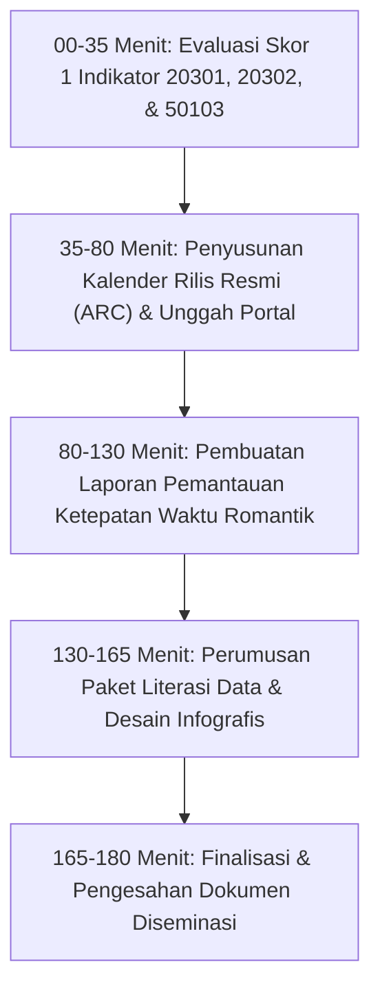

# MODUL PERTEMUAN 07: DISEMINASI DATA, KALENDER RILIS RESMI (ARC), FORMAT TERBUKA, & LITERASI STATISTIK
## Rencana Kerja 3 (Kualitas Data), RK 4 (Probis), & RK 6 (SSN) Pembinaan 2026
**Kode Dokumen:** `PSS2026-PLAN-07`  
**Waktu Pelaksanaan:** Minggu Ke-7 Pembinaan  
**Durasi Efektif:** 180 Menit (3 Jam)  
**Tempat:** Mempawah Command Centre (MCC) / Aula Kantor Dinas Kominfo Kabupaten Mempawah  
**Penyelenggara:** Tim Pembina Statistik Sektoral BPS Kabupaten Mempawah berkolaborasi dengan Bidang Informasi Publik & Statistik Diskominfo  
**Sasaran Peserta:** Operator Data OPD Kegiatan Prioritas (Dinkes & Disperindagnaker), Administrator Portal SDI Diskominfo, Pengelola Media Sosial Dinas, dan Pejabat Pengelola Informasi dan Dokumentasi (PPID)  

---

## 🎯 1. Tujuan Pertemuan & Keterkaitan Indikator EPSS 2028

### 1.1 Penyelamatan Tiga Indikator Kritis Skor 1 Sekaligus
Pada EPSS 2026, terjadi kehilangan poin masif pada aspek diseminasi dan keterbukaan informasi:
1. **Indikator 20301 (Penjaminan Aktualitas Data - Skor 1):** Bukti rilis data Disperindagnaker di portal SDI belum diunggah dan tidak ada pembuktian bahwa jeda waktu antara tahun data dan penerbitan telah memenuhi standar KAK.
2. **Indikator 20302 (Pemantauan Ketepatan Waktu Diseminasi - Skor 1):** Kabupaten Mempawah gagal meraih nilai karena tidak memiliki dokumen perbandingan jadwal rilis resmi. **Rekomendasi tegas Pleno Provinsi BPS Kalbar:**
   > *"Jangan hanya memakai KAK karena rentang waktunya terlalu luas. Penilaian ketepatan waktu diseminasi WAJIB menyandingkan Jadwal Rilis pada Surat Rekomendasi ROMANTIK BPS dengan Tanggal Realisasi Rilis Faktual di Portal SDI / Buku Publikasi!"*
3. **Indikator 50103 (Sosialisasi dan Literasi Hasil Statistik - Skor 1):** Bukti dukung di folder interviu kosong melompong (hanya menyertakan selembar foto videotron tanpa narasi dan tanpa dokumen penyelenggaraan sosialisasi). Tim penilai menolak foto tersebut karena *"literasi statistik bukan sekadar menampilkan foto videotron, melainkan adanya kegiatan edukasi terencana yang membimbing pengguna data memahami angka statistik."*

Tujuan Pertemuan 7 adalah:
1. Menyusun dan menetapkan dokumen **Kalender Rilis Resmi (*Advance Release Calendar* / ARC)** Publikasi Statistik Sektoral Pemkab Mempawah Tahun 2026 yang dipublikasikan secara terbuka di portal Satu Data Mempawah.
2. Membimbing operator OPD dalam menyusun **Laporan Pemantauan Ketepatan Waktu Diseminasi** yang menyandingkan jadwal rilis ROMANTIK BPS dengan tanggal rilis nyata.
3. Memastikan dataset kegiatan prioritas telah diunggah ke Portal Satu Data Indonesia Kabupaten Mempawah dalam **format data terbuka (*machine-readable* .csv / .xlsx)**.
4. Menyelenggarakan dan mendokumentasikan kegiatan **Sosialisasi & Peningkatan Literasi Statistik (50103)** lengkap dengan 5 berkas fisik (Undangan, Hadir, Notula, Materi Infografis, Bukti Media Publik).

### 1.2 Pemetaan Indikator EPSS 2028 & Target Kematangan

| Kode Indikator | Nama Indikator EPSS | Bobot Relatif | Kondisi 2026 | Target EPSS 2028 | Syarat Pemenuhan Bukti Dukung Level 4 |
|:---:|:---|:---:|:---:|:---:|:---|
| **20301** | Penjaminan Aktualitas Data | 2.52% | **Skor 1 (Kritis)** | **Level 4 (Terpadu)** | Bukti rilis data tepat waktu di portal SDI yang membuktikan time lag minimal dan sesuai target KAK. |
| **20302** | Pemantauan Ketepatan Waktu Diseminasi | 2.52% | **Skor 1 (Kritis)** | **Level 4 (Terpadu)** | Kalender Rilis Resmi (ARC) publik di portal pemda + Laporan Pemantauan Ketepatan Waktu Diseminasi yang menyandingkan jadwal ROMANTIK BPS vs tanggal rilis faktual (on-time). |
| **20401** | Ketersediaan Data untuk Pengguna | 1.71% | Level 3 | **Level 4** | Data statistik sektoral tersedia secara berkala dan mudah diakses melalui kanal portal Satu Data Mempawah. |
| **20402** | Akses Media Penyebarluasan Data | 1.66% | Level 3 | **Level 4** | Penyebarluasan data multi-kanal: portal web, media sosial resmi OPD, videotron pemkab, dan siaran pers. |
| **20403** | Penyediaan Format Data Terbuka | 1.66% | Level 3 | **Level 4** | Dataset disediakan dalam format data terbuka terstruktur (.csv, .xlsx, REST-API) tanpa enkripsi proprietari. |
| **30401** | Diseminasi Data Statistik | 3.99% | Level 3 | **Level 4** | Diseminasi data mematuhi SOP diseminasi, rilis tepat waktu, disertai metadata, dan bebas biaya (*free access*). |
| **50103** | Sosialisasi & Literasi Hasil Statistik | 1.35% | **Skor 1 (Kritis)** | **Level 4 (Terpadu)** | Paket lengkap dokumentasi sosialisasi/bimtek literasi data ke stakeholder (Undangan, Hadir, Notula, Materi), dashboard visualisasi tematik, infografis medsos, dan dokumentasi videotron. |

---

## 📚 2. Ringkasan Materi Teknis untuk Operator OPD

### 2.1 Konsep Advance Release Calendar (ARC) / Kalender Rilis Resmi
Sesuai standar internasional IMF (*Special Data Dissemination Standard* / SDDS) dan BPS:
- Kalender Rilis adalah jadwal yang diumumkan kepada publik **sebelum tahun berjalan dimulai**, yang memuat tanggal pasti atau rentang waktu kapan sebuah publikasi statistik akan dirilis.
- Tujuannya adalah menjamin transparansi, kepastian informasi bagi pembuat kebijakan, dan mencegah penundaan rilis demi kepentingan tertentu.
- Pada tingkat Kabupaten Mempawah, Diskominfo selaku Walidata menetapkan Kalender Rilis Resmi Statistik Sektoral yang memuat seluruh tanggal publikasi dinas-dinas.

### 2.2 Prosedur Monitoring Ketepatan Waktu Berbasis ROMANTIK BPS (Formula Penyelamat 20302)
Untuk membuktikan ketepatan waktu diseminasi pada penilai EPSS, operator OPD wajib menyusun tabel penyandingan 3 pilar:
$$\textbf{[Jadwal Tahap E pada Rekomendasi ROMANTIK BPS]} \iff \textbf{[Jadwal Batas Rilis pada KAK]} \iff \textbf{[Tanggal Aktual Rilis di Portal / Buku]}$$
- *Contoh Disperindagnaker:*
  - Jadwal ROMANTIK BPS No. Reg `K-24.6104.005`: Tahap Penyajian disetujui **01 s.d. 31 Januari 2025**.
  - Tanggal Rilis Faktual di Portal Satu Data: **15 Januari 2025** (Status: *Tepat Waktu / On-Time*).
- *Contoh Dinkes:*
  - Jadwal ROMANTIK BPS No. Reg `K-24.6104.002`: Tahap Penyajian disetujui **s.d. 01 April 2025**.
  - Tanggal Rilis Faktual Buku Profilkes: **April 2025** (Status: *Tepat Waktu / On-Time*).

### 2.3 Standar Format Data Terbuka (Open Data Standards)
Berdasarkan Perpres No. 39 Tahun 2019 Pasal 3:
- Data yang disajikan pada portal data daerah tidak boleh hanya berbentuk PDF yang terkunci (*read-only*), melainkan **wajib menyediakan format terbuka tabular (`.csv` dan `.xlsx`)** yang dapat diolah langsung oleh komputer (*machine-readable*).
- Karakteristik format tabel terbuka: Baris 1 adalah Header Nama Variabel, tidak ada sel yang di-*merge* (*no merged cells*), dan setiap baris merepresentasikan unit observasi yang konsisten.

### 2.4 Membangun Literasi Statistik yang Sah (Domain 5 Indikator 50103)
Literasi data statistik bukan sekadar menampilkan foto layar videotron, melainkan proses transfer pemahaman. Bukti dukung yang sah wajib mencakup:
1. **Kegiatan Bimbingan Teknis / Sosialisasi Data:** Rapat atau webinar yang mengundang pengguna data (Bapperida, akademisi, instansi vertikal, perwakilan masyarakat) untuk memaparkan arti angka statistik dinas.
2. **Dashboard Visualisasi Tematik:** Grafik interaktif pada Portal Satu Data Mempawah yang memudahkan orang awam membaca tren data.
3. **Produk Literasi Populer:** Infografis visual yang diunggah di Instagram/Facebook resmi OPD, siaran pers (*press release*), serta penayangan ringkasan data pada videotron publik Taman Mempawah.

---

## 🛠️ 3. Rangkaian Kegiatan Sesi Pembinaan (Rundown 180 Menit)



### 3.1 Sesi 1: Evaluasi Kegagalan Diseminasi pada EPSS 2026 (35 Menit)
- Pemaparan alasan penilai BPS Ketapang memberikan Skor 1 pada 20301, 20302, dan 50103.
- Mengapa foto videotron tanpa dokumen pendukung ditolak penilai.
- Menjelaskan formula penyandingan jadwal ROMANTIK vs rilis faktual sebagai bukti penyelamat.

### 3.2 Sesi 2: Workshop Penyusunan Kalender Rilis Resmi (ARC) & Unggah Portal (45 Menit)
- Diskominfo bersama seluruh operator OPD menyusun Dokumen Kalender Rilis Resmi (ARC) Pemkab Mempawah 2026.
- Menetapkan tanggal rilis pasti untuk seluruh publikasi sektoral OPD.
- Operator mempraktikkan pengunggahan data tabular format `.csv` dan `.xlsx` ke dalam Portal Satu Data Indonesia Kabupaten Mempawah.
- Mengambil tangkapan layar (*screenshot*) halaman unduhan format terbuka sebagai bukti dukung Indikator 20403.

### 3.3 Sesi 3: Pembuatan Laporan Pemantauan Ketepatan Waktu Berbasis Romantik (50 Menit)
- Operator membuka surat rekomendasi ROMANTIK BPS yang telah diterbitkan pada Pertemuan 3.
- Mengisi tabel matriks penyandingan jadwal rencana vs tanggal realisasi rilis faktual.
- Melampirkan cetakan screenshot halaman portal data bertanggal rilis dan lembar pengesahan buku publikasi.
- Menandatangani Laporan Pemantauan Ketepatan Waktu Diseminasi (Template H).

### 3.4 Sesi 4: Penyusunan Paket Literasi Data & Penutupan (50 Menit)
- Operator bersama fungsional statistisi BPS merancang draf materi infografis populer dari data publikasi dinas (misal: Infografis Tren Penyerapan Tenaga Kerja 2026; Infografis Penurunan Kasus Stunting 2026).
- Menjadwalkan pelaksanaan Sosialisasi Literasi Statistik OPD ke stakeholder daerah.
- Pembina BPS memverifikasi seluruh bundel bukti dukung diseminasi.

---

## 📋 4. Format Laporan Pemantauan Ketepatan Waktu Diseminasi (Template H)

Operator OPD wajib menyusun naskah laporan berikut berkop dinas:

```markdown
LAPORAN PEMANTAUAN KETEPATAN WAKTU DISEMINASI STATISTIK SEKTORAL
BERDASARKAN REKOMENDASI KEGIATAN STATISTIK (ROMANTIK) BPS
DINAS PERINDUSTRIAN, PERDAGANGAN DAN TENAGA KERJA KABUPATEN MEMPAWAH
TAHUN ANGGARAN 2026

I. DASAR PELAKSANAAN
1. Kerangka Acuan Kerja (KAK) Kegiatan Kompilasi Data Ketenagakerjaan Tahun 2026.
2. Surat Rekomendasi Kegiatan Statistik Sektoral BPS Kabupaten Mempawah Nomor: B-.../61040/VS.100/2026, Kode Rekomendasi: K-26.6104.005.
3. Kalender Rilis Resmi (Advance Release Calendar) Publikasi Statistik Pemkab Mempawah Tahun 2026.

II. MATRIKS PENYANDINGAN JADWAL REKOMENDASI BPS VS REALISASI RILIS FAKTUAL
| No | Judul Produk Publikasi / Dataset | Nomor Registrasi ROMANTIK BPS | Target Batas Waktu Rilis pada KAK | Target Rentang Jadwal Rilis ROMANTIK BPS (Tahap E) | Tanggal Realisasi Rilis Faktual di Portal SDI | Status Ketepatan Waktu | Tautan / Bukti Publikasi Digital |
|:--:|:---|:---:|:---:|:---:|:---:|:---:|:---|
| 1  | Laporan Data Penempatan Tenaga Kerja Kabupaten Mempawah Tahun 2026 | K-26.6104.005 | 31 Oktober 2026 | 01 s.d. 31 Oktober 2026 | 15 Oktober 2026 | **TEPAT WAKTU (ON-TIME)** | [Portal SDI Mempawah: data.mempawahkab.go.id/dataset/naker-2026](https://data.mempawahkab.go.id) |
| 2  | Laporan Profil Kesehatan Kabupaten Mempawah Tahun 2026 | K-26.6104.002 | 31 Oktober 2026 | 01 s.d. 31 Oktober 2026 | 20 Oktober 2026 | **TEPAT WAKTU (ON-TIME)** | [Portal SDI Mempawah: data.mempawahkab.go.id/dataset/profilkes-2026](https://data.mempawahkab.go.id) |

III. EVALUASI DAN ANALISIS KETEPATAN WAKTU
Berdasarkan perbandingan antara jadwal penyajian yang disetujui oleh Kepala Badan Pusat Statistik Kabupaten Mempawah dalam Surat Rekomendasi ROMANTIK dengan realisasi rilis faktual pada portal resmi daerah:
1. Seluruh publikasi statistik sektoral berhasil dirilis lebih awal dari batas akhir toleransi yang ditetapkan, membuktikan bahwa penyelenggaraan kegiatan memenuhi prinsip **AKTUALITAS DATA** dan **KETEPATAN WAKTU DISEMINASI**.
2. Dataset telah dipublikasikan secara lengkap disertai dokumen metadata dan disediakan dalam format data terbuka tabular (.csv / .xlsx).
3. Bukti tangkapan layar unggah portal dan lembar pengesahan publikasi terlampir pada dokumen ini.

Mempawah,      November 2026
Petugas Pemantau Diseminasi,                 Kepala Bidang Tenaga Kerja / Yankes,
(tanda tangan)                               (tanda tangan & cap dinas)


........................................     ........................................
NIP. ...................................     NIP. ...................................
```

---

## 📋 5. Format Paket Bukti Literasi Statistik (Indikator 50103)

Paket bukti literasi statistik disusun dalam 1 bundel PDF 6 halaman:
- **Halaman 1:** Surat Undangan Resmi Bimbingan Teknis / Sosialisasi Pemahaman Data Sektoral kepada OPD/Kecamatan.
- **Halaman 2:** Daftar Hadir peserta kegiatan edukasi statistik.
- **Halaman 3:** Notula Kegiatan yang mencatat materi literasi yang disampaikan oleh fungsional statistisi/operator.
- **Halaman 4:** Tangkapan layar materi infografis / ringkasan eksekutif data statistik yang diunggah pada akun Instagram resmi OPD / Pemkab Mempawah.
- **Halaman 5:** Tangkapan layar Dashboard Tematik interaktif pada Portal Satu Data Indonesia Kabupaten Mempawah.
- **Halaman 6:** Dokumentasi Foto kegiatan sosialisasi tatap muka dan foto penayangan ringkasan indikator pada Videotron Publik Taman Mempawah.

---

## 📦 6. Artefak Bukti Fisik yang Wajib Dihasilkan (Deliverables Pertemuan 7)

### 6.1 Deliverable Teknis Statistik (Bukti EPSS 2028)
1. **Dokumen Kalender Rilis Resmi (Advance Release Calendar / ARC) Pemkab Mempawah Tahun 2026:**
   - Ditetapkan oleh Kepala Diskominfo selaku Walidata Daerah dan diumumkan secara luas di portal resmi daerah.
   - Disimpan di: `02_DOMAIN_2_KUALITAS_DATA/20302_Ketepatan_Waktu_Diseminasi/`.
2. **Laporan Pemantauan Ketepatan Waktu Diseminasi Berbasis ROMANTIK BPS (Format PDF):**
   - Berisi matriks penyandingan jadwal ROMANTIK vs KAK vs Rilis Faktual bertandatangan resmi Kepala Bidang & Kadis.
   - Menjadi bukti fisik mutlak untuk menaikkan **Indikator 20301 (Aktualitas) dan 20302 (Ketepatan Waktu) langsung ke Level 4!**
3. **Bundel Tangkapan Layar Format Terbuka Portal SDI:**
   - Menampilkan dataset tabular format `.csv` dan `.xlsx` yang dapat diunduh bebas oleh publik tanpa login/password.
   - Disimpan di: `02_DOMAIN_2_KUALITAS_DATA/20403_Penyediaan_Format_Data/`.
4. **Paket Lengkap Dokumentasi Sosialisasi & Literasi Statistik (Bundel PDF 6 Halaman):**
   - Memuat Undangan, Hadir, Notula, Materi Infografis, Dashboard Tematik, dan Dokumentasi Media.
   - Disimpan di: `05_DOMAIN_5_STATISTIK_NASIONAL/50103_Sosialisasi_dan_Literasi_Statistik/` *(Penyelamat Mutlak Indikator 50103!)*.

### 6.2 Deliverable Administrasi Pembinaan (Portal SPESIAL)
1. Surat Undangan Pertemuan 7 dari Kepala BPS.
2. Daftar Hadir peserta pembinaan.
3. Notula Pertemuan yang mendokumentasikan pembahasan kalender rilis dan strategi literasi data.
4. Materi Paparan Diseminasi Data Terbuka & Literasi Statistik Sektoral.
5. Dokumentasi Foto pelaksanaan workshop penyusunan ARC.

---

## 📌 7. Tindak Lanjut Operator Menuju Pertemuan 8
Sebelum hadir pada **Pertemuan 8 (Quality Gates, Penjaminan Mutu oleh Walidata, & Evaluasi GSBPM)**, operator OPD wajib:
1. Memastikan file dataset final telah diunggah ke Portal Satu Data Mempawah dengan status *Pending Review Walidata*.
2. Membawa draf publikasi lengkap dan dokumen kelengkapan data (SDS, MS-Var, Laporan Akurasi, KAK, Surat Netralitas) untuk diaudit kelayakannya oleh Tim Walidata Diskominfo.
3. Menyiapkan draf formulir serah terima data produsen data kepada Walidata Daerah.
