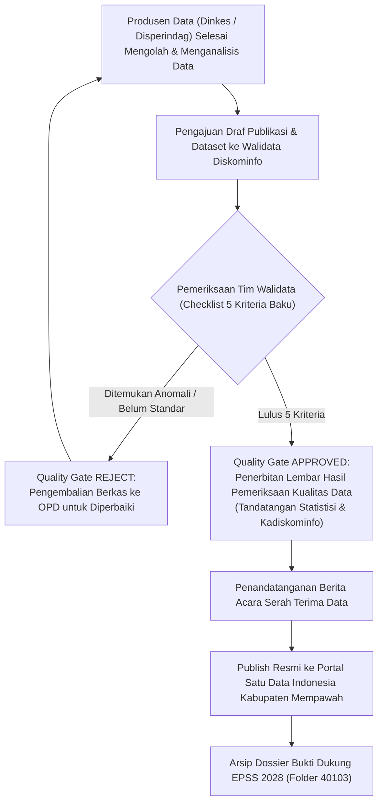

# MODUL PERTEMUAN 08: QUALITY GATES, PENJAMINAN MUTU WALIDATA, & EVALUASI GSBPM
## Rencana Kerja 3 (Kualitas Data) & Rencana Kerja 5 (Kelembagaan) Pembinaan 2026
**Kode Dokumen:** `PSS2026-PLAN-08`  
**Waktu Pelaksanaan:** Minggu Ke-8 Pembinaan  
**Durasi Efektif:** 180 Menit (3 Jam)  
**Tempat:** Ruang Rapat Dinas Komunikasi dan Informatika Kabupaten Mempawah  
**Penyelenggara:** Tim Pembina Statistik Sektoral BPS Kabupaten Mempawah berkolaborasi dengan Tim Walidata Daerah Diskominfo  
**Sasaran Peserta:** Tim Walidata Daerah (Diskominfo: Kepala Dinas, Kabid Statistik & Persandian, Fungsional Statistisi/Pranata Komputer), Pejabat Penanggung Jawab Data & Operator OPD Kegiatan Prioritas (Dinkes & Disperindagnaker)  

---

## 🎯 1. Tujuan Pertemuan & Keterkaitan Indikator EPSS 2028

### 1.1 Penyelamatan Indikator Kritis 40103 (Skor 1 pada EPSS 2026)
Pada pelaksanaan evaluasi EPSS 2026, **Indikator 40103 (Penjaminan Kualitas Data)** Kabupaten Mempawah anjlok ke **Nilai 1 (Tingkat Kematangan Terendah)**.
- *Akar Masalah Evaluasi 2026:* 
  - Walidata Daerah (Dinas Kominfo) dinilai belum memiliki dokumen regulasi/SOP pemeriksaan mutu data (*quality assurance*).
  - Folder bukti dukung interviu **kosong melompong (0 berkas)** karena Diskominfo tidak pernah menerbitkan lembar kontrol mutu formal sebelum suatu dataset dipublikasikan di portal satu data.
  - Catatan Pleno Provinsi BPS Kalbar menegaskan: *"Sebagai Walidata Daerah, Diskominfo wajib memiliki instrumen kendali mutu tertulis (Quality Checklist) yang ditandatangani oleh fungsional statistisi pemeriksa dan disahkan Kepala Dinas Kominfo sebelum data diizinkan rilis."*

Tujuan Pertemuan 8 adalah:
1. Memformalkan **SOP Verifikasi dan Validasi Data Statistik Sektoral oleh Walidata Daerah**.
2. Menerapkan mekanisme **Quality Gates** (titik kendali mutu) yang mengunci bahwa dataset OPD tidak boleh dipublikasikan sebelum mengantongi persetujuan mutu Walidata.
3. Menyusun dan melegalkan **Lembar Hasil Pemeriksaan Kualitas Data Statistik Sektoral (Quality Checklist 5 Kriteria Baku - Template B)** bertandatangan resmi fungsional statistisi Walidata dan Kepala Diskominfo.
4. Menerbitkan **Berita Acara Serah Terima Data** dari Produsen Data kepada Walidata Daerah.
5. Menyusun **Dokumen Laporan Evaluasi Penyelenggaraan Kegiatan Statistik (GSBPM Fase 8)** guna memastikan siklus continuous improvement, sekaligus menaikkan Indikator 40103 dan 40304 langsung ke **Level 4 (Terpadu dan Terukur)** pada EPSS 2028.

### 1.2 Pemetaan Indikator EPSS 2028 & Target Kematangan

| Kode Indikator | Nama Indikator EPSS | Bobot Relatif | Kondisi 2026 | Target EPSS 2028 | Syarat Pemenuhan Bukti Dukung Level 4 |
|:---:|:---|:---:|:---:|:---:|:---|
| **40103** | Penjaminan Kualitas Data (Walidata) | 1.49% | **Skor 1 (Kritis)** | **Level 4 (Terpadu)** | SOP penjaminan mutu data oleh Walidata, SK Tim Pemeriksa Mutu Data Daerah, dan Lembar Hasil Pemeriksaan Kualitas Data (Checklist 5 Kriteria Baku) bertandatangan resmi Tim Walidata & Kadiskominfo. |
| **40304** | Pelaksanaan Tugas Sebagai Walidata | 1.49% | Level 2 | **Level 4** | Laporan berkala pelaksanaan tugas Walidata (pemeriksaan standar data, pengelolaan portal SDI, bimbingan produsen data, dan diseminasi data daerah). |
| *Overarching* | *Evaluasi Penyelenggaraan (GSBPM Fase 8)* | *--* | *Level 3* | *Level 4* | *Dokumen Laporan Evaluasi Kegiatan Statistik yang mencatat reviu seluruh tahapan GSBPM (perencanaan s.d. diseminasi) dan rekomendasi perbaikan tahun berikutnya.* |

---

## 📚 2. Ringkasan Materi Teknis untuk Walidata & Operator OPD

### 2.1 Peran Sentral Walidata Daerah dalam Satu Data Indonesia (Perpres 39/2019)
Dinas Komunikasi dan Informatika Kabupaten Mempawah berkedudukan sebagai **Walidata Daerah** yang memiliki tugas dan wewenang mutlak:
1. Mengumpulkan, memeriksa kesesuaian data, dan mengelola data yang disampaikan oleh Produsen Data sesuai prinsip SDI.
2. Menyebarluaskan Data dan Metadata di Portal Satu Data Indonesia Kabupaten Mempawah.
3. Membantu Pembina Data (BPS) dalam membina Produsen Data.

### 2.2 Lima Kriteria Baku Pemeriksaan Mutu Walidata (Quality Checklist Template B)
Sebelum suatu data dirilis ke publik, Walidata wajib menguji kelayakan dataset berdasarkan 5 parameter baku:
1. **Kesesuaian Standar Data Statistik (SDS):** Apakah konsep, definisi operasional, ukuran, dan satuan data telah sesuai dengan ketetapan Pembina Data BPS?
2. **Kelengkapan Cakupan Wilayah Data (Completeness):** Apakah seluruh unit observasi (14 Puskesmas, 9 Kecamatan, seluruh desa sasaran) telah terdata 100% tanpa ada wilayah yang bolong?
3. **Kepatuhan Kode Referensi & Data Induk:** Apakah penulisan kode wilayah menggunakan kode baku Kemendagri, dan klasifikasi industri memakai KBLI 2020?
4. **Ketersediaan Format Terbuka (Open Data Format):** Apakah data disediakan dalam format tabular terstruktur (`.csv` / `.xlsx`) yang siap diolah mesin tanpa proteksi sel?
5. **Logika Konsistensi & Integritas Rumus:** Apakah data bebas dari kesalahan penjumlahan matematis, bebas dari duplikasi data, dan konsisten secara internal?

### 2.3 Mekanisme Quality Gate antar-Fase GSBPM



---

## 🛠️ 3. Rangkaian Kegiatan Sesi Pembinaan (Rundown 180 Menit)

### 3.1 Sesi 1: Bedah Kegagalan Indikator 40103 & Regulasi Walidata (35 Menit)
- Fasilitator BPS memaparkan catatan penolakan bukti dukung 40103 pada pleno provinsi EPSS 2026.
- Menjelaskan landasan hukum tugas Walidata dan pentingnya jejak audit verifikasi (*verification audit trail*).
- Penjelasan instrumen Checklist Mutu 5 Kriteria Baku.

### 3.2 Sesi 2: Simulasi Sidang Audit Mutu Data (Quality Gate Clinic) (60 Menit)
- Tim Walidata Diskominfo (didampingi pembina BPS) bertindak sebagai Auditor Mutu.
- Operator Dinkes dan Disperindagnaker menyerahkan berkas data tahun 2026 yang telah dibersihkan pada Pertemuan 5 dan dianalisis pada Pertemuan 6.
- Tim Walidata memeriksa kelayakan data secara teliti menggunakan Formulir Checklist Mutu:
  - Memeriksa konsistensi kode wilayah Kemendagri pada file Excel.
  - Memeriksa ketersediaan format `.csv`.
  - Menguji logika penjumlahan matematis baris dan kolom.

### 3.3 Sesi 3: Penerbitan & Penandatanganan Lembar Hasil Pemeriksaan Mutu (45 Menit)
- Setelah seluruh koreksi kecil diselesaikan, Tim Walidata mengisi kesimpulan kelayakan: *"Dataset Dinyatakan LULUS Verifikasi Penjaminan Mutu dan Layak Dipublikasikan"*.
- Penandatanganan resmi **Lembar Hasil Pemeriksaan Kualitas Data (Template B)** oleh Fungsional Statistisi Diskominfo dan Kepala Dinas Komunikasi dan Informatika.
- Penandatanganan **Berita Acara Serah Terima Data** antara Kepala Bidang OPD dengan Kepala Bidang Statistik Diskominfo.

### 3.4 Sesi 4: Workshop Penyusunan Laporan Evaluasi GSBPM (40 Menit)
- Pembina BPS membimbing tim gabungan dalam menyusun Laporan Evaluasi Penyelenggaraan Kegiatan Statistik (Fase 8 GSBPM).
- Mencatat kendala lapangan yang dialami selama pengumpulan data 2026 dan merumuskan langkah mitigasi untuk kegiatan tahun 2027/2028.
- Pengarsipan berkas fisik ke dalam Dossier EPSS.

---

## 📋 4. Format Lembar Hasil Pemeriksaan Mutu Walidata (Template B Mandatori)

*(Dicetak 1 lembar berkop resmi Dinas Komunikasi dan Informatika Kabupaten Mempawah, ditandatangani basah, dan dibubuhi cap dinas)*

```markdown
KOP RESMI DINAS KOMUNIKASI DAN INFORMATIKA
KABUPATEN MEMPAWAH (WALIDATA DAERAH)

LEMBAR HASIL PEMERIKSAAN KUALITAS DATA STATISTIK SEKTORAL
Nomor: ... / DISKOMINFO-STAT / 2026

Pada hari ini, ................ tanggal ..... bulan ............... tahun 2026, Tim Pengendalian Mutu dan Pemeriksaan Data Statistik Sektoral Dinas Komunikasi dan Informatika Kabupaten Mempawah selaku Walidata Daerah telah melaksanakan pemeriksaan kelayakan dan verifikasi kualitas data terhadap dataset:

Nama Dataset / Publikasi : Kompilasi Data Profil Kesehatan Kabupaten Mempawah Tahun 2026
                           (atau: Laporan Data Penempatan Tenaga Kerja Kabupaten Mempawah 2026)
Produsen Data            : Dinas Kesehatan, Pengendalian Penduduk dan KB
                           (atau: Dinas Perindustrian, Perdagangan dan Tenaga Kerja)
Tanggal Pengajuan Data   : .............................. 2026
Nomor Rekomendasi Romantik: K-26.6104.XXX

HASIL UJI KELAYAKAN 5 KRITERIA BAKU PENJAMINAN MUTU:
| No | Kriteria Pemeriksaan Mutu Walidata | Indikator Penilaian Kelayakan | Hasil Pengujian Faktual | Status Kelayakan |
|:--:|:---|:---|:---|:---:|
| 1  | Kesesuaian Standar Data Statistik (SDS) | Mengacu pada konsep, definisi operasional, satuan, dan ukuran yang telah disahkan Pembina Data BPS. | Sesuai Standar Baku Nasional Kemenkes / KBLI 2020 | [✓] MEMENUHI |
| 2  | Kelengkapan Cakupan Wilayah Data | Mencakup 100% unit pelapor di seluruh wilayah administratif Kabupaten Mempawah tanpa data kosong. | Terdata lengkap 14 Puskesmas / 27 Perusahaan Mitra (100%) | [✓] MEMENUHI |
| 3  | Penggunaan Kode Referensi Wilayah | Menggunakan kodefikasi wilayah baku Kemendagri / BPS secara konsisten pada setiap baris data. | Sesuai Kode Wilayah Resmi Kemendagri (61.04.xx) | [✓] MEMENUHI |
| 4  | Ketersediaan Format Terbuka (Open Data) | Tersedia dalam format tabular terstruktur (.csv dan .xlsx) tanpa proteksi sel yang menghambat pembacaan mesin. | Format .csv dan .xlsx tabular tersedia dan tervalidasi | [✓] MEMENUHI |
| 5  | Logika Konsistensi Rumus & Validasi | Bebas dari kesalahan rumus matematis, bebas pencatatan ganda (de-duplicated), dan konsisten antar-variabel. | Rumus agregasi terkunci valid, data ganda telah tereliminasi | [✓] MEMENUHI |

KESIMPULAN PEMERIKSAAN WALIDATA:
Berdasarkan hasil pengujian terhadap 5 kriteria baku di atas, dataset tersebut DINYATAKAN LULUS VERIFIKASI PENJAMINAN MUTU STATISTIK SEKTORAL dan DISETUJUI UNTUK DISEBARLUASKAN secara resmi melalui Portal Satu Data Indonesia Kabupaten Mempawah.

Mempawah, .............................. 2026

Petugas Pemeriksa Mutu Data,                Mengetahui dan Mengesahkan:
Fungsional Statistisi Diskominfo,           Kepala Dinas Komunikasi dan Informatika
                                            Kabupaten Mempawah Selaku Walidata Daerah,
(tanda tangan)                              (tanda tangan basah & cap dinas)


........................................    ........................................
NIP. ...................................    NIP. ...................................
```

---

## 📋 5. Format Berita Acara Serah Terima Data ke Walidata

```markdown
BERITA ACARA SERAH TERIMA DATA STATISTIK SEKTORAL
PEMERINTAH KABUPATEN MEMPAWAH TAHUN 2026
Nomor: ... / BAST-DATA / 2026

Pada hari ini, ................ tanggal ..... bulan ............... tahun 2026, bertempat di Kantor Dinas Komunikasi dan Informatika Kabupaten Mempawah, telah dilaksanakan serah terima dataset statistik sektoral yang telah lulus verifikasi penjaminan mutu antara:

1. Nama    : ..............................................................
   NIP     : ..............................................................
   Jabatan : Kepala Bidang ................. Dinas .......................
   Dalam hal ini bertindak untuk dan atas nama Produsen Data, selanjutnya disebut PIHAK PERTAMA.

2. Nama    : ..............................................................
   NIP     : ..............................................................
   Jabatan : Kepala Bidang Statistik dan Persandian Dinas Kominfo Kab. Mempawah
   Dalam hal ini bertindak untuk dan atas nama Walidata Daerah, selanjutnya disebut PIHAK KEDUA.

PIHAK PERTAMA menyerahkan kepada PIHAK KEDUA dan PIHAK KEDUA menyatakan telah menerima dari PIHAK PERTAMA dataset statistik sektoral:
- Judul Dataset : ..............................................................
- Format Berkas : Tabular Data Terbuka (.csv dan .xlsx) serta Dokumen Publikasi (.pdf)
- Jumlah Variabel: ...... Variabel Statistik disertai Lembar Metadata (MS-Var)
- Status Mutu   : Telah LULUS Pemeriksaan Mutu Walidata (Lembar Mutu No: ... Terlampir)

PIHAK KEDUA akan mempublikasikan dataset tersebut pada Portal Satu Data Indonesia Kabupaten Mempawah (data.mempawahkab.go.id) sesuai jadwal Kalender Rilis Resmi Daerah.

Demikian Berita Acara Serah Terima ini dibuat dalam rangkap 2 (dua) untuk dipergunakan sebagaimana mestinya.

PIHAK PERTAMA (Produsen Data),              PIHAK KEDUA (Walidata Daerah),
Kepala Bidang .........................     Kepala Bidang Statistik & Persandian,
(tanda tangan)                              (tanda tangan)


........................................    ........................................
NIP. ...................................    NIP. ...................................
```

---

## 📦 6. Artefak Bukti Fisik yang Wajib Dihasilkan (Deliverables Pertemuan 8)

### 6.1 Deliverable Teknis Statistik (Bukti EPSS Indikator 40103 & 40304)
1. **Lembar Hasil Pemeriksaan Kualitas Data Statistik Sektoral (Quality Checklist 5 Kriteria Baku - Template B):**
   - Ditandatangani basah oleh Fungsional Statistisi Diskominfo dan Kepala Dinas Komunikasi dan Informatika.
   - Disimpan di: `04_DOMAIN_4_KELEMBAGAAN/40103_Penjaminan_Kualitas_Walidata/` *(Kunci Mutlak Mengubah Skor 1 Jadi Skor 4!)*.
2. **SOP Pengendalian Mutu & Verifikasi Data Statistik Sektoral oleh Walidata Daerah (Format PDF Resmi):**
   - SK/SOP Kepala Diskominfo yang mengatur alur verifikasi data sebelum rilis.
   - Disimpan sebagai dokumen payung regulasi Indikator 40103.
3. **Berita Acara Serah Terima Data Statistik Sektoral (BAST Data):**
   - Bukti tertulis alur formal pertukaran data dari OPD Produsen Data ke Walidata Diskominfo.
   - Disimpan di: `04_DOMAIN_4_KELEMBAGAAN/40304_Tugas_Sebagai_Walidata/`.
4. **Dokumen Laporan Evaluasi Penyelenggaraan Kegiatan Statistik Sektoral (GSBPM Fase 8):**
   - Memuat reviu komprehensif evaluasi tahapan perencanaan, pengumpulan, pengolahan, analisis, dan diseminasi.

### 6.2 Deliverable Administrasi Pembinaan (Portal SPESIAL)
1. Surat Undangan Pertemuan 8 dari Kepala BPS.
2. Daftar Hadir bertandatangan seluruh tim Walidata dan Produsen Data.
3. Notula Pertemuan yang mencatat proses audit mutu dan persetujuan dataset.
4. Materi Paparan Quality Gates & Tata Kelola Walidata Daerah.
5. Dokumentasi Foto pelaksanaan sidang pemeriksaan data di ruang rapat Diskominfo.

---

## 📌 7. Tindak Lanjut Menuju Pertemuan 9
Sebelum hadir pada **Pertemuan 9 (Kelembagaan, Sidang Pleno Forum SDI, & Rencana Aksi SDI Daerah)**, tim gabungan wajib:
1. Menyiapkan rekapitulasi seluruh dataset OPD yang telah diserahkan ke Walidata sepanjang tahun 2026.
2. Berkoordinasi dengan Bapperida untuk penyiapan bahan Rapat Pleno Forum Satu Data Indonesia Kabupaten Mempawah.
3. Menyiapkan draf usulan Matriks Program Kerja Rencana Aksi Satu Data Indonesia Kabupaten Mempawah 2026–2028.
