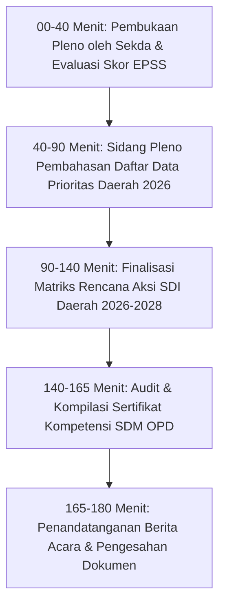

# MODUL PERTEMUAN 09: PENGUATAN FORUM SDI, KOMPETENSI SDM, & RENCANA AKSI PEMBANGUNAN STATISTIK
## Rencana Kerja 5 (Kelembagaan) & Rencana Kerja 6 (SSN) Pembinaan Statistik 2026
**Kode Dokumen:** `PSS2026-PLAN-09`  
**Waktu Pelaksanaan:** Minggu Ke-9 Pembinaan  
**Durasi Efektif:** 180 Menit (3 Jam)  
**Tempat:** Aula Rapat Bapperida Kabupaten Mempawah / Ruang Rapat Sekretaris Daerah  
**Penyelenggara:** Bapperida (Sekretariat Forum SDI) bekerjasama dengan BPS (Pembina Data) dan Diskominfo (Walidata)  
**Sasaran Peserta:** Sekretaris Daerah (Koordinator Forum SDI), Kepala Bapperida (Sekretariat SDI), Kepala Diskominfo (Walidata), Kepala BPS (Pembina Data), Seluruh Kepala OPD / Pejabat Eselon II & III Produsen Data, dan Fungsional Perencana Daerah  

---

## 🎯 1. Tujuan Pertemuan & Keterkaitan Indikator EPSS 2028

### 1.1 Penyelamatan Indikator Kritis 40302 (Skor 2) dan 50301 (Skor 1)
Pada evaluasi EPSS 2026, tata kelola kelembagaan dan perencanaan statistik daerah mengalami hambatan serius:
1. **Indikator 40302 (Penyelenggaraan Forum SDI - Turun Menjadi Skor 2):** 
   - Bukti berkas rapat forum data tahun-tahun sebelumnya tidak terhimpun lengkap di folder interviu.
   - Terjadi kesalahan fatal dengan dilampirkannya surat alasan efisiensi anggaran (Inpres 1/2025) yang justru dijadikan pembenaran ketiadaan rapat rutin, sehingga skor terkunci dan diturunkan oleh penilai provinsi menjadi Skor 2.
   - Rekomendasi Pleno BPS Kalbar: **Hapus surat alasan efisiensi! Wajib tunjukkan bukti fisik pelaksanaan rapat Forum SDI secara berkala minimal 2 kali setahun lengkap dengan Berita Acara Kesepakatan Daftar Data Prioritas Daerah.**
2. **Indikator 50301 (Perencanaan Pembangunan Statistik - Skor 1 Terendah):** 
   - Kabupaten Mempawah dinilai tidak memiliki dokumen perencanaan jangka menengah/panjang pembangunan statistik sektoral. Dokumen yang ada hanya dokumen lama tahun 2023 yang sudah kedaluwarsa.
   - Evaluator TPB mewajibkan tersedianya **Dokumen Rencana Aksi Satu Data Indonesia (SDI) Daerah** yang memuat matriks program kerja statistik sektoral multisektoral.
3. **Indikator 40201 & 40202 (Kompetensi SDM Bidang Statistik & Manajemen Data - Skor 2):** Belum dilakukannya reviu kompetensi berkala dan belum optimalnya pengarsipan sertifikat bimtek statistik operator OPD.

Tujuan Pertemuan 9 adalah:
1. Menyelenggarakan dan mendokumentasikan **Sidang Pleno Forum Satu Data Indonesia (SDI) Kabupaten Mempawah** yang sah dan berkala.
2. Menghasilkan dan menandatangani **Berita Acara Kesepakatan Penetapan Daftar Data Prioritas Daerah Tahun 2026**.
3. Menyusun, menyepakati, dan melegalkan **Dokumen Rencana Aksi Satu Data Indonesia (SDI) Kabupaten Mempawah Periode 2026–2028** (Matriks 6 Program Kerja Statistik).
4. Melakukan rekapitulasi portofolio **Sertifikat Kompetensi SDM Pengelola Data OPD** guna menaikkan skor Indikator 40201, 40202, 40302, dan 50301 langsung ke **Level 4 (Terpadu dan Terukur)** pada EPSS 2028.

### 1.2 Pemetaan Indikator EPSS 2028 & Target Kematangan

| Kode Indikator | Nama Indikator EPSS | Bobot Relatif | Kondisi 2026 | Target EPSS 2028 | Syarat Pemenuhan Bukti Dukung Level 4 |
|:---:|:---|:---:|:---:|:---:|:---|
| **40201** | Pemenuhan Kompetensi SDM Statistik | 2.55% | Level 2 | **Level 4** | Analisis kebutuhan diklat SDM statistik, rekapitulasi sertifikat pelatihan/bimtek statistik berkala untuk seluruh operator data OPD. |
| **40202** | Pemenuhan Kompetensi SDM Manajemen Data | 2.55% | Level 2 | **Level 4** | Rekapitulasi sertifikat pelatihan manajemen data/database/TI untuk operator OPD dan fungsional pranata komputer. |
| **40301** | Kolaborasi Penyelenggaraan Statistik | 1.49% | Level 3 | **Level 4** | Perjanjian kerja sama / nota kesepakatan formal pertukaran dan pemanfaatan data lintas sektor. |
| **40302** | Penyelenggaraan Forum SDI | 1.49% | **Skor 2 (Kritis)** | **Level 4 (Terpadu)** | Paket lengkap berkas rapat Forum SDI berkala (SK Bupati Forum SDI, Undangan Sekda, Daftar Hadir seluruh OPD, Notula, Foto) + Berita Acara Kesepakatan Daftar Data Prioritas Daerah Tahun Berjalan. |
| **40303** | Kolaborasi dengan Pembina Data Statistik | 1.49% | Level 3 | **Level 4** | Surat tugas pembinaan, notula rapat koordinasi rutin triwulanan BPS-Diskominfo-Bapperida, dan evaluasi hasil pembinaan. |
| **50101** | Penggunaan Data Statistik Dasar Kebijakan | 1.39% | Level 3 | **Level 4** | Dokumen perencanaan daerah (RPJMD/RKPD Mempawah) yang secara eksplisit mengutip dan memanfaatkan data statistik dasar BPS (IPM, Kemiskinan, Pertumbuhan Ekonomi, Inflasi). |
| **50102** | Penggunaan Data Statistik Sektoral Kebijakan | 1.35% | Level 3 | **Level 4** | Dokumen Renstra/Renja/Perda/Perbup yang memanfaatkan data statistik sektoral hasil kompromin OPD (Profil Kesehatan, Naker, Pangan). |
| **50301** | Perencanaan Pembangunan Statistik | 1.31% | **Skor 1 (Kritis)** | **Level 4 (Terpadu)** | Dokumen Rencana Aksi Satu Data Indonesia (SDI) Kabupaten Mempawah 2026–2028 yang disahkan Bupati/Sekda memuat 6 program kerja strategis yang mengikat seluruh perangkat daerah. |
| **50303** | Pemanfaatan Big Data Daerah | 1.35% | Level 3 *(Unggul di Kalbar)* | **Level 4** | Pemanfaatan analitik big data / mobile positioning / AI dashboard pada Mempawah Command Centre (MCC) yang dievaluasi secara berkala. |

---

## 📚 2. Ringkasan Materi Teknis untuk Forum SDI & Perencana Daerah

### 2.1 Tata Kelola Kelembagaan Forum Satu Data Indonesia Daerah
Sesuai Perpres 39/2019 dan SK Bupati Mempawah No. 391/2019:
- **Koordinator Forum SDI:** Sekretaris Daerah Kabupaten Mempawah.
- **Sekretariat Forum SDI:** Bapperida Kabupaten Mempawah.
- **Pembina Data Statistik:** BPS Kabupaten Mempawah.
- **Walidata Daerah:** Dinas Komunikasi dan Informatika.
- **Produsen Data:** Seluruh Organisasi Perangkat Daerah (OPD).
- **Kewajiban Sidang Pleno Berkala:** Forum SDI wajib bersidang minimal **2 (dua) kali dalam satu tahun anggaran**:
  1. *Forum Awal Tahun (Februari - Maret):* Menyepakati Daftar Data Prioritas Daerah Tahun Berjalan dan menyelaraskan KAK kegiatan statistik OPD.
  2. *Forum Akhir Tahun (November - Desember):* Mengevaluasi ketercapaian rilis data di portal, menyelesaikan anomali data sektoral, dan merumuskan Rencana Aksi SDI tahun berikutnya.

### 2.2 Struktur Dokumen Rencana Aksi SDI Daerah (Anti-Skor 1 Indikator 50301)
Dokumen Rencana Aksi SDI Kabupaten Mempawah Periode 2026–2028 memuat **6 Matriks Program Kerja Strategis**:
1. **Program 1: Penguatan Regulasi & Kelembagaan SDI Daerah** (Pemutakhiran Perbup SDI, penerbitan SOP penjaminan mutu, penguatan sekretariat forum).
2. **Program 2: Standarisasi Data & Pengelolaan Metadata Nasional** (Penerapan 100% SDS pada data prioritas, registrasi seluruh variabel pada Portal INDAH BPS).
3. **Program 3: Peningkatan Kapasitas & Sertifikasi SDM Statistik** (Bimtek berkala bagi operator OPD, pengangkatan fungsional statistisi daerah, pelatihan analisis data).
4. **Program 4: Modernisasi Infrastruktur Portal SDI & Interoperabilitas** (Integrasi API portal daerah ke portal SDI Pusat, visualisasi dashboard tematik di MCC).
5. **Program 5: Pengendalian Mutu & Penegakan Rekomendasi ROMANTIK** (Kewajiban rekomendasi BPS untuk seluruh survei/kompromin OPD, penerapan checklist mutu Walidata).
6. **Program 6: Penguatan Pemanfaatan Data Resmi & Eksplorasi Big Data** (Pemanfaatan data untuk penyusunan RPJMD, LPPD, LKjIP, dan integrasi analitik geospasial/sensor).

---

## 🛠️ 3. Rangkaian Kegiatan Sesi Pembinaan (Rundown 180 Menit)



### 3.1 Sesi 1: Pembukaan Pleno oleh Sekretaris Daerah (40 Menit)
- Pengarahan Sekretaris Daerah Kabupaten Mempawah: Menegaskan komitmen seluruh Kepala OPD untuk mendukung Satu Data Indonesia dan EPSS 2028.
- Paparan Kepala BPS Kabupaten Mempawah mengenai evaluasi kelembagaan statistik, bahaya surat alasan efisiensi, dan target pencapaian Predikat Sangat Baik.
- Paparan Kepala Diskominfo dan Kepala Bapperida mengenai progres portal SDI dan agenda prioritas daerah.

### 3.2 Sesi 2: Sidang Pleno Penetapan Daftar Data Prioritas Daerah 2026 (50 Menit)
- Forum meninjau usulan daftar data dari masing-masing dinas yang selaras dengan tema RKP daerah dan SPM.
- Pembina BPS memvalidasi bahwa setiap data prioritas telah memiliki spesifikasi konsep dan jadwal rilis.
- Forum menetapkan secara aklamasi **Daftar Data Prioritas Kabupaten Mempawah Tahun 2026** yang terdiri dari 50+ dataset strategis lintas sektor.

### 3.3 Sesi 3: Finalisasi Dokumen Rencana Aksi SDI Daerah 2026–2028 (50 Menit)
- Pembahasan draft naskah Rencana Aksi Satu Data Indonesia Kabupaten Mempawah 2026–2028.
- Memastikan matriks 6 program kerja mencantumkan target tahunan yang terukur, indikator keberhasilan, dan OPD penanggung jawab.
- Menyetujui naskah final untuk ditetapkan menjadi Keputusan Bupati / Peraturan Bupati Mempawah.

### 3.4 Sesi 4: Rekapitulasi Kompetensi SDM & Penandatanganan Berita Acara (40 Menit)
- Tim BPS bersama Diskominfo menghimpun seluruh arsip sertifikat pelatihan/bimtek statistik yang pernah diikuti oleh operator OPD selama tahun berjalan.
- Penandatanganan resmi **Berita Acara Kesepakatan Sidang Pleno Forum SDI Kabupaten Mempawah Tahun 2026** oleh Sekretaris Daerah, Kepala Bapperida, Kepala Diskominfo, Kepala BPS, dan Perwakilan Kepala OPD.
- Penyerahan naskah Rencana Aksi SDI ke bagian hukum setda.

---

## 📋 4. Format Berita Acara Kesepakatan Forum SDI (Template I)

*(Dicetak pada kertas berkop Sekretariat Daerah Kabupaten Mempawah, ditandatangani basah, dan dibubuhi cap dinas)*

```markdown
BERITA ACARA KESEPAKATAN HASIL SIDANG PLENO
FORUM SATU DATA INDONESIA TINGKAT KABUPATEN MEMPAWAH
TAHUN ANGGARAN 2026
Nomor: ... / BA-FORUM-SDI / 2026

Pada hari ini, ................ tanggal ..... bulan ............... tahun Dua Ribu Dua Puluh Enam, bertempat di Aula Bapperida Kabupaten Mempawah, telah diselenggarakan Sidang Pleno Forum Satu Data Indonesia (SDI) Tingkat Kabupaten Mempawah yang dipimpin oleh Sekretaris Daerah selaku Koordinator Forum SDI, serta dihadiri oleh Kepala BPS Kabupaten Mempawah (Pembina Data), Kepala Dinas Komunikasi dan Informatika (Walidata), Kepala Bapperida (Sekretariat Forum SDI), serta para Kepala Organisasi Perangkat Daerah (Produsen Data) di lingkungan Pemerintah Kabupaten Mempawah.

Setelah mendengarkan paparan evaluasi penyelenggaraan statistik sektoral, laporan pengelolaan portal data daerah, serta masukan teknis dari Pembina Data, Forum Satu Data Indonesia Kabupaten Mempawah DENGAN SEPAKAT MEMUTUSKAN:

1. Menetapkan DAFTAR DATA PRIORITAS KABUPATEN MEMPAWAH TAHUN 2026 sebagaimana tercantum dalam Lampiran I Berita Acara ini, yang mencakup data pemenuhan Standar Pelayanan Minimal (SPM), indikator RPJMD, pengentasan kemiskinan, penurunan stunting, dan ketenagakerjaan daerah.
2. Mewajibkan seluruh Produsen Data pemilik Data Prioritas untuk menerapkan 4 Prinsip Satu Data Indonesia (Standar Data, Metadata Statistik, Interoperabilitas, dan Kode Referensi) serta mengajukan Rekomendasi Statistik (ROMANTIK) ke BPS sebelum pengumpulan data dilaksanakan.
3. Menyetujui dan mengesahkan DOKUMEN RENCANA AKSI SATU DATA INDONESIA KABUPATEN MEMPAWAH PERIODE 2026–2028 sebagaimana tercantum dalam Lampiran II Berita Acara ini, sebagai pedoman strategis pembangunan statistik sektoral multisektoral yang mengikat seluruh perangkat daerah.
4. Menugaskan Walidata Daerah (Diskominfo) untuk mengawasi ketepatan waktu rilis data sesuai Kalender Rilis Resmi dan melaporkan kepatuhan pemenuhan bukti dukung EPSS secara berkala kepada Koordinator Forum SDI.

Demikian Berita Acara ini dibuat dengan penuh tanggung jawab untuk dipergunakan sebagaimana mestinya.

Mempawah, .............................. 2026

Menyetujui dan Menetapkan:

SEKRETARIS DAERAH KABUPATEN MEMPAWAH
Selaku Koordinator Forum Satu Data Indonesia Daerah,
(tanda tangan basah & cap dinas)


...................................................
Pembina Utama Madya / NIP. .........................

Kepala BPS Kabupaten Mempawah,              Kepala Dinas Komunikasi dan Informatika,
Selaku Pembina Data Statistik,              Selaku Walidata Daerah,
(tanda tangan & cap)                        (tanda tangan & cap)


.......................................     .......................................
NIP. ..................................     NIP. ..................................

Kepala Bapperida Kabupaten Mempawah,        Perwakilan Produsen Data (Kadis Kesehatan),
Selaku Sekretariat Forum SDI,
(tanda tangan & cap)                        (tanda tangan & cap)


.......................................     .......................................
NIP. ..................................     NIP. ..................................
```

---

## 📋 5. Format Matriks Rencana Aksi SDI Daerah 2026–2028 (Template J)

```markdown
MATRIKS RENCANA AKSI SATU DATA INDONESIA (SDI) KABUPATEN MEMPAWAH
PERIODE TAHUN 2026 - 2028

| No | Program Kerja Strategis | Rincian Kegiatan Operasional | Target Indikator Capaian | Target 2026 | Target 2027 | Target 2028 | OPD Penanggung Jawab |
|:--:|:---|:---|:---|:---:|:---:|:---:|:---|
| **1** | **Penguatan Tata Kelola & Forum SDI** | Penyelenggaraan Sidang Pleno Forum SDI berkala | Jumlah sidang pleno per tahun | 2 Kali | 2 Kali | 2 Kali | Bapperida, Kominfo, BPS |
| | | Penetapan Keputusan Bupati Daftar Data Prioritas | Terbitnya SK Bupati Data Prioritas | 1 SK | 1 SK | 1 SK | Bapperida & Setda |
| **2** | **Standarisasi Data & Metadata** | Penetapan Standar Data Statistik (SDS) OPD | Persentase data prioritas ber-SDS | 80% | 90% | 100% | BPS & Seluruh OPD |
| | | Registrasi Metadata pada Portal INDAH BPS | Jumlah variabel terdaftar di INDAH | 30 Var | 60 Var | 100 Var | Diskominfo & OPD |
| **3** | **Pengendalian Mutu & Rekomendasi** | Pengajuan Rekomendasi Kegiatan Statistik (ROMANTIK) | Persentase kegiatan ber-Rekomendasi | 75% | 90% | 100% | Seluruh OPD & BPS |
| | | Penerapan Lembar Kontrol Mutu Walidata (Quality Checklist) | Persentase data teruji mutu sebelum rilis | 100% | 100% | 100% | Diskominfo (Walidata) |
| **4** | **Penyebarluasan & Interoperabilitas** | Penetapan Kalender Rilis Resmi (ARC) Publik | Ketersediaan ARC di portal data | Ada | Ada | Ada | Diskominfo |
| | | Integrasi API Portal SDI Daerah ke Portal SDI Pusat | Status integrasi sistem elektronik | 100% Live | 100% Live | 100% Live | Diskominfo & BPS |
| **5** | **Peningkatan Kapasitas SDM** | Pelatihan Statistik Sektoral & Manajemen Data | Jumlah operator terlatih per tahun | 30 Orang | 35 Orang | 40 Orang | BKPSDM, Kominfo, BPS |
| | | Pembentukan Jabatan Fungsional Statistisi Daerah | Ketersediaan pejabat fungsional | 2 Orang | 4 Orang | 5 Orang | Diskominfo & Bag. Org |
| **6** | **Pemanfaatan Data & Big Data** | Integrasi statistik sektoral ke RPJMD/RKPD | Dokumen perencanaan berdasar bukti | 100% Dok | 100% Dok | 100% Dok | Bapperida & OPD |
| | | Pengembangan Dashboard Tematik & Analitik Big Data | Fitur analitik big data di MCC | 2 Modul | 3 Modul | 4 Modul | Diskominfo & BPS |
```

---

## 📦 6. Artefak Bukti Fisik yang Wajib Dihasilkan (Deliverables Pertemuan 9)

### 6.1 Deliverable Teknis Statistik (Bukti EPSS 2028)
1. **Paket Lengkap Dokumen Penyelenggaraan Sidang Pleno Forum SDI 2026 (Format PDF):**
   - SK Bupati Forum SDI No. 391/2019 (atau pemutakhiran 2026).
   - Surat Undangan Sidang Pleno dari Sekretaris Daerah.
   - Daftar Hadir lengkap seluruh Kepala OPD dan Pembina Data.
   - Notula Rapat Pleno terperinci yang mencatat kesepakatan tata kelola data.
   - Dokumentasi Foto pelaksanaan sidang pleno di Aula Bapperida.
   - Disimpan di: `04_DOMAIN_4_KELEMBAGAAN/40302_Penyelenggaraan_Forum_SDI/` *(Penyelamat Skor 2 Naik ke Level 4!)*.
2. **Berita Acara Kesepakatan Daftar Data Prioritas Daerah Tahun 2026 Bertandatangan Sah:**
   - Ditandatangani oleh Sekda, Bapperida, Diskominfo, BPS, dan perwakilan OPD.
   - Menjadi bukti fisik mutlak untuk **Indikator 20101, 20102, dan 40302**.
3. **Dokumen Resmi Rencana Aksi Satu Data Indonesia (SDI) Kabupaten Mempawah 2026–2028:**
   - Memuat matriks 6 program kerja strategis yang mengikat seluruh perangkat daerah.
   - Disimpan di: `05_DOMAIN_5_STATISTIK_NASIONAL/50301_Perencanaan_Pembangunan_Statistik/` *(Penyelamat Mutlak Indikator 50301 dari Skor 1 Naik ke Level 4!)*.
4. **Laporan Rekapitulasi Portofolio Sertifikat Kompetensi SDM Statistik OPD:**
   - Bundel salinan sertifikat bimtek/pelatihan statistik seluruh operator dinas.
   - Disimpan di: `04_DOMAIN_4_KELEMBAGAAN/40201_Kompetensi_SDM_Statistik/` dan `40202_Kompetensi_SDM_Manajemen_Data/`.

### 6.2 Deliverable Administrasi Pembinaan (Portal SPESIAL)
1. Surat Undangan Pertemuan 9 dari Kepala BPS.
2. Daftar Hadir peserta pembinaan tingkat pimpinan.
3. Notula Pertemuan yang mendokumentasikan koordinasi kelembagaan.
4. Materi Paparan Penguatan Kelembagaan & Rencana Aksi SDI.
5. Dokumentasi Foto pelaksanaan rapat pleno bersama pimpinan daerah.

---

## 📌 7. Tindak Lanjut Menuju Pertemuan 10 (Gelar Pasukan & Simulasi Akhir)
Sebelum hadir pada **Pertemuan 10 (Simulasi Penilaian Mandiri & Finalisasi Dossier EPSS 2028)**, seluruh tim wajib:
1. Mengunggah seluruh file dokumen bukti dukung dari Pertemuan 1 s.d. 9 ke dalam folder Google Drive Master EPSS 2028.
2. Tim Penilai Internal (TPI) menyiapkan laptop untuk simulasi entri skor dan narasi penjelasan pada format aplikasi SIMBATIK.
3. Mencetak seluruh dokumen bertanda tangan basah ke dalam binder fisik per domain.
