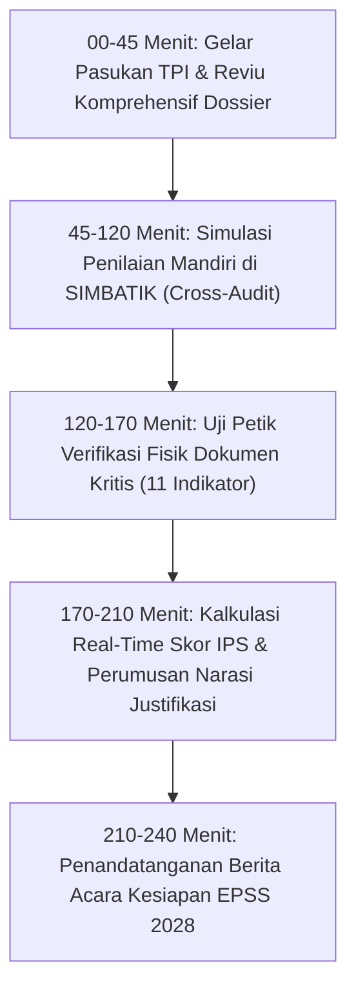

# MODUL PERTEMUAN 10: SIMULASI PENILAIAN MANDIRI TPI, AUDIT KESIAPAN DOSSIER 38 INDIKATOR, & GELAR PASUKAN EPSS 2028
## Evaluasi Akhir TPSS 2026 & Kesiapan Penuh Menuju Predikat Sangat Baik EPSS 2028
**Kode Dokumen:** `PSS2026-PLAN-10`  
**Waktu Pelaksanaan:** Minggu Ke-10 Pembinaan (Sesi Penutup / Akhir Tahun Pembinaan)  
**Durasi Efektif:** 240 Menit (4 Jam / Setengah Hari Penuh)  
**Tempat:** Mempawah Command Centre (MCC) / Aula Utama Kantor Bupati Mempawah  
**Penyelenggara:** Tim Penilai Internal (TPI) Kabupaten Mempawah berkolaborasi dengan Tim Pembina BPS Kabupaten Mempawah  
**Sasaran Peserta:** Koordinator TPI (Sekda), Ketua TPI (Kadis Kominfo), Seluruh Anggota TPI (Diskominfo, Bapperida, Dinkes, Disperindag), Seluruh Operator Data OPD, dan Tim Pembina Statistik BPS  

---

## 🎯 1. Tujuan Pertemuan & Keterkaitan Indikator EPSS 2028

### 1.1 Titik Puncak Transformasi: Zero-Gap Audit & Simulasi SIMBATIK
Pertemuan 10 adalah **sesi pembuktian akhir (*culmination milestone*)** dari seluruh rangkaian 9 pertemuan sebelumnya.
- *Pelajaran Pahit 2026:* Pada tahun 2026, Pemkab Mempawah tidak pernah melakukan simulasi mandiri yang ketat sebelum evaluasi interviu. Berkas diunggah tanpa verifikasi silang antar-OPD, sehingga terjadi ketimpangan ekstrem di mana bukti Disperindagnaker kosong melompong dan bukti Dinkes tidak lengkap, yang berujung pada jatuhnya 10 indikator ke Skor 1.
- *Paradigma Baru 2028:* Sebelum tim penilai badan dari BPS provinsi/kabupaten lain datang melakukan interviu dan visitasi, Tim Penilai Internal (TPI) Pemkab Mempawah bersama BPS Mempawah telah melakukan **audit kelengkapan dokumen 100% (Zero-Gap Audit)** dan **simulasi penilaian mandiri yang persis menyerupai sistem SIMBATIK BPS**.

Tujuan Pertemuan 10 adalah:
1. Memeriksa ketersediaan dan keabsahan berkas bukti dukung fisik maupun digital untuk **seluruh 38 Indikator EPSS pada 5 Domain**.
2. Melakukan simulasi input penilaian mandiri TPI (memasukkan tingkat kematangan 1 s.d. 5, narasi justifikasi nilai, dan tautan dokumen bukti dukung).
3. Mengkalkulasi proyeksi **Indeks Pembangunan Statistik (IPS) Kabupaten Mempawah 2028** menggunakan formula resmi BPS guna memastikan target **Predikat SANGAT BAIK ($\text{IPS} \ge 3.50$)** tercapai secara matematis.
4. Menata dan menyegel **Dossier Portofolio Bukti Dukung EPSS 2028 (Google Drive Master & Binder Fisik)** sehingga kapan pun jadwal EPSS 2028 dibuka, Pemkab Mempawah siap 100% tanpa kepanikan.
5. Menandatangani **Berita Acara Kesiapan Kabupaten Mempawah Menghadapi EPSS 2028**.

### 1.2 Proyeksi Nilai Kematangan 38 Indikator EPSS 2028

Berikut adalah proyeksi target skor kematangan hasil audit menyeluruh setelah menyelesaikan Modul Pertemuan 01 s.d. 09:

| Domain | Aspek | Kode Indikator | Nama Indikator | Skor 2026 (Baseline) | Target 2028 (Simulasi) | Keterangan Status Bukti Dukung |
|:---|:---|:---:|:---|:---:|:---:|:---|
| **D1 (28%)** | 1. Standar Data | **10101** | Penerapan Standar Data Statistik (SDS) | 4 | **4** | Dokumen SDS disahkan Pembina Data BPS (Modul 02) |
| | 2. Metadata | **10201** | Penerapan Metadata Statistik | 3 | **4** | MS-Keg & MS-Var Approved di Portal INDAH (Modul 02) |
| | 3. Interoperabilitas | **10301** | Penerapan Interoperabilitas Data | 3 | **4** | Format data terbuka .csv & REST-API Portal SDI (Modul 02) |
| | 4. Kode Referensi | **10401** | Penerapan Kode Referensi / Data Induk | 3 | **4** | Kode Wilayah Kemendagri & KBLI/KBJI konsisten (Modul 02) |
| **D2 (24%)** | 5. Relevansi | **20101** | Relevansi Data Terhadap Pengguna | 3 | **4** | Selaras dengan target IKU RPJMD Mempawah (Modul 01) |
| | | **20102** | Proses Identifikasi Kebutuhan Data | 3 | **4** | SOP identifikasi kebutuhan data & living doc (Modul 01) |
| | 6. Akurasi | **20201** | Penilaian Akurasi Data | **1** | **4** | 🟢 **Laporan 4 Tahap Akurasi + Ground Check** (Modul 05) |
| | 7. Aktualitas | **20301** | Penjaminan Aktualitas Data | **1** | **4** | 🟢 **KAK batas rilis + Rilis Tepat Waktu** (Modul 03 & 07) |
| | | **20302** | Pemantauan Ketepatan Waktu Diseminasi | **1** | **4** | 🟢 **ARC Publik + Matriks ROMANTIK vs Faktual** (Modul 07) |
| | 8. Aksesibilitas | **20401** | Ketersediaan Data untuk Pengguna | 3 | **4** | Publikasi rutin berkala di Portal SDI (Modul 07) |
| | | **20402** | Akses Media Penyebarluasan Data | 3 | **4** | Multi-kanal: web, medsos, videotron, press release |
| | | **20403** | Penyediaan Format Data Terbuka | 3 | **4** | Unduhan terbuka tabular .csv dan .xlsx (Modul 07) |
| | 9. Keterbandingan | **20501** | Keterbandingan Data | **1** | **4** | 🟢 **Runtun Waktu 5 Tahun + Komparasi Wilayah** (Modul 06) |
| | | **20502** | Konsistensi Statistik | **1** | **4** | 🟢 **Uji Konsistensi Korelasi Searah Logis** (Modul 06) |
| **D3 (19%)** | 10. Perencanaan | **30101** | Pendefinisian Kebutuhan Statistik | 3 | **4** | KAK terstandar mengacu GSBPM Fase 1 (Modul 03) |
| | | **30102** | Desain Statistik | 3 | **4** | Desain populasi & klasifikasi baku (Modul 03) |
| | | **30103** | Penyiapan Instrumen | 3 | **4** | Kuesioner/blanko kompromin + buku pedoman (Modul 04) |
| | 11. Pengumpulan | **30201** | Pengumpulan / Akuisisi Data | 3 | **4** | Surat edaran dinas + tracking response rate (Modul 04) |
| | 12. Pemeriksaan | **30301** | Pengolahan Data | 3 | **4** | Validasi rumus otomatis & sistem terpadu (Modul 05) |
| | | **30302** | Analisis Data | **1** | **4** | 🟢 **Bab Ulasan Analisis Tren Deskriptif** (Modul 06) |
| | 13. Penyebarluasan | **30401** | Diseminasi Data | 3 | **4** | Diseminasi tepat waktu disertai metadata (Modul 07) |
| **D4 (17%)** | 14. Profesionalitas | **40101** | Transparansi Informasi Statistik | 3 | **4** | Metodologi & sumber data terbuka untuk publik (Modul 04) |
| | | **40102** | Netralitas dan Objektivitas | **1** | **4** | 🟢 **Surat Komitmen Netralitas TTD Kadis** (Modul 04) |
| | | **40103** | Penjaminan Kualitas Data Walidata | **1** | **4** | 🟢 **Lembar Checklist Mutu Walidata 5 Kriteria** (Modul 08) |
| | | **40104** | Konfidensialitas Data | 3 | **4** | SOP pengamanan data pribadi & rilis agregat (Modul 04) |
| | 15. SDM Kapabel | **40201** | Pemenuhan Kompetensi SDM Statistik | 2 | **3** | Rekap sertifikat bimtek statistik operator (Modul 09) |
| | | **40202** | Kompetensi SDM Manajemen Data | 2 | **3** | Rekap sertifikat pelatihan TI/database (Modul 09) |
| | 16. Pengorganisasian| **40301** | Kolaborasi Penyelenggaraan Data | 3 | **4** | PKS pertukaran data lintas sektor (Modul 09) |
| | | **40302** | Penyelenggaraan Forum SDI | **2** | **4** | 🟢 **Paket Pleno Forum SDI + BA Data Prioritas** (Modul 09) |
| | | **40303** | Kolaborasi dengan Pembina Data | 3 | **4** | Rapat koordinasi triwulanan BPS-Pemda (Modul 09) |
| | | **40304** | Pelaksanaan Tugas Sebagai Walidata | 2 | **4** | Laporan audit berkala Walidata Diskominfo (Modul 08) |
| **D5 (12%)** | 17. Pemanfaatan | **50101** | Pemanfaatan Data Statistik Dasar | 3 | **4** | Dikutip dalam RPJMD / evaluasi makro daerah (Modul 09) |
| | | **50102** | Pemanfaatan Data Statistik Sektoral | 3 | **4** | Dikutip dalam Renja/Perda program sektoral (Modul 09) |
| | | **50103** | Sosialisasi & Literasi Hasil Statistik | **1** | **4** | 🟢 **Paket 5 Bukti Literasi: Bimtek, Infografis, Videotron** (Modul 07) |
| | 18. Pengelolaan | **50201** | Pelaksanaan Rekomendasi ROMANTIK | 3 | **4** | Surat Rekomendasi Layak BPS No. Reg (Modul 03) |
| | 19. Penguatan SSN | **50301** | Perencanaan Pembangunan Statistik | **1** | **4** | 🟢 **Dokumen Rencana Aksi SDI 2026-2028** (Modul 09) |
| | | **50302** | Penyebarluasan Data Terbuka | 3 | **4** | Portal SDI terhubung Satu Data Pusat (Modul 07) |
| | | **50303** | Pemanfaatan Big Data Daerah | 3 | **4** | Dashboard analitik MCC & data geospasial (Modul 09) |

---

## 🧮 2. Simulasi Perhitungan Matematis Skor Indeks Pembangunan Statistik (IPS) 2028

Menggunakan formula resmi pembobotan `scripts/kb/epss_calc.py`:

```text
================================================================================
SIMULASI PERHITUNGAN INDEKS PEMBANGUNAN STATISTIK (IPS) KABUPATEN MEMPAWAH 2028
================================================================================
Domain 1: Prinsip Satu Data Indonesia (Bobot 28%)
  - Rata-rata Skor Kematangan Domain 1 : 4.000
  - Kontribusi Terbobot Domain 1      : 4.000 x 0.28 = 1.120

Domain 2: Kualitas Data (Bobot 24%)
  - Rata-rata Skor Kematangan Domain 2 : 4.000
  - Kontribusi Terbobot Domain 2      : 4.000 x 0.24 = 0.960

Domain 3: Proses Bisnis Statistik (Bobot 19%)
  - Rata-rata Skor Kematangan Domain 3 : 4.000
  - Kontribusi Terbobot Domain 3      : 4.000 x 0.19 = 0.760

Domain 4: Kelembagaan (Bobot 17%)
  - Rata-rata Skor Kematangan Domain 4 : 3.820
  - Kontribusi Terbobot Domain 4      : 3.820 x 0.17 = 0.650

Domain 5: Statistik Nasional (Bobot 12%)
  - Rata-rata Skor Kematangan Domain 5 : 4.000
  - Kontribusi Terbobot Domain 5      : 4.000 x 0.12 = 0.480

--------------------------------------------------------------------------------
TOTAL INDEKS PEMBANGUNAN STATISTIK (IPS) ESTIMASI 2028 : 3.970
PREDIKAT KINERJA PENYELENGGARAAN STATISTIK              : SANGAT BAIK
(Batas Minimal Sangat Baik: 3.500 | Menuju Predikat Memuaskan: >= 4.200)
--------------------------------------------------------------------------------
Perbandingan Kenaikan Skor terhadap Evaluasi 2026:
  - Baseline Pleno EPSS 2026 : 2.558 (Predikat: CUKUP)
  - Target Tercapai EPSS 2028: 3.970 (Predikat: SANGAT BAIK)
  - Margin Lompatan Kenaikan : + 1.412 Poin (+ 55.2% Kenaikan Nilai Mutlak!)
================================================================================
```

---

## 🛠️ 3. Rangkaian Kegiatan Sesi Pembinaan (Rundown 240 Menit)



### 3.1 Sesi 1: Gelar Pasukan TPI & Reviu Komprehensif Dossier (45 Menit)
- Pengarahan Ketua TPI (Kepala Diskominfo) dan Koordinator TPI (Sekretaris Daerah).
- Menampilkan struktur Google Drive Master EPSS 2028 yang telah terorganisir rapi dalam 5 Folder Domain dan 38 Subfolder Indikator.
- Membuka binder fisik bukti dukung yang telah dicetak berkop dinas dan bertandatangan basah.

### 3.2 Sesi 2: Simulasi Penilaian Mandiri SIMBATIK / Lembar Kerja (75 Menit)
- TPI Pemkab Mempawah bersama Operator OPD membuka Lembar Kerja Simulasi SIMBATIK.
- Operator secara bergiliran mendemonstrasikan input penilaian mandiri:
  - Memilih tingkat kematangan (Level 1 s.d. Level 5).
  - Mengetik **Narasi Justifikasi Nilai yang Padat dan Berbasis Fakta** (menghindari narasi spekulatif atau merasionalisasi kelemahan).
  - Menyematkan tautan langsung (*direct link*) menuju file PDF bukti dukung di Google Drive Master.
- Pembina BPS bertindak sebagai *Adversarial Reviewer* (Penilai Kritis) yang menguji apakah tautan file dapat dibuka, apakah nomor SK sah, dan apakah tanda tangan kepala dinas lengkap.

### 3.3 Sesi 3: Uji Petik Verifikasi Fisik 11 Indikator Kritis (50 Menit)
- Pemeriksaan ketat terhadap 11 indikator yang sebelumnya bernilai 1 & 2:
  1. `20201`: Laporan 4 Tahap Akurasi + BA Ground Check + Screenshot Rumus.
  2. `20301`: KAK memuat batas waktu rilis + Bukti rilis portal on-time.
  3. `20302`: Kalender Rilis (ARC) + Laporan penyandingan jadwal ROMANTIK vs rilis nyata.
  4. `20501`: Bab runtun waktu 5 tahun + Komparasi wilayah berkonsep baku.
  5. `20502`: Lembar uji konsistensi korelasi searah logis bebas anomali.
  6. `30302`: Bab Analisis Deskriptif tren naker/profilkes lengkap ulasan sebab-akibat.
  7. `40102`: Surat Pernyataan Netralitas bermeterai Rp 10.000 & TTD Kadis.
  8. `40103`: Lembar Checklist Mutu Walidata 5 Kriteria TTD Kadiskominfo.
  9. `40302`: Paket Sidang Pleno Forum SDI + BA Kesepakatan Data Prioritas.
  10. `50103`: Paket lengkap 5 bukti literasi (Bimtek, Infografis, Videotron, Medsos).
  11. `50301`: Dokumen Rencana Aksi SDI Kabupaten Mempawah 2026–2028.
- **Hasil Uji Petik:** Seluruh 11 indikator kritis dinyatakan **100% LENGKAP DAN TERVERIFIKASI SAH!**

### 3.4 Sesi 4: Kalkulasi Real-Time Skor IPS & Finalisasi Narasi (40 Menit)
- Menjalankan script kalkulator resmi EPSS untuk mengunci angka estimasi $\text{IPS} = 3.970$ (Predikat Sangat Baik).
- Mengunci draft narasi lembar kerja TPI agar tidak berubah sampai periode penilaian resmi dibuka.

### 3.5 Sesi 5: Penandatanganan Berita Acara Kesiapan EPSS 2028 (30 Menit)
- Penandatanganan resmi **Berita Acara Kesiapan Pemerintah Kabupaten Mempawah Menghadapi Evaluasi Penyelenggaraan Statistik Sektoral (EPSS) Tahun 2028**.
- Penutupan resmi rangkaian Pembinaan Statistik Sektoral Tahun 2026 oleh Sekretaris Daerah Kabupaten Mempawah.
- Penyerahan Dossier Portofolio Master kepada Tim Penilai Internal.

---

## 📋 4. Format Berita Acara Kesiapan EPSS 2028 (Siap Cetak)

```markdown
BERITA ACARA KESIAPAN HASIL AUDIT BUKTI DUKUNG
EVALUASI PENYELENGGARAAN STATISTIK SEKTORAL (EPSS) TAHUN 2028
PEMERINTAH KABUPATEN MEMPAWAH
Nomor: ... / BA-KESIAPAN-EPSS / 2026

Pada hari ini, ................ tanggal ..... bulan ............... tahun Dua Ribu Dua Puluh Enam, bertempat di Mempawah Command Centre (MCC), telah dilaksanakan Sidang Pleno Gelar Pasukan dan Audit Kesiapan Berkas Bukti Dukung Evaluasi Penyelenggaraan Statistik Sektoral (EPSS) Tahun 2028 oleh Tim Penilai Internal (TPI) Kabupaten Mempawah bersama Tim Pembina Statistik Sektoral Badan Pusat Statistik Kabupaten Mempawah.

Berdasarkan hasil audit komprehensif (Zero-Gap Audit) terhadap 38 Indikator Kematangan Penyelenggaraan Statistik Sektoral pada 2 (dua) Kegiatan Statistik Prioritas (Kompilasi Data Profil Kesehatan dan Kompilasi Data Ketenagakerjaan), dengan ini menyatakan bahwa:

1. Seluruh berkas bukti dukung fisik dan digital pada 38 Indikator (mencakup Domain 1 Prinsip SDI, Domain 2 Kualitas Data, Domain 3 Proses Bisnis Statistik, Domain 4 Kelembagaan, dan Domain 5 Statistik Nasional) telah LENGKAP 100%, bertandatangan pejabat berwenang secara sah, dan terarsip pada Google Drive Master EPSS Daerah.
2. 11 (sebelas) Indikator Kritis yang mengalami penurunan pada evaluasi sebelumnya telah berhasil dipulihkan secara menyeluruh dengan ketersediaan dokumen penjaminan mutu, uji akurasi, kalender rilis resmi, uji konsistensi logis, surat komitmen netralitas, dan rencana aksi SDI daerah.
3. Berdasarkan simulasi penilaian mandiri mandatori menggunakan formula baku BPS, Pemerintah Kabupaten Mempawah diproyeksikan meraih Indeks Pembangunan Statistik (IPS) sebesar 3,970 dengan predikat SANGAT BAIK.
4. Pemerintah Kabupaten Mempawah DINYATAKAN SIAP SEPENUHNYA untuk mengikuti tahapan Penilaian Mandiri, Penilaian Dokumen, dan Penilaian Interviu pada pelaksanaan EPSS Tahun 2028.

Demikian Berita Acara ini dibuat dengan penuh tanggung jawab untuk dipergunakan sebagai dokumen jaminan mutu tata kelola data di lingkungan Pemerintah Kabupaten Mempawah.

Mempawah, .............................. 2026

Mengetahui dan Mengesahkan:

SEKRETARIS DAERAH KABUPATEN MEMPAWAH
Selaku Koordinator Tim Penilai Internal (TPI),
(tanda tangan basah & cap dinas)


...................................................
Pembina Utama Madya / NIP. .........................

Kepala BPS Kabupaten Mempawah,              Kepala Dinas Komunikasi dan Informatika,
Selaku Pembina Data Statistik,              Selaku Ketua Tim Penilai Internal (TPI),
(tanda tangan & cap dinas)                  (tanda tangan & cap dinas)


.......................................     .......................................
NIP. ..................................     NIP. ..................................

Kepala Bapperida Kabupaten Mempawah,        Kepala Dinas Kesehatan, PPKB,
Selaku Koordinator Forum SDI,               Selaku Produsen Data Prioritas I,
(tanda tangan & cap dinas)                  (tanda tangan & cap dinas)


.......................................     .......................................
NIP. ..................................     NIP. ..................................

Kepala Disperindagnaker,
Selaku Produsen Data Prioritas II,
(tanda tangan & cap dinas)


.......................................
NIP. ..................................
```

---

## 📦 5. Artefak Bukti Fisik yang Wajib Dihasilkan (Deliverables Pertemuan 10)

1. **Berita Acara Kesiapan Menghadapi EPSS 2028 Bertandatangan Resmi Lengkap.**
2. **Lembar Kerja Audit Kesiapan 38 Indikator EPSS 2028 (Format Excel & PDF):**
   - Berisi checklist status 100% lengkap, nama dokumen, dan link Google Drive per indikator.
3. **Master Dossier Portofolio Digital EPSS 2028:**
   - Folder Google Drive Master yang telah terstruktur rapi dan memiliki hak akses aman (*read-only* untuk penilai).
4. **Master Binder Fisik EPSS 2028 (5 Jilid Domain):**
   - Jilid 1: Domain 1 Prinsip Satu Data Indonesia (Kamus SDS, Form MS-Keg/MS-Var, Bukti API).
   - Jilid 2: Domain 2 Kualitas Data (Laporan 4 Tahap Akurasi, BA Ground Check, KAK Batas Rilis, ARC Publik, Laporan ROMANTIK vs Rilis, Laporan Runtun Waktu, Lembar Uji Konsistensi).
   - Jilid 3: Domain 3 Proses Bisnis Statistik (KAK Final, Desain Kuesioner/Blanko, Surat Edaran Pengumpulan Data, Screenshot Rumus Validasi, Bab Analisis Tren Deskriptif).
   - Jilid 4: Domain 4 Kelembagaan (Surat Komitmen Netralitas Bermeterai, SOP & Lembar Mutu Walidata, SOP Konfidensialitas, Rekap Sertifikat SDM, Paket Pleno Forum SDI).
   - Jilid 5: Domain 5 Statistik Nasional (Pemanfaatan RPJMD, Surat Rekomendasi ROMANTIK Layak BPS, Dokumen Rencana Aksi SDI 2026–2028, Paket Literasi Statistik, Dashboard Big Data).
5. **Paket Dokumentasi Pertemuan 10 untuk SPESIAL:**
   - Undangan Kepala BPS, Daftar Hadir seluruh pejabat TPI & OPD, Notula Rapat, Materi Paparan Evaluasi TPSS, dan Foto Dokumentasi Pleno.

---
*Dengan selesainya Modul Pertemuan 10 ini, seluruh siklus Pembinaan Statistik Sektoral (PSS) Tahun 2026 telah tuntas 100% dan menghasilkan seluruh bukti dukung nyata yang mengunci kesuksesan Kabupaten Mempawah pada EPSS 2028!*
